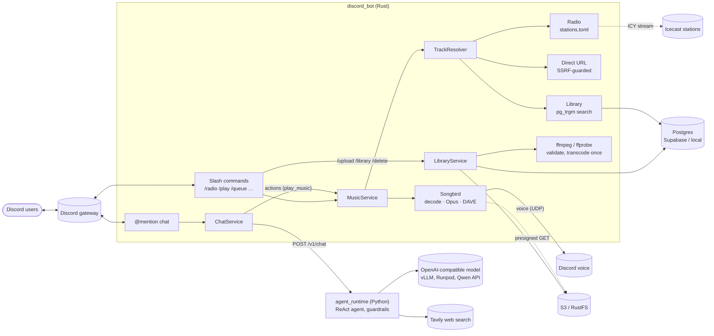

# TatarBot

TatarBot is a Discord bot for one community. Mention it and it answers through an LLM
agent that can search the web and replies in Thai or English, whichever you wrote in. In a
voice channel it plays curated radio stations, direct audio links, and a per-server library
of audio that members upload, through slash commands or just by asking in chat
("@TatarBot เปิดเพลงชิลๆ หน่อย"). This README explains how those pieces work and why they are
built the way they are; each directory's README covers configuration and day-to-day use.

## Architecture



ffmpeg is not in the playback path: it runs once per upload. Playback decodes with Symphonia
and encodes Opus inside Songbird (see [Playback pipeline](#2-playback-pipeline)).

## Components

| Component | What it does | Directory |
|---|---|---|
| Discord bot | Gateway connection, slash commands, voice playback, the server library; forwards chat to the runtime | [`discord_bot/`](discord_bot/) |
| Agent runtime | Conversation history, system prompt, guardrails, Thai/English replies, ReAct web-search agent; HTTP API for the bot | [`agent_runtime/`](agent_runtime/) |
| Model inference | vLLM serving: local GPU (Docker Compose) and a Runpod Serverless template; endpoint smoke test | [`model-inference/`](model-inference/) |
| Infrastructure | Terraform for AWS (ECS on one Graviton EC2 instance or Fargate, ECR, IAM, SSM wiring, S3, budget) and the CI/CD notes | [`infra/aws/`](infra/aws/) |
| Integration tests | The runtime image against a mock OpenAI-compatible model | [`integration/`](integration/) |
| Design records | Inference provider ADR and the cloud inference design | [`docs/`](docs/) |

## How it works

### 1. Request flow

Two entry points, deliberately separate:

* **Slash commands** (`/radio`, `/play`, `/upload`, …) are handled entirely in the bot.
  Every command is acknowledged first (Discord allows 3 s), then calls one inbound port:
  `MusicService` for playback, `LibraryService` for the library
  (`discord_bot/src/adapters/inbound/discord/respond.rs`, `music.rs`, `library.rs`).
  Results are public; refusals are ephemeral.
* **@mention chat** goes to `ChatService`, which calls the runtime's `POST /v1/chat`. The
  bot knows nothing about models. In a server it also offers its stations as a client-side
  tool; any `actions` that come back are carried out through `MusicService`
  (`discord_bot/src/adapters/inbound/discord/chat_actions.rs`).

All playback rules live in one place, `MusicUseCase`
(`discord_bot/src/application/use_cases/music.rs`): you must be in a voice channel, controls
need you in the bot's channel, the bot never leaves listeners mid-track for another channel,
`/radio` replaces the queue, the queue is capped. The commands are thin adapters that pass
plain values (server, user, voice channel) in.

*Why:* music keeps working when the runtime or the model is down, and chat control reuses
the same rules unchanged: "play lofi" in chat and `/radio lofi` end in the same call, with
the same checks (you must be in a voice channel, the station must exist).

### 2. Playback pipeline

```text
radio / link  → HTTP stream → Symphonia decode → resample 48 kHz → Opus encode → Discord (DAVE)
library track → presigned S3 GET → Ogg Opus 48 kHz stereo → passthrough ──────→ Discord (DAVE)
```

* Songbird 0.6 handles the voice connection, including Discord's DAVE end-to-end
  encryption. Sources open lazily when a track starts
  (`discord_bot/src/adapters/outbound/songbird_voice.rs`).
* **Re-encoding** happens for radio and direct links: they are MP3/AAC/etc., so they are
  decoded and encoded to Opus (libopus, linked statically).
* **Passthrough** happens for library tracks: they were transcoded at upload to exactly
  what Discord sends (Ogg Opus, 48 kHz, stereo, 20 ms frames), so Songbird forwards the
  packets without decoding, as long as the track is the only one playing at full volume.
* Library objects are presigned when the track *starts*, not when it is queued, so a long
  queue can't outlive the 30-minute URL.

*Why:* decoding and encoding cost CPU on a quarter-vCPU task; doing the transcode once at
upload makes every later play of that file free.

### 3. Radio streaming

* **Reconnect.** A station that ends or errors without `/skip`, `/stop` or `/leave` has
  dropped. It is started again as a fresh track after 1, 2, 4, 8, 16 s; after 5 failures
  in a row the bot gives up; a minute of good playback resets the backoff. A stalled
  stream is cut after 30 s without data (`songbird_voice.rs`, the `Reconnects` policy).
* **Now playing.** Stations are requested with `Icy-MetaData: 1`. The server then
  interleaves a metadata block every `icy-metaint` bytes; `IcyParser` strips them before the
  decoder sees the audio and keeps the `StreamTitle`, which `/queue` shows
  (`discord_bot/src/adapters/outbound/icy.rs`).

*Trade-off:* reconnecting restarts the decoder, so a drop costs a 1–2 s gap. Splicing a new
connection into the running decoder was rejected: MP3 frames would be cut mid-way, the bit
reservoir would reference missing data, and Songbird ends a track on any decode error.

### 4. Upload pipeline

```text
/upload → size check → download (Discord CDN only, ≤ 25 MB, SHA-256 while streaming)
        → already in this server? → audio already stored by any server? ── yes ──┐
                                        └─ no → ffprobe → ffmpeg → Ogg Opus ─────┤
        Postgres tx: lock server + hash, quota, PUT object, INSERT row, commit ◀──┘
```

* **Validation** never trusts the extension: ffprobe must find an audio stream and at most
  15 minutes (`discord_bot/src/adapters/outbound/ffmpeg.rs`).
* **ffmpeg hardening:** `file:` paths only, `-protocol_whitelist file`, a demuxer whitelist,
  and limits on memory, CPU time, output size and wall-clock time. The image's ffmpeg is a
  minimal static build that contains only those demuxers and the file protocol.
* **Transcode once, dedupe by hash.** Objects are keyed by the SHA-256 of the *uploaded
  original*, so the same file uploaded in many servers is stored and transcoded once.
* **Consistency** (`discord_bot/src/adapters/outbound/pg_library.rs`): upload and delete
  take `pg_advisory_xact_lock` on the hash and write or delete the object while holding
  it, so an upload can never attach a row to an object a delete is removing. Delete is
  refcounted: the object goes only with the last row.
* **Orphan sweep:** hourly, objects with no row and older than 1 hour are deleted, after
  re-checking both under the hash lock. The grace period protects uploads in flight.
* **Quota** is per server; a shared file counts in full for each server. A second lock per
  server stops two concurrent uploads from both passing the check.

*Why hash the original, not the output:* transcoder output can change between ffmpeg
versions, which would quietly stop deduplication. The race tests run against real Postgres,
and each one fails if its lock is removed.

### 5. Library search

* A title matches if it **contains** the query (`LIKE` on the lowercased title, wildcards
  escaped) or is **trigram-similar** (`pg_trgm` `word_similarity` / `similarity` ≥ 0.3).
* Ranking: exact match, then prefix, then substring, then trigram score, then shorter
  titles. One GIN trigram index serves both kinds of match.
* **Thai** has no spaces between words and uses combining marks. Whether `pg_trgm` sees Thai
  letters depends on the database's `LC_CTYPE`: with `en_US.UTF-8` Thai typos match too;
  with `C` Thai produces no trigrams and only the substring match works. Both are tested;
  the bot logs which applies when it connects.
* **Autocomplete** can't be deferred, so its search gets 2 s of Discord's 3 s; a slow
  database means no suggestions rather than an error.

### 6. Security

* **SSRF guard on `/play` URLs** (`discord_bot/src/adapters/outbound/audio_http.rs`):
  hostnames resolve through a resolver that drops private, loopback, link-local (including
  the ECS credentials endpoint), CGNAT and other non-public addresses, so DNS rebinding gains
  nothing. Every redirect is checked; IP-literal and `localhost` links are refused.
* **ffmpeg:** protocol and format whitelists at run time, plus a build without HLS, concat or
  network inputs. A crafted HLS or concat playlist makes a stock ffmpeg read another local
  file; here it fails on both counts (tested).
* **Uploads** come only from Discord's CDN hosts, capped while streaming.
* **Agent runtime guardrails** (`agent_runtime/src/agent_runtime/domain/guardrails.py`):
  narrow English and Thai prompt-injection patterns are refused before the model is called;
  replies that repeat the system prompt are withheld; credential-looking strings are
  redacted. Search results are passed to the model as untrusted content.
* **Secrets** live in SSM Parameter Store and `.env` files only; TLS to Supabase is
  verified against its root CA (`sslmode=verify-full`).
* **Bounded tool arguments:** the `play_music` tool's `station` is an enum of the stations
  the bot sent, and `action` is one of play, play_track, skip, stop, queue. Song titles
  (`play_track`) are free text, since a library can hold hundreds of titles; they are only
  ever searched in the server's own library: link-like text is dropped by the runtime and
  refused again by the bot before `MusicService` is called. The bot runs at most 2 actions
  per message. Even a successful prompt injection can only pick a listed station or a song
  already uploaded to that server; it can't make the bot fetch a URL, leave, upload or delete
  (`agent_runtime/src/agent_runtime/domain/client_tools.py`,
  `discord_bot/src/adapters/inbound/discord/chat_actions.rs`).

### 7. Agent runtime

* **ReAct loop** (`agent_runtime/src/agent_runtime/application/agent.py`, LangGraph):
  `reason` writes a short thought ending in `Next: SEARCH <query>` or `Next: ANSWER`;
  `act` offers the `web_search` tool only if the thought chose to search; `observe` runs the
  searches and loops back. At most 3 searches per message; the whole turn is capped below the
  bot's timeout. Thoughts are logged, never shown or stored.
* **Server-side tools** run inside the runtime: today that is `web_search` (Tavily). The
  reply carries a sources footer built from the actual results.
* **Client-side tools** run in the caller, not the runtime. The bot sends what it supports
  in `client_tools` (its station list, and with a library the 20 most recent titles as hints
  for matching requests like "play that Proxie song"); the reason step may choose `Next: MUSIC`, the act step
  then offers only `play_music`, and a valid call ends the turn without another model call:
  it comes back in the `actions` field of `/v1/chat`. The bot carries it out; if an action
  fails (not in a voice channel), it shows the real error instead of the model's text, which
  might claim success. The runtime never calls the bot, and the new fields are optional, so
  older bots and runtimes still work.
* **Memory of actions.** History stores each action as a real tool call with a tool result,
  "pending" until the bot reports the outcome with the conversation's next message ("ok: Now
  playing …" or "failed: Join a voice channel first."). Every request also carries the
  current playback state (voice channel, what's playing, the station's current song), which
  the system message shows as data. *Why tool calls, not text notes:* with `[action] …` notes
  in history, a model started writing such notes instead of calling the tool.
* **Language:** each message is classified as Thai or English by script, and the system
  message tells the model which language to reply in
  (`agent_runtime/src/agent_runtime/domain/language.py`).

### 8. Deployment

Designed for AWS. `terraform plan` succeeds against the account, but the configuration
**has not been applied**.

* **ECS on one Graviton instance by default (t4g.micro, about $15/month 24/7).** The bot and
  the runtime are separate ECS services, sharing the instance with bridge networking. The
  bot calls the runtime's host port over the Docker bridge. `launch_type = "FARGATE"`
  switches to one ARM64 task each, connected over Cloud Map private DNS, for about
  $26.50/month. The bot runs exactly one task (`minimumHealthyPercent=0`,
  `maximumPercent=100`): two bots on one token both answer every command. Costs,
  assumptions and the start/stop schedule are in
  [`infra/aws/`](infra/aws/README.md#cost-ap-southeast-1).
* **SSM Parameter Store** (SecureString) for secrets, read by per-service execution roles.
  The bot's only task role is scoped to its library prefix in S3.
* **Supabase** (free tier, Singapore) for library metadata, through the Supavisor pooler in
  session mode (sqlx uses prepared statements). The bot reads the library table every
  6 hours, because Supabase pauses free projects without database activity.
* **S3** for library audio (RustFS locally).

*Why EC2 by default:* for one small community, Fargate's per-task price plus one IPv4
address per task costs about 75% more than one shared instance. The usual objections to
EC2 are handled by ECS and the ASG:
- **Patching:** applying a new ECS-optimized AMI replaces the instance.
- **Access:** Session Manager, no SSH.
- **Deploys:** the same image-swap workflow as Fargate.

The price is availability: one instance is a single point of failure for both services.
*Why not Lambda for the bot:* Songbird holds the gateway WebSocket and a UDP voice session
for as long as music plays. *Why not SQLite (or SQLite on EFS):* task and instance disks
are wiped on every deploy or replacement, and EFS adds cost, Terraform and locking
caveats; Supabase's free Postgres is managed and survives deploys. *Why not EFS for audio:*
S3 is cheaper, needs no mount, and presigned URLs let Songbird stream objects directly.

Design records: [ADR 0001](docs/adr/0001-inference-provider.md) and
[cloud inference design](docs/architecture/cloud-inference.md).

## Measured numbers

| What | Result | How |
|---|---|---|
| Library search (database round trip) | 2.7–8.8 ms | `EXPLAIN ANALYZE` of the search query on 100,000 synthetic tracks across 100 servers (1,000 per server), local Postgres 17 |
| Command to first audio | not measured yet | `discord_bot/scripts/timing_report.py` turns the `tatarbot::timing` debug log of a session into these numbers |
| Autocomplete reply time | not measured yet | same |
| Chat music request to action (runtime only) | about 2.0 s (4 prompts; a library title 2–7.5 s) | Alibaba `qwen3.8-flash`: Thai "เปิดเพลงชิลๆ หน่อย" → `play chill`, "put on some jazz" → `play jazz`, "skip this song" → `skip`, a maths question → no action; two model calls each (reason + act) |

## Run and test

```sh
make up                              # the runtime on :8080, then the bot
make check                           # lint and test both services
make -C discord_bot library-up       # Postgres + RustFS for the library
make -C discord_bot test-db          # library integration tests (races, S3, ffmpeg, search)
make integration                     # runtime image against a mock model
make compose-up                      # whole stack in Docker Compose
```

Each service has its own image (non-root, no secrets baked in; configuration from the
environment, `.env` locally and SSM in ECS) and can be built, run and stopped on its own:
`make -C <service> image` / `image-run`. In Compose the bot reaches the runtime at
`http://agent_runtime:8080`; the library's `postgres` and `rustfs` are published on
`127.0.0.1:55432` and `:59000` only.

Each directory's README has the configuration and details: [discord_bot](discord_bot/README.md),
[agent_runtime](agent_runtime/README.md), [model-inference](model-inference/README.md),
[infra/aws](infra/aws/README.md).

## Status and plans

Built: chat with the agent runtime, radio, direct links, the server library, fuzzy search,
music control from chat (stations, library songs by title, skip, stop, queue), CI, and the
AWS Terraform (not applied). By design, chat can't play links, leave, upload or delete; and
the audio latency measurements above are still to do.
