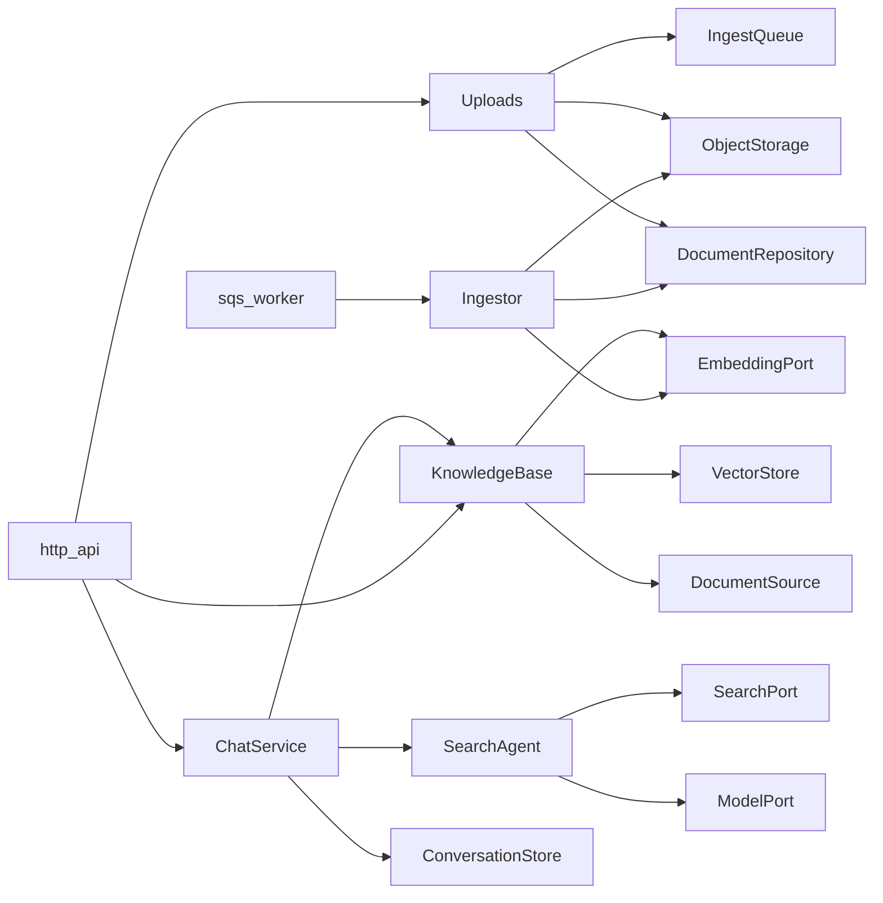

# application

Use cases and the ports they depend on. Code here orchestrates `domain` policies and talks
to the outside world only through the abstract classes in `ports.py`; the composition roots
(`main.py`, `worker.py`) inject the adapters.

| Module | Use case |
|---|---|
| `chat_service.py` | `ChatService.reply`: history, language, guardrails, knowledge excerpts, client-side tools, turn timeout, then `SearchAgent` |
| `agent.py` | `SearchAgent`: the LangGraph ReAct loop (reason → act → observe), web search budget, `play_music` |
| `knowledge.py` | `KnowledgeBase`: index `RAG_DOCS_DIR`, retrieve per turn (score threshold, keyword hits, context budget) |
| `ingestion.py` | `Uploads` (create, list, delete, reprocess documents) and `Ingestor` (one upload event → ready document) |
| `ports.py` | `ModelPort`, `ConversationStore`, `SearchPort`, `EmbeddingPort`, `VectorStore`, `DocumentSource`, `ObjectStorage`, `IngestQueue`, `DocumentRepository` |

## Behavioural contracts

These are what callers and tests rely on; changing one is a design change.

* **Retrieval never fails a turn.** Embedding errors, timeouts and store/database failures
  are logged and the turn continues without knowledge (`KnowledgeBase.retrieve`).
* **Indexing does not block startup** and a failed reload keeps the previous index.
* **Ingestion is idempotent per job identity** and returns `Outcome.DONE` (acknowledge) or
  `Outcome.RETRY` (redeliver). Invalid content and missing objects are `DONE` with the
  document `failed`; everything else is `RETRY` until `max_attempts`.
* **Namespaces:** `Uploads` methods take a namespace and never see documents outside it;
  `ChatService` passes `retrieval_namespaces(conversation_id)` to retrieval.
* Use cases raise domain errors only (`InvalidInputError`, `EmbeddingError`,
  `StorageError`, `ModelError`); the HTTP adapter maps them.

## Extending

* **A new backend for an existing port** (another model API, vector store, queue): write an
  adapter in `adapters/outbound/` and select it in `main.py`. No change here.
* **A new port:** define the ABC in `ports.py` with the error contract in its docstring, add
  an in-memory or fake implementation for tests, and inject it through the use case's
  constructor.
* **A new use case:** a class here taking ports in its constructor, exported from
  `__init__.py`, wired in `main.py`, exposed by an inbound adapter.

## Testing

Use cases are tested with fakes (`tests/conftest.py` `FakeModel`, the fakes in
`test_knowledge.py` and `test_ingestion.py`); `Ingestor` and `Uploads` also run against a
real Postgres in `test_ingestion.py` (`make test-db`).
