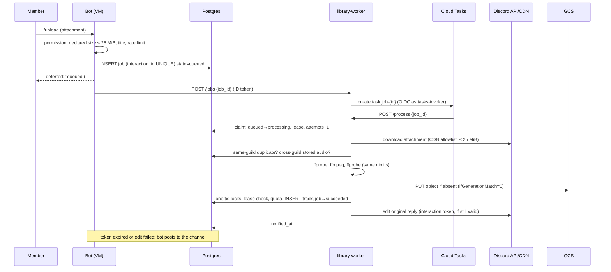

# ADR 0004: Music library ingestion on a Cloud Run worker with Cloud Tasks

- Status: Proposed (design only; nothing implemented, merged or applied)
- Date: 2026-11-03
- Details: [ADR 0003](0003-deploy-on-gcp.md) (GCP layout),
  [database](../architecture/database.md), `discord_bot/src/application/use_cases/library.rs`,
  `discord_bot/src/adapters/outbound/{ffmpeg,pg_library,s3_store,songbird_voice}.rs`

## Context

Today the bot does the whole `/upload` pipeline in-process on the e2-micro VM (0.25 vCPU
sustained, 1 GiB):

| Step | Code | Behaviour to keep |
|---|---|---|
| Accept | `inbound/discord/library.rs` | Defers the reply; checks permission, declared size ≤ 25 MiB (`MAX_UPLOAD_BYTES`), title |
| Download + hash | `attachment_fetch.rs` | Discord CDN hosts only; 25 MiB enforced while streaming; SHA-256 |
| Dedupe | `use_cases/library.rs` | Same hash in the same guild → "already in library"; same hash in another guild → reuse the stored object, no transcode |
| Validate + transcode | `ffmpeg.rs` | ffprobe, ffmpeg → Ogg Opus 48 kHz stereo 20 ms, ≤ 15 min; RLIMIT_AS 512 MiB, CPU 20/240 s, FSIZE, STACK 8 MiB (PR #18); one at a time |
| Persist | `pg_library.rs` `add` | Advisory locks on (guild) and (hash); quota check; object PUT (key = content hash); row insert |
| Play | `songbird_voice.rs` | Presigned GET (30 min) streamed by songbird; Opus passed through without re-encode |
| Clean up | `pg_library.rs` `sweep` | Hourly: objects with no row, older than 1 h, are deleted |

Problems:
- A 15-minute upload can take up to 240 CPU-seconds on the shared core, next to real-time
  Opus encoding for radio and links. Uploads compete with voice.
- The VM must hold an HMAC key with write access to the whole bucket. It's a static,
  long-lived credential and the only one of its kind (ADR 0003).
- ffmpeg, which parses untrusted files, runs on the always-on machine that holds the
  Discord token.
- The upload's state lives only in a task and Discord's 15-minute interaction token. A
  restart mid-upload loses it silently.

## Decision

1. **A `library-worker` Cloud Run service** (second binary in the `discord_bot` crate) does
   download, hash, dedupe, probe, transcode and persist, reusing `LibraryUseCase`,
   `Ffmpeg`, `PgLibrary` and the attachment fetcher unchanged in behaviour.
2. **Cloud Tasks** delivers work to it: one queue, at-least-once delivery, retries with
   backoff, one dispatch at a time.
3. **Job state lives in Postgres** (`library_upload_jobs`). The database, not Cloud Tasks
   or Discord, decides what happens. Effects are exactly-once through atomic,
   lease-fenced state transitions in the same transaction as the track insert.
4. **No HMAC.** The worker uses its own service account with the GCS JSON API. The VM
   plays objects with a bucket-scoped, read-only, short-lived token (Credential Access
   Boundary) minted on the host. The HMAC key and its secrets are deleted.
5. **The VM keeps** the Gateway, voice, playback, `/delete` (row only) and a fallback
   notifier. ffmpeg leaves the VM image once the worker is validated.
6. **Cloud Scheduler** calls two maintenance endpoints: the reaper (stuck jobs) and the
   object sweep, which moves from the VM to the worker.

### Components

| Component | Where | Identity | Responsibility |
|---|---|---|---|
| Bot | VM container | none (ID tokens and a downscoped GCS token from host files) | Validates `/upload`, inserts the job, calls `/jobs`, plays audio, notifies on fallback |
| Host token timer | VM host | VM service account | Writes `id-token` (runtime), `worker-id-token` (worker) and `gcs-token` (downscoped) |
| `library-worker` | Cloud Run, asia-southeast1 | `tatarbot-library-worker` SA | `/jobs` (enqueue), `/process` (do the work), `/maintenance/reap`, `/maintenance/sweep` |
| Queue `library-uploads` | Cloud Tasks, asia-southeast1 | tasks sign OIDC as `tatarbot-tasks-invoker` | At-least-once delivery, retries, concurrency 1 |
| Scheduler jobs | Cloud Scheduler | OIDC as `tatarbot-tasks-invoker` | Reaper every 5 min, sweep hourly |
| Postgres | Supabase (existing) | `DATABASE_URL` secret | `library_tracks` (unchanged), `library_upload_jobs` (new) |
| Bucket | GCS (existing music bucket, same keys) | IAM only | Audio objects |

### Data flow



The task carries only `job_id`. Everything the worker acts on (attachment URL, guild,
title) comes from the row the bot wrote, so a forged or replayed task can't inject input.

### 1. Job state independent of the interaction token

The job row holds everything needed to finish and report the upload. The interaction token
is only one way to report.

```sql
-- discord_bot/migrations/<ts>_library_upload_jobs.sql (sqlx, schema public, next to library_tracks)
CREATE TABLE library_upload_jobs (
    id                BIGSERIAL   PRIMARY KEY,
    interaction_id    BIGINT      NOT NULL UNIQUE,              -- idempotency key
    guild_id          BIGINT      NOT NULL,
    channel_id        BIGINT      NOT NULL,
    user_id           BIGINT      NOT NULL,
    attachment_url    TEXT        NOT NULL CHECK (attachment_url ~ '^https://(cdn\.discordapp\.com|media\.discordapp\.net)/'),
    declared_size     BIGINT      NOT NULL CHECK (declared_size BETWEEN 1 AND 26214400),
    title             TEXT        NOT NULL CHECK (char_length(title) BETWEEN 1 AND 100),
    state             TEXT        NOT NULL DEFAULT 'queued'
        CHECK (state IN ('queued', 'processing', 'succeeded', 'failed', 'cancelled')),
    attempts          INTEGER     NOT NULL DEFAULT 0 CHECK (attempts >= 0),
    max_attempts      INTEGER     NOT NULL DEFAULT 4,
    lease_owner       UUID,                                     -- fencing token per attempt
    lease_expires_at  TIMESTAMPTZ,
    cancel_requested  BOOLEAN     NOT NULL DEFAULT false,
    content_hash      TEXT        CHECK (content_hash ~ '^[0-9a-f]{64}$'),
    track_id          BIGINT      REFERENCES library_tracks (id) ON DELETE SET NULL,
    reused_audio      BOOLEAN,
    error_code        TEXT,                                     -- machine-readable, see "Failures"
    error_detail      TEXT        CHECK (char_length(error_detail) <= 500),  -- safe to show
    interaction_token TEXT,                                     -- cleared after use or expiry
    token_expires_at  TIMESTAMPTZ NOT NULL,                     -- received_at + 15 min
    notified_at       TIMESTAMPTZ,
    notified_via      TEXT        CHECK (notified_via IN ('interaction', 'channel')),
    created_at        TIMESTAMPTZ NOT NULL DEFAULT now(),
    updated_at        TIMESTAMPTZ NOT NULL DEFAULT now(),
    finished_at       TIMESTAMPTZ,
    CHECK ((state IN ('succeeded', 'failed', 'cancelled')) = (finished_at IS NOT NULL)),
    CHECK (state <> 'processing' OR (lease_owner IS NOT NULL AND lease_expires_at IS NOT NULL))
);
CREATE INDEX library_upload_jobs_active ON library_upload_jobs (state, lease_expires_at)
    WHERE state IN ('queued', 'processing');
CREATE INDEX library_upload_jobs_unnotified ON library_upload_jobs (finished_at)
    WHERE notified_at IS NULL AND finished_at IS NOT NULL;
CREATE INDEX library_upload_jobs_guild ON library_upload_jobs (guild_id, created_at);
```

- **Processing never needs the token.** A job finishes or fails on its own; the reaper
  resumes it after a crash.
- **Reporting:** the worker edits the original reply while `token_expires_at` is more than
  30 s away. Otherwise, or if the edit fails, the bot's notifier (every 30 s) claims the
  job (`UPDATE … SET notified_at = now() WHERE id = $1 AND notified_at IS NULL RETURNING`)
  and posts in the channel, mentioning the uploader. A claim made before sending means at
  most one message. A failed send clears the claim so it's retried.
- **The token is a credential** (it can post as the app in that interaction for 15
  minutes). It's cleared on use and by the notifier once expired. It is never logged and
  never put in a task.
- `/library jobs` (optional) lists the caller's recent jobs from the table.
- Rows are deleted 30 days after `finished_at`.

### 2. Idempotency and atomic state transitions

Cloud Tasks delivers at least once, and a task name only deduplicates task *creation*
(the name tombstone lasts 1 hour to 9 days). Exactly-once *effects* come from the
database:

| Transition | Who | Statement (sketch) |
|---|---|---|
| — → queued | bot | `INSERT … ON CONFLICT (interaction_id) DO NOTHING RETURNING id`, after rate-limit checks under the guild advisory lock |
| queued → processing | worker | `UPDATE … SET state='processing', attempts=attempts+1, lease_owner=$new_uuid, lease_expires_at=now()+'12 min' WHERE id=$1 AND NOT cancel_requested AND attempts < max_attempts AND (state='queued' OR (state='processing' AND lease_expires_at < now())) RETURNING *` |
| processing → succeeded | worker | Inside `PgLibrary::add`'s transaction: `SELECT … FOR UPDATE WHERE id=$1 AND state='processing' AND lease_owner=$me AND NOT cancel_requested`, then the existing locks, dedupe and quota checks, `INSERT library_tracks`, `UPDATE job SET state='succeeded', track_id, reused_audio, finished_at`. One commit. |
| processing → failed | worker | Same fencing (`lease_owner=$me`); permanent error, or the last attempt |
| processing → queued | worker | Transient error: clear the lease (`WHERE lease_owner=$me`), return 5xx so Cloud Tasks retries |
| queued → cancelled | bot | `UPDATE … WHERE state='queued'` |
| processing → cancelled | worker | `cancel_requested` seen at a checkpoint, or the commit guard fails because of it |
| terminal → notified | worker or bot | `UPDATE … WHERE notified_at IS NULL RETURNING` |

Properties:
- **A track row exists if and only if its job succeeded.** The insert and the transition
  commit together.
- **Lease fencing.** A worker whose lease expired (slow, or killed and taken over) can't
  commit: `lease_owner` no longer matches. The 12-minute lease is longer than the Cloud
  Run request timeout (10 min), so a live attempt never loses its lease.
- **Duplicate deliveries are harmless.** A claim that matches nothing re-reads the row.
  Terminal → 200 (drop). Live lease → 200 (the holder finishes; the reaper covers a crash).
  Attempts exhausted → mark `failed` and 200.
- **Object writes are idempotent.** The key is the content hash and the PUT uses
  `ifGenerationMatch=0` (create only if absent; 412 = already there). An object written by
  an attempt that then fails to commit is an orphan. The next attempt reuses it, or the
  sweep deletes it after the existing 1-hour grace.
- `UNIQUE (guild_id, content_hash)` on `library_tracks` and the existing advisory locks
  stay as a second guard.
- **Enqueue can't be lost.** The row is written before the task. If `/jobs` or task
  creation fails, the reaper finds `queued` jobs older than 2 minutes and creates
  `job-{id}-r{n}` tasks.

### 3. Native GCS authentication instead of HMAC

| Option | Credential | Scope | Verdict |
|---|---|---|---|
| Keep HMAC (today) | static, never expires | read/write, whole bucket, on the VM | Remove |
| HMAC on a read-only SA | static | read, whole bucket | Fallback only |
| Signed URLs via IAM `signBlob` | per request | per object | Needs TokenCreator on itself and an API call before each track starts |
| Metadata token with `devstorage.read_only` scope | 1 h | read, every bucket the VM SA can read | Weaker than a CAB |
| **Worker: own SA. VM: CAB-downscoped token** | 1 h, not revocable | worker: objects in one bucket; VM: read-only, one bucket and prefix | **Chosen** |

- **Worker.** An `ObjectStore` adapter on the GCS JSON API (`upload/storage/v1/...` with
  `uploadType=media&ifGenerationMatch=0`, plus list and delete). It uses tokens from the
  Cloud Run metadata server, cached until expiry. Role: `roles/storage.objectUser` on the
  music bucket only (create, get, list, delete; no IAM or bucket admin).
- **VM playback.** The host timer exchanges the VM SA's access token at STS for a token
  limited by a Credential Access Boundary: `inRole:roles/storage.objectViewer` on
  `//storage.googleapis.com/projects/_/buckets/<music>`, with a condition on the library
  prefix. It writes the token to `/run/tatarbot/gcs-token/token` (0640, bot UID), the same
  pattern as the ID token. The bot plays
  `https://storage.googleapis.com/storage/v1/b/<bucket>/o/<key>?alt=media` with
  `HttpRequest::new_with_headers` (present in songbird 0.6) and `Authorization: Bearer`,
  re-reading the token file each time a track starts. The VM SA needs
  `roles/storage.objectViewer` on the bucket; a CAB can only narrow access.
- **Deletes move off the VM.** `/delete` removes the row (quota is freed at once). The
  object is removed by the worker's sweep (Scheduler, hourly, same `sweep()` and 1-hour
  grace). A deleted track's audio now stays up to about 2 hours. It's unreachable from the
  bot meanwhile, and a re-upload within that window reuses it.
- **After cut-over:** delete `google_storage_hmac_key`, the two HMAC secrets and the
  `tatarbot-music` SA. The remaining static secrets are the Discord token, the model and
  Tavily keys, and the database password.
- The `aws-sdk-s3` dependency stays until AWS is gone. The S3 adapter is still used by
  local development (RustFS) and the AWS stack.

### 4. Retries, timeouts, cancellation, permanent failures

**Time budget for one attempt** (sum ≤ 7.5 min < Cloud Run timeout 10 min < lease 12 min):

| Step | Limit |
|---|---|
| Claim + DB reads | 15 s (statement timeouts) |
| Download (≤ 25 MiB) | 60 s |
| ffprobe | 20 s wall + 20 CPU-s (unchanged) |
| ffmpeg | 240 s wall + 240 CPU-s (unchanged) |
| ffprobe (output) | 20 s |
| GCS PUT (≤ ~15 MiB) | 60 s |
| Commit + notify | 30 s |

**Queue `library-uploads`:**
- `max_concurrent_dispatches = 1`, `max_dispatches_per_second = 1`. This replaces today's
  in-process semaphore and keeps the instance count at 1.
- Retries: `max_attempts = 4` (counts the first), `min_backoff = 15 s`,
  `max_backoff = 300 s`, `max_doublings = 3`, `max_retry_duration = 1 h`.
- Per task: `dispatch_deadline = 610 s`, a few seconds above the 600 s Cloud Run timeout,
  as Google recommends.

**Failure taxonomy.** Cloud Tasks retries every non-2xx response, so permanent failures are
recorded, reported, then answered with 2xx.

| Class | Examples | Job | HTTP |
|---|---|---|---|
| Permanent | `not_audio`, `too_long`, `too_large` (stream exceeded 25 MiB), `already_in_library`, `quota_exceeded`, `attachment_gone` (CDN 403/404/410), `unsupported_format` | `failed` + `error_code` | 200 |
| Transient | DB or GCS 5xx/timeout, CDN 5xx or connection errors, Discord 5xx on notify | back to `queued` | 503 |
| Resource | ffmpeg killed by a signal, `pthread_create`/ENOMEM (PR #18's exit details), wall or CPU timeout | retried once, then `failed: processing_limit` | 503 then 200 |
| Exhausted | attempts reach `max_attempts` | `failed: retries_exhausted` | 200 |
| Lost | instance killed mid-attempt | lease expires → reaper requeues | — |

The ffmpeg wrapper today maps every non-zero exit to `Unsupported`. That's how the CI bug
hid. The worker needs `AudioError` split into `Unsupported` (exit code with a demuxer or
decoder error) and `ResourceLimit` (signal, EAGAIN/ENOMEM).

**Cancellation.**
- `/library cancel` (uploader or manager), or the uploader leaving the guild, sets `queued`
  jobs to `cancelled`, or sets `cancel_requested` on `processing` ones.
- The worker checks the flag after download, after transcode and in the commit guard. It
  doesn't kill a running ffmpeg (240 s maximum).
- The task isn't deleted: its delivery finds a terminal job and returns 200.

**Reaper** (Scheduler every 5 min → `/maintenance/reap`):
- `queued` jobs older than 2 min get a new task.
- Expired-lease `processing` jobs go back to `queued` (or `failed: retries_exhausted`).
- Uploads stuck longer than 1 h become `failed: timed_out`.

### 5. Cost estimate and benchmark plan

**Unit prices.** Cloud Billing Catalog, asia-southeast1, Cloud Run request-based billing,
pulled 2026-11-03 for ADR 0003: $0.0000336 per vCPU-second, $0.0000035 per GiB-second,
$0.40 per million requests. Cloud Tasks and Cloud Scheduler prices are from their pricing
pages and need re-checking at implementation time.

**Assumptions,** until the benchmark replaces them: worker 1 vCPU, 1 GiB; billed time per
upload = cold start + download + transcode + upload. About 15 s for a 4-minute song, about
45 s for a 15-minute file.

| Scenario | Uploads/month | Billed vCPU-s | Cloud Run | Tasks + Scheduler | Total |
|---|---|---|---|---|---|
| Light | 100, all short | 1,500 | $0.06 | $0 (free tiers: first 1 M Tasks operations; 3 Scheduler jobs per billing account, we use 2) | **~$0.06** |
| Busy | 1,000, 25 % long | ~22,500 | $0.84 | $0 | **~$0.85** |
| Ceiling (abuse, 1 instance busy all month) | — | 2.59 M | ~$96 | $0 | bounded by max 1 instance + rate limits + budget alert |

All figures are before Cloud Run's monthly free tier, which would cover the first two rows
if it applies to this billing account. Other costs: GCS operations and egress within the
region (pennies); one more image in Artifact Registry (about 40 MB); logs (inside the free
50 GiB).

**The VM costs the same** ($7.54/month). The gain is CPU headroom for voice, not money.
Rate limits keep the ceiling theoretical:
- at most 3 unfinished jobs per user;
- at most 20 jobs per guild per hour, checked in the insert transaction.

**Benchmark plan** (before cut-over; results go into this ADR):
- **Corpus, 10 files:**
  - MP3 at 128k and 320k (4 min);
  - FLAC (4 min);
  - AAC/M4A (4 min);
  - Ogg Vorbis (4 min);
  - WebM/Opus (4 min);
  - WAV (15 min);
  - MP3 (15 min);
  - a 25 MiB-limit file;
  - a corrupt file.
- **Environments:**
  1. Today's bot container on the e2-micro with production limits, run while a radio
     station is playing.
  2. Cloud Run, second generation, 1 vCPU / 1 GiB, cold and warm.
  3. Cloud Run with 0.5 vCPU / 1 GiB (allowed at concurrency 1), to see whether cheaper
     is fast enough.
- **Measured per stage:** wall time; child CPU-seconds and peak RSS (`getrusage`); VmPeak
  and thread count from `/proc`, against the 512 MiB limit; cold-start latency;
  `/upload`-to-reply latency; Cloud Run billable instance time from Cloud Monitoring.
  On the VM, during transcodes: voice packet-send timing and underruns, from songbird's
  tracing.
- **Tool:** a `bench` subcommand of the worker binary runs `prepare()` over the corpus and
  prints JSON. On Cloud Run it runs as a one-off execution of a throwaway service, deleted
  afterwards.
- **Pass criteria:**
  - p95 end-to-end ≤ 30 s for files ≤ 5 min, warm or cold;
  - a 15-minute file finishes in ≤ 50 % of the 10-minute budget;
  - VmPeak ≤ 80 % of RLIMIT_AS on every file;
  - no resource-limit failures;
  - measured monthly cost within 2× of the table above.

### 6. Preserving the 25 MiB limit and per-guild dedupe

**25 MiB limit:**
1. The bot rejects `declared_size > 25 MiB` before creating a job (unchanged).
2. A database `CHECK` on `declared_size`.
3. The worker's download stops at 25 MiB whatever the attachment declared (unchanged
   `attachment_fetch`).
4. Files never pass through Cloud Tasks (the task is `{job_id}`; Tasks' size limit doesn't
   matter).
5. Cloud Run's `/tmp` is in memory: 25 MiB input + ~15 MiB output + ffmpeg (≤ 512 MiB
   address space) fits in the 1 GiB instance with concurrency 1.

**Per-guild dedupe and quota,** unchanged and in the same places:
- `UNIQUE (guild_id, content_hash)`.
- Hash and guild advisory locks in `PgLibrary::add`.
- Quota summed per guild inside the commit transaction.
- **Cross-guild reuse:** the worker checks `stored_audio(hash)` and skips ffmpeg, as
  today.
- **What changes:** a duplicate in the same guild is detected after download (as today, the
  hash needs the bytes) and reported as `failed: already_in_library` with a link to the
  existing track. Two concurrent uploads of the same file: one succeeds, the other gets
  `already_in_library` from the locked check.

### 7. IAM and ingress for Cloud Tasks → Cloud Run

| Who | Grant | On | Why |
|---|---|---|---|
| VM SA | `roles/run.invoker` | worker service | Bot → `/jobs` |
| VM SA | `roles/storage.objectViewer` | music bucket | Source of the downscoped playback token |
| Worker SA | `roles/cloudtasks.enqueuer` | the queue | Create tasks |
| Worker SA | `roles/iam.serviceAccountUser` (`actAs`) | tasks-invoker SA | Required to create tasks that carry its OIDC token |
| Worker SA | `roles/storage.objectUser` | music bucket | Write, read, list, delete objects |
| Worker SA | `roles/secretmanager.secretAccessor` | `tatarbot-database-url` | Postgres |
| Tasks-invoker SA | `roles/run.invoker` | worker service | Signed requests from Tasks and Scheduler |
| Cloud Tasks service agent | `roles/cloudtasks.serviceAgent` | project | Mints the OIDC token. Granted automatically when the API is enabled (projects enabled after 2019-03-19) |
| Deploy SA (GitHub) | `roles/run.developer` + `actAs` worker SA | worker service | Roll new revisions |
| Terraform identity | `actAs` tasks-invoker SA | — | Create the Scheduler jobs |

**Ingress: `INGRESS_TRAFFIC_INTERNAL_ONLY`.**
- Google's docs list Cloud Tasks (and Cloud Scheduler) as internal sources when they're in
  the same project and target the default `run.app` URL.
- The VM reaches it the same way it reaches the runtime.
- If either test below fails, the fallback is ingress `ALL` with IAM required. Requests
  are still authenticated; only network-level filtering is lost.

**Per-route identity.** Both the VM SA and the tasks-invoker SA hold `run.invoker`, so Cloud
Run alone can't tell `/jobs` callers from `/process` callers. Cloud Run has already
verified the token, so the worker decodes its payload and checks `email` per route:
- `/jobs`: the VM SA only;
- `/process` and `/maintenance/*`: the tasks-invoker SA only.

`/process` takes only a `job_id` and acts on database state, so even a misrouted call can't
inject input.

**Verification** (must pass before cut-over; see acceptance criteria):
1. From the internet: `curl https://<worker>.run.app/process` → 404 (internal ingress).
2. A task without an OIDC token → 401/403, visible in the task's attempt log.
3. A task with OIDC as tasks-invoker → 200.
4. The VM SA's ID token on `/process` → 403 from the route check.
5. The Scheduler job → 200 on `/maintenance/reap`.
6. A task created by a principal without `actAs` → refused at creation.

### Security model

- **The worker** holds no Discord bot token, no model or search keys, no HMAC key. It has
  the database URL and its own identity: write access to one bucket and enqueue access to
  one queue.
- **Untrusted files** are parsed only on the worker:
  - same ffmpeg build (audio-only, file protocol, demuxer whitelist);
  - same rlimits, plus STACK;
  - concurrency 1, so one untrusted file per instance;
  - second-generation execution environment (full Linux kernel semantics for rlimits);
  - no VPC access.
  It needs internet egress for the Discord CDN and API, and enforces the CDN host
  allowlist.
- **The VM container** gains only short-lived, narrow tokens: an ID token for the worker
  and a read-only, one-bucket token. It still never reaches the metadata server.
- **Interaction tokens** sit in Postgres for at most 15 minutes, next to data the same
  roles can already read.
- **Rate limits** per user and guild are enforced in Postgres; a budget alert already
  exists (ADR 0003).

### Terraform changes (planned, `infra/gcp`)

- `apis.tf`: add `cloudtasks.googleapis.com`, `cloudscheduler.googleapis.com`,
  `sts.googleapis.com`.
- New `library_worker.tf`:
  - SAs `tatarbot-library-worker` and `tatarbot-tasks-invoker`.
  - `google_cloud_run_v2_service.library_worker`: gen2, 1 vCPU, 1 GiB, concurrency 1,
    min 0, max 1, timeout 600 s, internal ingress, `cpu_idle = true`, startup boost,
    secret `DATABASE_URL`, env for bucket, prefix, queue and invoker SA; image ignored
    like the runtime.
  - `google_cloud_tasks_queue.library_uploads` (rate and retry settings above, sampled
    logging).
  - Two `google_cloud_scheduler_job`s (reap every 5 min, sweep hourly; OIDC as
    tasks-invoker; audience = worker URL).
  - The IAM members in the table above.
- `iam.tf`: deploy SA `run.developer` on the worker + `actAs` the worker SA.
- `storage.tf`:
  - VM SA `objectViewer`, worker SA `objectUser` on the music bucket.
  - **Phase 4:** remove `google_storage_hmac_key`, the music SA and its bucket role.
- `secrets.tf`:
  - `database_url` consumers += `worker`.
  - **Phase 4:** remove `music_hmac_access_id` and `music_hmac_secret`.
- `compute.tf` / `startup.sh.tftpl`:
  - The token timer also writes `worker-id-token` (audience = worker URL) and `gcs-token`
    (STS exchange with the CAB).
  - Bot env: `LIBRARY_WORKER_URL`, `LIBRARY_WORKER_ID_TOKEN_FILE`, `GCS_TOKEN_FILE`,
    `LIBRARY_PROCESSING=local|worker`.
- `outputs.tf`: `library_worker_url`; `GCP_LIBRARY_WORKER_SERVICE` for GitHub.
- Workflows: generalize `_deploy-cloudrun.yml` (service and Dockerfile inputs); add
  `deploy-gcp-library-worker.yml` (manual, `production` environment).
- Expected plan: about 20 added resources. Phase 4 removes 5.

### Code changes (planned, `discord_bot`)

- Migration `library_upload_jobs`. Repository methods for the transitions above.
  `PgLibrary::add` takes an optional job fence and completes the job in its transaction.
- `src/bin/library_worker.rs`:
  - HTTP server (new dependency: `axum`) with routes `/jobs`, `/process` and
    `/maintenance/{reap,sweep}`, plus the token `email` check.
  - Cloud Tasks REST client (create task) using a metadata-server token.
- `GcsStore` (`ObjectStore` on the JSON API, metadata token). Playback through
  `GcsReader` (bearer token from file, `new_with_headers`).
- `AudioError::ResourceLimit` split out of `Unsupported`.
- Bot:
  - `/upload` inserts the job and calls `/jobs` when `LIBRARY_PROCESSING=worker`;
  - fallback notifier loop;
  - `/library jobs` and `/library cancel`;
  - `/delete` deletes the row only when worker mode is on.
- Dockerfiles: worker image = the existing ffmpeg stage + the worker binary. The bot image
  drops the ffmpeg stage in phase 4.

## Migration strategy

Prerequisites: ADR 0003 applied and verified, library data copied from S3 to GCS, PR #18
merged.

| Phase | Change | Rollback |
|---|---|---|
| 0. Baseline | Benchmark environment 1 (e2-micro) | — |
| 1. Infrastructure | Apply worker, queue, Scheduler, IAM; additive migration; deploy worker. Bot stays `LIBRARY_PROCESSING=local` | Destroy the new resources; the migration is additive |
| 2. Verify | IAM and ingress checks 1–6; benchmark environments 2–3; drive `/process` with test jobs in a test guild | Fix forward; production is untouched |
| 3. Cut over | `LIBRARY_PROCESSING=worker`; the VM switches playback to the CAB token, and deletes and sweep to the worker | Set `local` again (the HMAC key still exists) |
| 4. Clean up, after 2 weeks with no `retries_exhausted` or resource-limit failures | Remove HMAC key, secrets and music SA; drop ffmpeg from the VM image; remove the local pipeline code | Revert the commit and re-create the HMAC key (new secret version) |

## Acceptance criteria

- [ ] Uploads in worker mode produce the same `library_tracks` rows and objects as local
      mode for the whole benchmark corpus (same key, duration ±0.1 s, `opus,48000,2`).
- [ ] Killing the worker mid-transcode (deleting the revision's instance) still ends in one
      `succeeded` job and one track row, through the reaper.
- [ ] Delivering the same task 3× (manual `tasks run`) produces one track and one
      notification.
- [ ] A job that finishes after its interaction token expired is reported in the channel.
- [ ] Permanent failures (corrupt file, 26 MiB stream, 16-minute file, same-guild
      duplicate, over quota) end as `failed` after one attempt, each with the right
      `error_code`.
- [ ] Transient failures (database unreachable for 2 min) recover without user action.
- [ ] Cancelling a queued job creates no track. Cancelling a processing job creates no
      track and leaves at most one orphan object, which the sweep removes.
- [ ] IAM and ingress checks 1–6 pass.
- [ ] Phase 4: no HMAC key in the project (`gcloud storage hmac list` is empty); VM image
      without ffmpeg; playback of library tracks still passes Opus through
      (songbird tracing).
- [ ] Benchmark pass criteria met; results and measured cost recorded here.
- [ ] Voice on the VM shows no underruns during a burst of 5 uploads.

## Alternatives considered

- **Cloud Run Jobs, one execution per upload.**
  - No built-in deduplication or rate limiting at the per-upload level.
  - Slower start for each execution, and launching one needs `run.jobs.runWithOverrides`.
  - The result still needs a channel back to the bot.
  - Kept for batch work, such as re-transcoding the whole library after changing the Opus
    settings.
- **The bot calls the worker synchronously** (like the runtime). No queue, but no retries
  or rate limiting, and the VM holds the request for up to 5 minutes.
- **Pub/Sub push instead of Cloud Tasks.** No deduplication by name, and its delivery rate
  is controlled only indirectly. Cloud Tasks' explicit dispatch rate and concurrency fit
  better for one task per upload.
- **The bot enqueues to Cloud Tasks directly.** The container would need an access token
  for the whole VM identity (it's blocked from the metadata server). `/jobs` keeps the
  container's credentials limited to an ID token.
- **Keep HMAC on the VM, read-only SA.** Simpler, but it's still a static credential. Kept
  as the fallback if the CAB exchange or bearer-token streaming fails in phase 2.
- **Postgres `LISTEN/NOTIFY` for completion.** Works through the session pooler, but the
  30 s notifier poll is simpler and survives bot restarts without missed notifications.

## Consequences

- Upload CPU moves off the VM. Voice keeps the shared core.
- The HMAC key, the last static cloud credential, goes away.
- The VM no longer runs ffmpeg, so its image gets smaller.
- **More moving parts:** a queue, two Scheduler jobs, one table, two SAs, a second binary
  and image.
- **Slower uploads:** latency rises by a cold start (estimate 2–5 s, unmeasured) when the
  worker is idle.
- **New dependencies:** `axum`, plus a small Cloud Tasks and GCS REST client (no Google
  SDK for Rust).
- Deleted tracks' audio stays up to about 2 hours (row-based quota frees at once).

## Revisit when

- Uploads regularly queue behind each other: raise `max_concurrent_dispatches` and max
  instances together (the database locks already make concurrent commits safe).
- Long files approach the 10-minute budget: split transcode into a Cloud Run Job.
- The runtime's RAG uploads (ADR 0002, S3 + SQS) move to GCP: reuse this queue pattern.

## Sources

- Cloud Run ingress and internal sources:
  [ingress](https://docs.cloud.google.com/run/docs/securing/ingress),
  [private networking](https://docs.cloud.google.com/run/docs/securing/private-networking)
- Cloud Tasks:
  [OIDC token and `actAs`](https://docs.cloud.google.com/tasks/docs/reference/rest/v2/OidcToken),
  [HTTP target tasks](https://docs.cloud.google.com/tasks/docs/creating-http-target-tasks),
  [retries](https://docs.cloud.google.com/tasks/docs/configure-retry-task),
  [queue configuration](https://docs.cloud.google.com/tasks/docs/configuring-queues),
  [roles and service agent](https://docs.cloud.google.com/iam/docs/roles-permissions/cloudtasks)
- Credential Access Boundaries:
  [overview](https://docs.cloud.google.com/iam/docs/downscoping-short-lived-credentials),
  [create a downscoped credential](https://docs.cloud.google.com/iam/docs/create-downscoped-short-lived-credentials)
- songbird 0.6 `HttpRequest::new_with_headers`: `songbird-0.6.0/src/input/sources/http.rs`
