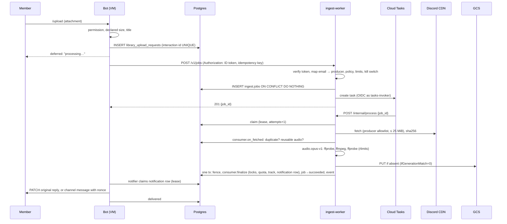

# ADR 0004: Asynchronous file ingestion on Cloud Run and Cloud Tasks, music library first

- Status: Proposed (design only; nothing implemented, merged or applied)
- Date: 2026-11-03 (revised the same day after the final architecture review: notification
  guarantees, caller identity, cost controls, generic ingestion boundaries)
- Details: [ADR 0003](0003-deploy-on-gcp.md) (GCP layout),
  [database](../architecture/database.md), `discord_bot/src/application/use_cases/library.rs`,
  `discord_bot/src/adapters/outbound/{ffmpeg,pg_library,s3_store,songbird_voice}.rs`

## Context

Today the bot does the whole `/upload` pipeline in-process on the e2-micro VM (0.25 vCPU
sustained, 1 GiB):

| Step | Code | Behaviour to keep |
|---|---|---|
| Accept | `inbound/discord/library.rs` | Defers the reply; checks permission, declared size ≤ 25 MiB (`MAX_UPLOAD_BYTES`), title |
| Download + hash | `attachment_fetch.rs` | Discord CDN hosts only; 25 MiB enforced while streaming; SHA-256 |
| Dedupe | `use_cases/library.rs` | Same hash in the same guild → "already in library"; same hash in another guild → reuse the stored object, no transcode |
| Validate + transcode | `ffmpeg.rs` | ffprobe, ffmpeg → Ogg Opus 48 kHz stereo 20 ms, ≤ 15 min; RLIMIT_AS 512 MiB, CPU 20/240 s, FSIZE, STACK 8 MiB (PR #18); one at a time |
| Persist | `pg_library.rs` `add` | Advisory locks on (guild) and (hash); quota check; object PUT (key = content hash); row insert |
| Play | `songbird_voice.rs` | Presigned GET (30 min) streamed by songbird; Opus passed through without re-encode |
| Clean up | `pg_library.rs` `sweep` | Hourly: objects with no row, older than 1 h, are deleted |

Problems:
- A 15-minute upload can take up to 240 CPU-seconds on the shared core, next to real-time
  Opus encoding for radio and links. Uploads compete with voice.
- The VM must hold an HMAC key with write access to the whole bucket. It's a static,
  long-lived credential, and the last one of its kind (ADR 0003).
- ffmpeg, which parses untrusted files, runs on the always-on machine that holds the
  Discord token.
- The upload's state lives only in an in-process task and Discord's 15-minute interaction
  token. A restart mid-upload loses it silently.

A planned **Universal Upload** service and **MCP-based file ingestion** will need the same
machinery: accept a file from a trusted producer, process it under resource limits, store
the result, report the outcome. TatarBot is the first consumer. The processing contract
must not depend on Discord.

## Decision

1. **A generic ingestion core** (crate `ingest-core`, schema `ingest`) owns jobs, their
   state machine, producer policies, the kill switch and outcome events. It knows nothing
   about Discord, guilds or music.
2. **An `ingest-worker` Cloud Run service** runs the core with registered *pipelines*
   (first: `audio.opus-v1`, the existing ffmpeg wrapper) and *consumers* (first: the
   TatarBot library). Work arrives through **Cloud Tasks**.
3. **TatarBot is a producer and a consumer.** It submits jobs through the public job API.
   Its library consumer runs inside the worker's commit transaction: dedupe, quota, track
   insert, notification row. The bot on the VM delivers Discord notifications from a
   transactional outbox. The worker never calls Discord.
4. **Exactly-once effects** come from lease-fenced transitions in Postgres; the task queue
   only supplies at-least-once delivery. Notifications are delivered at least once, through
   Discord operations that are safe to repeat.
5. **Layered caller identity:** internal ingress, then Cloud Run IAM, then the app verifies
   the Google ID token itself and maps its `email` to a registered producer, then the
   producer's policy limits what it may do.
6. **No HMAC.** The worker uses its own service account with the GCS JSON API. The VM plays
   objects with a bucket-scoped, read-only, short-lived token (Credential Access Boundary).
7. **Cost controls:** hard ceilings (max 1 instance, concurrency 1, queue rate),
   per-producer/tenant/actor limits, budget alerts, and a kill switch that a budget
   notification can also trip.
8. **The VM keeps** the Gateway, voice, playback, `/delete` (row only) and notification
   delivery. ffmpeg leaves the VM image once the worker is validated.

## Boundaries: generic core vs TatarBot

| Concern | Generic core (`ingest-core`, schema `ingest`) | TatarBot (consumer code, schema `public`) |
|---|---|---|
| Job identity | `job_id` (UUID), `(producer, idempotency_key)` unique | `idempotency_key = "discord-interaction:<id>"` |
| Who | `producer`, opaque `tenant` and `actor` strings | `tenant = "discord:guild:<id>"`, `actor = "discord:user:<id>"` |
| What | `pipeline` + `params` (pipeline-defined, validated) | `audio.opus-v1`, `{max_duration_s: 900}` |
| Input | `source {kind, uri, declared_size}`; fetch policy per producer | Discord CDN URL; host allowlist and 25 MiB live in the producer policy |
| Processing | pipeline registry, rlimits, timeouts, retries, leases | — |
| Output location | asks the consumer for the object key | `library/<sha256>.ogg` (today's keys) |
| Domain effects | calls consumer hooks inside its transactions | dedupe, quota, `library_tracks` insert |
| Outcome | `ingest.job_events` row per terminal transition; `GET /v1/jobs/{id}` | `discord_notifications` outbox row, delivered by the bot |
| Discord data | none | `library_upload_requests` (interaction, channel, title, token) |

**Contract** (HTTP JSON, also the shape for Universal Upload and the MCP server):

```text
POST /v1/jobs                       (producer identity from the ID token)
  { idempotency_key, tenant, actor, pipeline, params,
    source: { kind: "https_url" | "gcs_object", uri, declared_size } }
  → 201 { job_id, state }  |  200 same body if the key already exists  |  4xx policy error
GET  /v1/jobs/{job_id}              → { state, attempts, result?, error_code?, error_detail? }
POST /v1/jobs/{job_id}:cancel       → 202
result (succeeded) = { pipeline_version, source_sha256,
                       artifacts: [{ uri, sha256, size, media_type, metadata }] }
```

**Consumer hooks** (Rust trait in `ingest-core`, implemented per consumer, compiled into
the worker):
- `on_fetched(job, sha256) → Continue | Reuse(artifact) | Reject(code)`: lets the library
  skip the transcode (same audio in another guild) or reject early (same guild).
- `output_key(job, sha256)`: where the pipeline writes its artifact.
- `finalize_succeeded(tx, job, result)`, `finalize_failed(tx, job, error)` and
  `finalize_cancelled(tx, job)`: run in the same transaction as the core's state change.

A producer without a compiled-in consumer gets the **event mode**. The core records the
result and an `ingest.job_events` row. The producer reads `GET /v1/jobs/{id}` (later: a
webhook delivered from the same events). In-process consumers give exactly-once domain
effects because they share the database. Event-mode consumers must apply events
idempotently by `job_id`.

**Enforced by the compiler:** `ingest-core` doesn't depend on serenity, songbird or the
bot crate. The worker binary composes `ingest-core` + `audio.opus-v1` + the TatarBot
consumer.

**Built now:**
- one producer (`tatarbot`);
- one pipeline (`audio.opus-v1`);
- one source kind (`https_url` with a host allowlist);
- one in-process consumer;
- events written, status API.

**Deferred until Universal Upload or MCP needs them:**
- `gcs_object` sources and upload sessions (signed resumable uploads into
  `staging/<producer>/<uuid>`);
- webhooks;
- a content-addressed artifact cache shared across producers;
- several queues per resource class;
- the MCP server itself.

Mapping for later:
- **Universal Upload** authenticates its own users, creates an upload session, then submits
  a `gcs_object` job as producer `universal-upload` with `tenant = "uu:org:<id>"`.
- **An MCP server** authenticates MCP clients and exposes tools such as `ingest_submit` and
  `ingest_status`, calling the same API as producer `mcp-ingest`. Its policy should allow
  only `gcs_object` sources from its own sessions, not arbitrary URLs (SSRF).
- **End users and MCP clients never call the worker.**

## Components

| Component | Where | Identity | Responsibility |
|---|---|---|---|
| Bot | VM container | none (ID tokens and a downscoped GCS token from host files) | `/upload` checks, request row, `POST /v1/jobs`, playback, notification delivery |
| Host token timer | VM host | VM SA | Writes `id-token` (runtime), `ingest-id-token` (worker), `gcs-token` (downscoped) |
| `ingest-worker` | Cloud Run, asia-southeast1, gen2 | `tatarbot-ingest-worker` SA | `/v1/jobs*` (producers), `/internal/process` (Tasks), `/internal/maintenance/*` (Scheduler, budget) |
| Queue `ingest-default` | Cloud Tasks, asia-southeast1 | tasks sign OIDC as `tatarbot-tasks-invoker` | At-least-once delivery, retries, concurrency 1 |
| Scheduler jobs | Cloud Scheduler | OIDC as `tatarbot-tasks-invoker` | Reaper every 5 min, sweep hourly |
| Budget topic | Pub/Sub ← Cloud Billing budget | push with OIDC as `tatarbot-tasks-invoker` | Feeds the automatic brake |
| Postgres | Supabase (existing) | `DATABASE_URL` secret | `ingest.*` (core), `public.library_*` and `public.discord_notifications` (TatarBot) |
| Bucket | GCS (existing music bucket, same keys) | IAM only | Audio objects |

## Data flow



## 1. Job state and data model

```sql
-- ingest-core migrations (schema ingest), applied by an operator like the runtime's
-- (`ingest-worker migrate`, never on startup); history in public._ingest_migrations.
CREATE SCHEMA IF NOT EXISTS ingest;

CREATE TABLE IF NOT EXISTS ingest.producers (
    id                    TEXT    PRIMARY KEY CHECK (id ~ '^[a-z][a-z0-9-]{1,39}$'),
    service_account       TEXT    NOT NULL UNIQUE,   -- verified `email` claim
    tenant_prefix         TEXT    NOT NULL,          -- e.g. 'discord:'
    allowed_pipelines     TEXT[]  NOT NULL,
    allowed_source_kinds  TEXT[]  NOT NULL,
    source_url_hosts      TEXT[]  NOT NULL DEFAULT '{}',
    max_source_bytes      BIGINT  NOT NULL CHECK (max_source_bytes > 0),
    max_active_per_actor  INTEGER NOT NULL DEFAULT 3,
    max_jobs_per_tenant_hour INTEGER NOT NULL DEFAULT 20,
    enabled               BOOLEAN NOT NULL DEFAULT true
);

CREATE TABLE IF NOT EXISTS ingest.jobs (
    id               UUID        PRIMARY KEY DEFAULT gen_random_uuid(),
    producer_id      TEXT        NOT NULL REFERENCES ingest.producers (id),
    idempotency_key  TEXT        NOT NULL CHECK (char_length(idempotency_key) BETWEEN 1 AND 200),
    tenant           TEXT        NOT NULL CHECK (char_length(tenant) BETWEEN 1 AND 200),
    actor            TEXT        NOT NULL CHECK (char_length(actor) BETWEEN 1 AND 200),
    pipeline         TEXT        NOT NULL,
    params           JSONB       NOT NULL DEFAULT '{}' CHECK (jsonb_typeof(params) = 'object'),
    source_kind      TEXT        NOT NULL CHECK (source_kind IN ('https_url', 'gcs_object')),
    source_uri       TEXT        NOT NULL CHECK (char_length(source_uri) <= 4000),
    declared_size    BIGINT      CHECK (declared_size > 0),
    state            TEXT        NOT NULL DEFAULT 'queued'
        CHECK (state IN ('queued', 'processing', 'succeeded', 'failed', 'cancelled')),
    attempts         INTEGER     NOT NULL DEFAULT 0,
    max_attempts     INTEGER     NOT NULL DEFAULT 4,
    lease_owner      UUID,
    lease_expires_at TIMESTAMPTZ,
    cancel_requested BOOLEAN     NOT NULL DEFAULT false,
    source_sha256    TEXT        CHECK (source_sha256 ~ '^[0-9a-f]{64}$'),
    result           JSONB,
    error_code       TEXT,
    error_detail     TEXT        CHECK (char_length(error_detail) <= 500),
    created_at       TIMESTAMPTZ NOT NULL DEFAULT now(),
    updated_at       TIMESTAMPTZ NOT NULL DEFAULT now(),
    finished_at      TIMESTAMPTZ,
    UNIQUE (producer_id, idempotency_key),
    CHECK ((state IN ('succeeded', 'failed', 'cancelled')) = (finished_at IS NOT NULL)),
    CHECK (state <> 'processing' OR (lease_owner IS NOT NULL AND lease_expires_at IS NOT NULL))
);
CREATE INDEX IF NOT EXISTS jobs_active ON ingest.jobs (state, lease_expires_at)
    WHERE state IN ('queued', 'processing');
CREATE INDEX IF NOT EXISTS jobs_tenant ON ingest.jobs (producer_id, tenant, created_at);

-- One row per terminal transition, written in the same transaction (audit + event mode).
CREATE TABLE IF NOT EXISTS ingest.job_events (
    id         BIGSERIAL   PRIMARY KEY,
    job_id     UUID        NOT NULL REFERENCES ingest.jobs (id) ON DELETE CASCADE,
    type       TEXT        NOT NULL CHECK (type IN ('succeeded', 'failed', 'cancelled')),
    created_at TIMESTAMPTZ NOT NULL DEFAULT now()
);

-- Kill switch: 'global', 'producer:<id>', 'pipeline:<id>'.
CREATE TABLE IF NOT EXISTS ingest.switches (
    scope      TEXT        PRIMARY KEY,
    paused     BOOLEAN     NOT NULL,
    reason     TEXT        NOT NULL,
    updated_by TEXT        NOT NULL,   -- 'operator:<name>' or 'budget-alert'
    updated_at TIMESTAMPTZ NOT NULL DEFAULT now()
);
```

```sql
-- TatarBot (discord_bot sqlx migrations, schema public; after the ingest migrations).
CREATE TABLE library_upload_requests (
    idempotency_key   TEXT        PRIMARY KEY,          -- 'discord-interaction:<id>'
    job_id            UUID        UNIQUE REFERENCES ingest.jobs (id),  -- NULL until submitted
    application_id    BIGINT      NOT NULL,
    guild_id          BIGINT      NOT NULL,
    channel_id        BIGINT      NOT NULL,
    user_id           BIGINT      NOT NULL,
    title             TEXT        NOT NULL CHECK (char_length(title) BETWEEN 1 AND 100),
    attachment_url    TEXT        NOT NULL,
    declared_size     BIGINT      NOT NULL CHECK (declared_size BETWEEN 1 AND 26214400),
    interaction_token TEXT,                              -- cleared on use or expiry
    token_expires_at  TIMESTAMPTZ NOT NULL,              -- received + 15 min
    submit_attempts   INTEGER     NOT NULL DEFAULT 0,
    created_at        TIMESTAMPTZ NOT NULL DEFAULT now()
);

CREATE TABLE discord_notifications (
    id               BIGSERIAL   PRIMARY KEY,
    request_key      TEXT        NOT NULL UNIQUE REFERENCES library_upload_requests (idempotency_key),
    outcome          JSONB       NOT NULL,              -- what to say (track, error code)
    state            TEXT        NOT NULL DEFAULT 'pending'
        CHECK (state IN ('pending', 'sending', 'delivered', 'undeliverable')),
    attempts         INTEGER     NOT NULL DEFAULT 0,
    lease_expires_at TIMESTAMPTZ,
    nonce            TEXT        NOT NULL CHECK (char_length(nonce) <= 25),
    delivered_via    TEXT        CHECK (delivered_via IN ('interaction', 'channel')),
    discord_message_id BIGINT,
    last_error       TEXT,
    created_at       TIMESTAMPTZ NOT NULL DEFAULT now(),
    delivered_at     TIMESTAMPTZ
);
CREATE INDEX discord_notifications_due ON discord_notifications (state, lease_expires_at)
    WHERE state IN ('pending', 'sending');
```

- **Processing never needs the interaction token,** which lives only in TatarBot's own
  table, on the bot's side of the boundary.
- **Unsubmitted requests.** If `POST /v1/jobs` fails or the bot crashes after writing the
  request row, the bot's background loop re-submits requests with `job_id IS NULL`. The
  call is idempotent by key. It gives up after 10 minutes and writes a
  `submission_failed` notification.
- `/library jobs` lists the caller's recent uploads by joining the two schemas.
- **Retention:** finished jobs, events and delivered notifications are deleted after 30
  days; tokens are cleared at expiry.

## 2. Idempotency and atomic state transitions

Cloud Tasks delivers at least once, and a task name only deduplicates task *creation*
(the name tombstone lasts 1 hour to 9 days). Exactly-once *effects* come from the
database:

| Transition | Who | Statement (sketch) |
|---|---|---|
| — → queued | worker (`POST /v1/jobs`) | Policy and limits checked under an advisory lock on (producer, tenant); `INSERT … ON CONFLICT (producer_id, idempotency_key) DO NOTHING RETURNING`, else return the existing row |
| queued → processing | worker | `UPDATE … SET state='processing', attempts=attempts+1, lease_owner=$new_uuid, lease_expires_at=now()+'12 min' WHERE id=$1 AND NOT cancel_requested AND attempts < max_attempts AND (state='queued' OR (state='processing' AND lease_expires_at < now())) RETURNING *` |
| processing → succeeded | worker | One transaction: `SELECT … FOR UPDATE WHERE id=$1 AND state='processing' AND lease_owner=$me AND NOT cancel_requested`; `consumer.finalize_succeeded(tx, …)` (library: existing locks, dedupe, quota, `INSERT library_tracks`, `INSERT discord_notifications`); `UPDATE job → succeeded`; `INSERT job_events` |
| processing → failed | worker | Same fence; `consumer.finalize_failed` (library: notification row); job → failed; event |
| processing → queued | worker | Transient error: clear the lease (`WHERE lease_owner=$me`); 503 so Cloud Tasks retries |
| queued → cancelled | worker (`:cancel`) | `WHERE state='queued'`; `finalize_cancelled`; event |
| processing → cancelled | worker | `cancel_requested` seen at a checkpoint, or the commit fence fails because of it |

Properties:
- **A track row and its notification row exist if and only if the job succeeded.** All
  three change in one commit.
- **Lease fencing.** A worker whose lease expired (slow, or killed and taken over) can't
  commit: `lease_owner` no longer matches. The 12-minute lease is longer than the Cloud
  Run request timeout (10 min), so a live attempt never loses its lease.
- **Duplicate deliveries are harmless.** A claim that matches nothing re-reads the row.
  Terminal → 200. Live lease → 200 (the reaper covers a crash). Attempts exhausted →
  `failed` and 200.
- **Object writes are idempotent:** content-hash key and `ifGenerationMatch=0` (412 means
  the object is already there). Objects from attempts that never commit are orphans; the
  next attempt reuses them, or the sweep deletes them after the existing 1-hour grace.
- `UNIQUE (guild_id, content_hash)` on `library_tracks` and the existing advisory locks
  stay as a second guard.
- **Enqueue can't be lost.** The job row is written before the task. The reaper creates
  `job-<uuid>-r<n>` tasks for `queued` jobs older than 2 minutes, unless paused.

## 3. Notification delivery guarantees and crash recovery

**Guarantee:**
- Every terminal job of an in-process consumer has exactly one notification row
  (transactional outbox).
- Delivery is at least once.
- Each send is a Discord operation that is safe to repeat. So members see one message,
  except in the narrow case below.
- A notification that can't be delivered ends `undeliverable` with the reason; the outcome
  stays visible in `/library jobs`.

**Only the consumer delivers.** The bot's notifier is the single sender: the worker is
generic and holds no Discord credentials. It wakes every 3 s (and on `LISTEN` when
available; polling is the backstop) and claims a row:
`UPDATE … SET state='sending', attempts=attempts+1, lease_expires_at=now()+'60 s' WHERE id=(SELECT id … WHERE state='pending' OR (state='sending' AND lease_expires_at < now()) ORDER BY id FOR UPDATE SKIP LOCKED LIMIT 1) RETURNING *`.

| Send path | When | Why repeating is safe |
|---|---|---|
| Edit the original reply (`PATCH /webhooks/{app}/{token}/messages/@original`) | token valid for ≥ 30 s more | Same content each time; an edit is idempotent |
| Create a channel message with `nonce = "j" + 24 hex chars of the job id` and `enforce_nonce: true` | token expired, or the edit failed with 401/404 | Discord returns the existing message for a repeated nonce from the same author within a few minutes |

After Discord answers: `UPDATE … SET state='delivered', delivered_via, discord_message_id,
delivered_at`, and the request's token is cleared.

**Crash recovery:**

| Crash point | What happens |
|---|---|
| Worker, before commit | Lease expires; the reaper requeues; no track, no notification yet |
| Worker, after commit | Nothing lost: the notification row is committed with the result |
| Bot, before claiming | Row stays `pending`; delivered after restart |
| Bot, after claim, before send | Lease (60 s) expires; another loop iteration sends |
| Bot, after Discord accepted, before `delivered` | Lease expires and the send repeats: the edit is idempotent; the channel message is deduplicated by nonce, because the retry happens 60 s later, inside Discord's window |
| VM down longer than 15 min | Token expired; the channel path is used after restart. A repeat after the nonce window could duplicate the message. That requires a crash in the millisecond between Discord's answer and the DB update *and* an outage longer than a few minutes. Accepted. |
| Permanent Discord errors (channel deleted, missing permission, 50001/50013) | `undeliverable` immediately |
| Transient errors (429 with `retry_after`, 5xx) | Back to `pending` with backoff (5 s, 30 s, 2 min, 10 min); `undeliverable` after 8 attempts or 1 hour |

## 4. Caller identity: Cloud Run IAM vs application

| Layer | Answers | Mechanism | Granularity |
|---|---|---|---|
| Network | Can the request reach the service? | `INGRESS_TRAFFIC_INTERNAL_ONLY`: same-project VPC (VM), Cloud Tasks, Cloud Scheduler, Pub/Sub push, on the `run.app` URL | service |
| Cloud Run IAM | May this Google identity invoke the service? | `roles/run.invoker` for the VM SA and the tasks-invoker SA only | service, not route |
| App: transport identity | Which workload is calling, for this route? | Verify the Google ID token **in the app**: signature (Google JWKS, cached), `iss`, `aud` = service URL, `exp`, `email_verified`; then `email` → route allowlist (`/internal/*`: tasks-invoker only) or → `ingest.producers` (`/v1/*`) | route, producer |
| App: producer policy | What may this producer do? | Allowed pipelines, source kinds, URL hosts, size, tenant prefix, rate limits, `enabled` | producer |
| Data | On whose behalf? | `tenant` and `actor` are asserted by the producer, checked against its `tenant_prefix`, used for quotas and audit. The core never authenticates end users. | tenant, actor |

**Why the app re-verifies the token, and which header it uses:**
- Cloud Run checks only `X-Serverless-Authorization` when both headers are present, and it
  **removes the signature** from that header before the request reaches the container. The
  plain `Authorization` header is forwarded unchanged.
- So every caller of `ingest-worker` sends `Authorization: Bearer <ID token>`. The bot
  (unlike its call to the runtime, which uses `Authorization` for the API key) and Cloud
  Tasks / Scheduler / Pub/Sub (which do this by default) all comply.
- The app **rejects** requests without a verifiable signature rather than trusting
  stripped claims.
- **Result:** a misconfiguration at the IAM layer (`allUsers` invoker,
  `invoker_iam_disabled`, a broad role grant) doesn't open the routes. A token for another
  audience, or from a non-producer identity, fails in the app.

**Terraform guardrails:**
- No `allUsers`/`allAuthenticatedUsers` bindings on the service.
- `invoker_iam_disabled = false`.
- Ingress pinned to internal, with a `precondition` on each.

**Payload minimization:** `/internal/process` takes only `job_id`. URLs, tenants and params
come from the row a verified producer created, so a replayed or misrouted task can't
inject input.

## 5. Native GCS authentication instead of HMAC

| Option | Credential | Scope | Verdict |
|---|---|---|---|
| Keep HMAC (today) | static, never expires | read/write, whole bucket, on the VM | Remove |
| HMAC on a read-only SA | static | read, whole bucket | Fallback only |
| Signed URLs via IAM `signBlob` | per request | per object | Needs TokenCreator on itself and an API call before each track starts |
| Metadata token with `devstorage.read_only` scope | 1 h | read, every bucket the VM SA can read | Weaker than a CAB |
| **Worker: own SA. VM: CAB-downscoped token** | 1 h, not revocable | worker: objects in one bucket; VM: read-only, one bucket and prefix | **Chosen** |

- **Worker.** An `ObjectStore` adapter on the GCS JSON API (media upload with
  `ifGenerationMatch=0`, list, delete). It uses tokens from the Cloud Run metadata server.
  Role: `roles/storage.objectUser` on the music bucket only.
- **VM playback.** The host timer exchanges the VM SA's access token at STS for a token
  limited by a Credential Access Boundary: `inRole:roles/storage.objectViewer` on the
  bucket, with a condition on the library prefix. It writes the token to
  `/run/tatarbot/gcs-token/token` (0640, bot UID). The bot streams
  `…/storage/v1/b/<bucket>/o/<key>?alt=media` with `HttpRequest::new_with_headers`
  (present in songbird 0.6) and `Authorization: Bearer`, re-reading the file each time a
  track starts. The VM SA needs `roles/storage.objectViewer` on the bucket; a CAB can only
  narrow access.
- **Deletes move off the VM.** `/delete` removes the row (quota is freed at once); the
  worker's hourly sweep removes the object after the 1-hour grace.
- **After cut-over:** delete the HMAC key, its two secrets and the `tatarbot-music` SA. The
  remaining static secrets are the Discord token, the model and Tavily keys, and the
  database password.

## 6. Retries, timeouts, cancellation, permanent failures

**Time budget for one attempt** (sum ≤ 7.5 min < Cloud Run timeout 10 min < lease 12 min):

| Step | Limit |
|---|---|
| Claim + DB reads | 15 s |
| Fetch (≤ producer `max_source_bytes`) | 60 s |
| ffprobe / ffmpeg / ffprobe | 20 s / 240 s / 20 s wall, same CPU-second limits |
| GCS PUT | 60 s |
| Commit | 30 s |

**Queue `ingest-default`:**
- `max_concurrent_dispatches = 1`, `max_dispatches_per_second = 1`.
- Retries: `max_attempts = 4`, `min_backoff = 15 s`, `max_backoff = 300 s`,
  `max_doublings = 3`, `max_retry_duration = 1 h`.
- Per task: `dispatch_deadline = 610 s`, a few seconds above the 600 s Cloud Run timeout.

**Failure taxonomy.** Cloud Tasks retries every non-2xx response, so permanent failures are
recorded, then answered with 2xx.

| Class | Examples | Job | HTTP |
|---|---|---|---|
| Permanent | `not_audio`, `too_long`, `too_large`, `already_in_library`, `quota_exceeded`, `source_gone` (403/404/410), `unsupported_format`, `policy_denied` | `failed` | 200 |
| Transient | DB or GCS 5xx/timeout, source 5xx or connection errors | back to `queued` | 503 |
| Resource | ffmpeg killed by a signal, `pthread_create`/ENOMEM, wall or CPU timeout | retried once, then `failed: processing_limit` | 503 then 200 |
| Exhausted | `attempts = max_attempts` | `failed: retries_exhausted` | 200 |
| Paused | kill switch on | stays `queued`, not claimed | 200 |
| Lost | instance killed | lease expires → reaper | — |

`AudioError` is split into `Unsupported` (exit code with a demuxer or decoder error) and
`ResourceLimit` (signal, EAGAIN/ENOMEM), using PR #18's exit details.

**Cancellation.**
- `POST /v1/jobs/{id}:cancel` from the job's producer. TatarBot exposes it as
  `/library cancel` (uploader or manager).
- `queued` → `cancelled` at once. `processing` gets `cancel_requested`, checked after fetch,
  after transcode and in the commit fence. A running ffmpeg isn't killed (240 s maximum).

**Reaper** (Scheduler every 5 min → `/internal/maintenance/reap`):
- requeues stuck jobs, as in §2;
- marks jobs older than 1 h `failed: timed_out`;
- does nothing while the global switch is paused.

## 7. Cost controls and kill switch

**Hard ceilings** (these, not budgets, bound the bill):
- Cloud Run: `max_instance_count = 1`, concurrency 1, 1 vCPU / 1 GiB, timeout 600 s. That
  caps compute at about $96 per month even if the instance is busy around the clock.
- Queue: 1 dispatch at a time, at most 1 per second.
- Per producer: `max_source_bytes`, `max_active_per_actor` (3), `max_jobs_per_tenant_hour`
  (20). Library quota per guild (unchanged).

**Budget alerts:**
- The project budget from ADR 0003 gets thresholds at 50, 90 and 100 %, actual and
  forecast, emailed to the owner.
- Budgets only alert; they don't cap spend, and their data lags by hours.

**Kill switch, in layers:**

| Level | Action | Effect | Who |
|---|---|---|---|
| 1. App switch | `INSERT … ON CONFLICT (scope) DO UPDATE SET paused` in `ingest.switches` (`global`, `producer:tatarbot` or `pipeline:audio.opus-v1`) | `POST /v1/jobs` returns 503 `paused` (the bot tells the member uploads are paused); `/internal/process` doesn't claim (jobs stay `queued`, attempts not consumed); the reaper stops re-enqueuing. Resume = set `paused = false`; the reaper re-enqueues the backlog. | operator (SQL or `ingest-worker switch` command), or the budget brake |
| 2. Queue pause | `gcloud tasks queues pause ingest-default` | Tasks are still accepted but not dispatched; resume dispatches the backlog in order. (`tasks run` still bypasses a pause.) | operator |
| 3. Stop invocation | Remove the tasks-invoker's `run.invoker` binding, or set the service's ingress to internal-and-LB with no load balancer | Nothing reaches the worker; tasks fail and use up their retries | operator, emergency only |

**Automatic brake:**
- The budget publishes programmatic notifications to a Pub/Sub topic. A push subscription
  calls `/internal/maintenance/budget` (OIDC as tasks-invoker; Pub/Sub push counts as an
  internal source).
- When `costAmount ≥ budgetAmount` for the current period, the worker sets
  `ingest.switches('global')` to paused with `updated_by = 'budget-alert'`. It never
  resumes automatically.
- **Billing is deliberately not disabled.** Google's sample does that, but here it would
  also stop the bot and voice.
- The brake is late by the budget delay. The hard ceilings above bound the cost meanwhile.

**Monitoring** (Cloud Monitoring, check alerting prices when implementing):
- worker billable instance time per day;
- age of the oldest queued job;
- share of `failed` jobs per hour;
- `undeliverable` notifications.

## 8. Cost estimate and benchmark plan

**Unit prices.** Cloud Billing Catalog, asia-southeast1, Cloud Run request-based billing,
pulled 2026-11-03 for ADR 0003: $0.0000336 per vCPU-second, $0.0000035 per GiB-second,
$0.40 per million requests. Cloud Tasks, Scheduler and Pub/Sub prices are from their
pricing pages and need re-checking at implementation time.

**Assumptions,** until the benchmark replaces them: about 15 s billed for a 4-minute song,
about 45 s for a 15-minute file (1 vCPU, 1 GiB).

| Scenario | Uploads/month | Billed vCPU-s | Cloud Run | Tasks, Scheduler, Pub/Sub | Total |
|---|---|---|---|---|---|
| Light | 100, all short | 1,500 | $0.06 | $0 (free tiers: first 1 M Tasks operations; 3 Scheduler jobs per billing account, we use 2; Pub/Sub volume is tiny) | **~$0.06** |
| Busy | 1,000, 25 % long | ~22,500 | $0.84 | $0 | **~$0.85** |
| Ceiling | instance busy all month | 2.59 M | ~$96 | $0 | bounded by §7 |

All figures are before Cloud Run's free tier. Other costs: GCS operations (pennies); one
more Artifact Registry image (about 40 MB); logs (inside the free 50 GiB). The VM costs
the same; the gain is CPU headroom for voice.

**Benchmark plan** (before cut-over; results recorded here):
- **Corpus, 10 files:**
  - MP3 at 128k and 320k (4 min);
  - FLAC, AAC/M4A, Ogg Vorbis, WebM/Opus (4 min each);
  - WAV (15 min);
  - MP3 (15 min);
  - a 25 MiB-limit file;
  - a corrupt file.
- **Environments:**
  1. The e2-micro with today's container and limits, while a radio station plays.
  2. Cloud Run gen2, 1 vCPU / 1 GiB, cold and warm.
  3. Cloud Run, 0.5 vCPU / 1 GiB.
- **Measured per stage:** wall time; child CPU-seconds and peak RSS (`getrusage`); VmPeak
  and thread count (`/proc`) against the 512 MiB limit; cold start; `/upload`-to-reply
  latency; Cloud Run billable instance time. On the VM: songbird send timing and underruns
  during transcodes.
- **Tool:** `ingest-worker bench <corpus>` runs the pipeline and prints JSON. On Cloud Run
  it runs on a throwaway revision, deleted afterwards.
- **Pass criteria:**
  - p95 end-to-end ≤ 30 s for files ≤ 5 min;
  - a 15-minute file finishes in ≤ 50 % of the budget;
  - VmPeak ≤ 80 % of RLIMIT_AS;
  - no resource-limit failures;
  - measured cost within 2× of the table.

## 9. Preserving the 25 MiB limit and per-guild dedupe

**25 MiB limit:**
1. The bot rejects `declared_size > 25 MiB` before submitting.
2. A `CHECK` on `library_upload_requests.declared_size`.
3. `POST /v1/jobs` rejects `declared_size` above the producer's `max_source_bytes`
   (`tatarbot`: 25 MiB).
4. The fetcher stops at `max_source_bytes` whatever was declared.
5. Files never pass through Cloud Tasks.
6. Cloud Run's in-memory `/tmp` (25 MiB + ~15 MiB + ffmpeg ≤ 512 MiB) fits in 1 GiB at
   concurrency 1.

**Per-guild dedupe, quota and cross-guild reuse** stay in TatarBot code, now in the
consumer hooks:
- `on_fetched` returns `Reject(already_in_library)` for the same hash in the same guild,
  and `Reuse` when the audio is already stored for another guild (no transcode).
- `finalize_succeeded` runs today's `PgLibrary::add` logic inside the commit transaction:
  advisory locks, `UNIQUE (guild_id, content_hash)`, per-guild quota sum.
- Two concurrent uploads of the same file: one succeeds, the other fails
  `already_in_library`.

## 10. IAM and ingress for Cloud Tasks → Cloud Run

| Who | Grant | On | Why |
|---|---|---|---|
| VM SA | `roles/run.invoker` | worker service | Bot → `/v1/jobs` |
| VM SA | `roles/storage.objectViewer` | music bucket | Source of the downscoped playback token |
| Worker SA | `roles/cloudtasks.enqueuer` | the queue | Create tasks |
| Worker SA | `roles/iam.serviceAccountUser` (`actAs`) | tasks-invoker SA | Required to create tasks carrying its OIDC token (same project as the queue) |
| Worker SA | `roles/storage.objectUser` | music bucket | Objects |
| Worker SA | `roles/secretmanager.secretAccessor` | `tatarbot-database-url` | Postgres |
| Tasks-invoker SA | `roles/run.invoker` | worker service | Tasks, Scheduler and Pub/Sub push |
| Cloud Tasks service agent | `roles/cloudtasks.serviceAgent` | project | Mints OIDC tokens; automatic when the API is enabled (after 2019-03-19) |
| Pub/Sub service agent | `roles/iam.serviceAccountTokenCreator` | project | OIDC for push; only needed on older projects (verify at implementation) |
| Deploy SA (GitHub) | `roles/run.developer` + `actAs` worker SA | worker service | Roll revisions |
| Terraform identity | `actAs` tasks-invoker SA | — | Create Scheduler jobs and the push subscription |

**Verification** (must pass before cut-over):
1. From the internet: `curl https://<worker>.run.app/v1/jobs` → 404 (internal ingress).
2. A task without an OIDC token → 401/403 in the attempt log.
3. A task with OIDC as tasks-invoker → 200 on `/internal/process`.
4. The VM SA's token on `/internal/process` → 403 from the app's route check.
5. The tasks-invoker token on `/v1/jobs` → 403 (not a producer).
6. A token for another audience → 403 from the app.
7. A request whose token arrives without a signature (sent in `X-Serverless-Authorization`)
   → 401 from the app. This proves the app doesn't trust stripped claims.
8. The Scheduler job and the budget push → 200 on their maintenance routes.
9. Creating a task as a principal without `actAs` on tasks-invoker → refused.
10. Pausing via `ingest.switches` stops claims; resuming drains the backlog.

## Security model

- **The worker** holds no Discord credential, no model or search keys, no HMAC key. It has
  the database URL, write access to one bucket and enqueue access to one queue.
- **Untrusted files** are parsed only on the worker:
  - the existing audio-only ffmpeg build;
  - the same rlimits plus STACK;
  - concurrency 1;
  - gen2 (full Linux rlimit semantics);
  - no VPC access.
  It reaches the internet only to fetch sources, within each producer's host allowlist.
- **The VM container** gains only short-lived, narrow tokens: an ID token for the worker
  and a read-only, one-bucket token. It still never reaches the metadata server.
- **Interaction tokens** stay in TatarBot's table, for at most 15 minutes, and never reach
  the worker or a task.
- **Producers are explicit rows,** each tied to one verified service account and a tenant
  prefix.

## Terraform changes (planned, `infra/gcp`)

- `apis.tf`: add `cloudtasks`, `cloudscheduler`, `sts`, `pubsub`.
- New `ingest.tf`:
  - SAs `tatarbot-ingest-worker` and `tatarbot-tasks-invoker`.
  - `google_cloud_run_v2_service.ingest_worker`: gen2, 1 vCPU, 1 GiB, concurrency 1, min 0,
    max 1, timeout 600 s, internal ingress, `invoker_iam_disabled = false`, secret
    `DATABASE_URL`, image ignored like the runtime, with preconditions on ingress and max
    instances.
  - `google_cloud_tasks_queue.ingest_default`.
  - Two `google_cloud_scheduler_job`s.
  - `google_pubsub_topic.budget` and a push `google_pubsub_subscription` (OIDC,
    audience = worker URL).
  - The IAM members above.
- `budget.tf` (existing budget): thresholds at 50/90/100 % (actual and forecast) and
  `all_updates_rule.pubsub_topic`.
- `iam.tf`: deploy SA `run.developer` on the worker + `actAs` the worker SA.
- `storage.tf`:
  - VM SA `objectViewer`, worker SA `objectUser` on the music bucket.
  - **Phase 4:** remove the HMAC key, the music SA and its role.
- `secrets.tf`:
  - `database_url` consumers += `ingest`.
  - **Phase 4:** remove the HMAC secrets.
- `compute.tf` / `startup.sh.tftpl`:
  - The token timer also writes `ingest-id-token` and `gcs-token`.
  - Bot env: `INGEST_URL`, `INGEST_ID_TOKEN_FILE`, `GCS_TOKEN_FILE`,
    `LIBRARY_PROCESSING=local|worker`.
- `outputs.tf`: `ingest_worker_url`; `GCP_INGEST_SERVICE` for GitHub.
- Workflows: generalize `_deploy-cloudrun.yml`; add `deploy-gcp-ingest-worker.yml`
  (manual, `production` environment).
- Expected plan: about 25 added resources, 1 changed (the budget). Phase 4 removes 5.

## Code changes (planned)

- **Cargo workspace:**
  - `crates/ingest-core`: contract types, state machine, repository, producer policy,
    switches, the token verifier (JWKS) and the `Consumer` and `Pipeline` traits. No
    Discord dependencies. Migrations for schema `ingest`.
  - `crates/ingest-worker` (binary):
    - routes on `axum` (new dependency);
    - Cloud Tasks and GCS JSON REST clients (metadata-server tokens);
    - pipeline `audio.opus-v1` (moves `ffmpeg.rs` here, plus `AudioError::ResourceLimit`);
    - `migrate`, `switch` and `bench` subcommands.
  - `discord_bot`:
    - the library consumer (hooks around today's `PgLibrary` logic), compiled into the
      worker through a `tatarbot-library` crate or feature;
    - the producer client;
    - the request and notification tables;
    - the notifier and re-submission loops;
    - `GcsReader` playback;
    - `/library jobs` and `/library cancel`.
- **Dockerfiles:** the worker image = the existing ffmpeg stage + the worker binary. The
  bot image drops ffmpeg in phase 4.

## Migration strategy

Prerequisites: ADR 0003 applied and verified, library data copied from S3 to GCS, PR #18
merged.

| Phase | Change | Rollback |
|---|---|---|
| 0. Baseline | Benchmark environment 1 (e2-micro) | — |
| 1. Infrastructure | Apply `ingest.tf`; `ingest-worker migrate`; register producer `tatarbot`; deploy the worker. Bot stays `LIBRARY_PROCESSING=local` | Destroy the new resources; migrations are additive |
| 2. Verify | Checks 1–10; benchmarks 2–3; jobs in a test guild; crash drills (below) | Fix forward; production untouched |
| 3. Cut over | `LIBRARY_PROCESSING=worker`; playback switches to the CAB token; deletes and sweep move to the worker | `LIBRARY_PROCESSING=local` (the HMAC key still exists) |
| 4. Clean up, after 2 weeks with no `retries_exhausted`, `processing_limit` or `undeliverable` | Remove HMAC key, secrets and music SA; drop ffmpeg from the VM image; remove the local pipeline | Revert, re-create the HMAC key |

## Acceptance criteria

- [ ] Worker mode produces the same `library_tracks` rows and objects as local mode for the
      whole corpus (same key, duration ±0.1 s, `opus,48000,2`).
- [ ] **Crash drills, each ending with one track and one delivered notification:**
  - [ ] kill the worker mid-transcode;
  - [ ] kill the worker right after commit;
  - [ ] kill the bot between claiming and sending a notification;
  - [ ] kill the bot right after Discord accepts a channel message, then restart within
        60 s.
- [ ] Delivering the same task 3× (`tasks run`) gives one track and one notification.
- [ ] Submitting the same idempotency key 3× gives one job.
- [ ] A job finishing after its token expired is announced once in the channel.
- [ ] Permanent failures (corrupt file, 26 MiB stream, 16-minute file, same-guild
      duplicate, over quota) end `failed` after one attempt, each with the right
      `error_code`.
- [ ] A 2-minute database outage recovers without user action.
- [ ] Cancelling a queued job creates no track. Cancelling a processing job creates no
      track and leaves at most one orphan object, which the sweep removes.
- [ ] IAM and ingress checks 1–10 pass.
- [ ] The kill switch:
  - [ ] the app switch pauses within one poll, and the bot shows "paused";
  - [ ] a simulated budget message (published to the topic) trips the global switch;
  - [ ] resuming drains the backlog.
- [ ] `ingest-core` builds without serenity, songbird or the bot crate
      (`cargo tree -p ingest-core`).
- [ ] Phase 4: `gcloud storage hmac list` is empty; VM image without ffmpeg; library
      playback still passes Opus through.
- [ ] Benchmark pass criteria met; results and measured cost recorded here.
- [ ] No voice underruns on the VM during a burst of 5 uploads.

## Alternatives considered

- **Cloud Run Jobs per upload.**
  - No built-in deduplication or rate limiting per upload.
  - Slower start per execution; launching one needs `run.jobs.runWithOverrides`.
  - The result still needs a channel back.
  - Kept for batch work, such as re-transcoding the library.
- **The bot calls the worker synchronously.** No queue, but no retries or rate limiting, and
  the VM holds the request for minutes.
- **Pub/Sub push instead of Cloud Tasks.** No deduplication by name, and its delivery rate
  is controlled only indirectly.
- **The bot enqueues to Cloud Tasks directly.** The container would need an access token for
  the whole VM identity, and producers would bypass policy checks. `/v1/jobs` keeps both
  narrow.
- **The worker sends Discord notifications.** Faster by one poll interval, but it puts a
  Discord credential and Discord code in the generic worker. Rejected.
- **A Discord-shaped job table** (the first draft of this ADR). Simpler now, but every
  future producer would inherit Discord columns. Replaced by core + consumer tables.
- **Trusting Cloud Run IAM alone.** Service-level only; it can't separate routes or map
  producers, and one IAM mistake opens everything. The app verifies tokens itself.
- **Disabling billing from the budget notification.** Stops the bot and voice too; the
  scoped app switch is enough.

## Consequences

- Upload CPU moves off the VM, the HMAC key goes away, and the VM image loses ffmpeg.
- The core is reusable by Universal Upload and an MCP server without schema changes.
- **More moving parts:** a queue, Scheduler jobs, a Pub/Sub topic, two schemas' worth of
  tables, two SAs, a worker binary and image, a Cargo workspace.
- **Slower uploads:** latency rises by a cold start (estimate 2–5 s, unmeasured) plus up to
  3 s of notifier polling.
- **The in-process consumer** links TatarBot code into the worker. External consumers use
  event mode instead.
- Deleted tracks' audio stays up to about 2 hours (quota frees at once).

## Revisit when

- Uploads queue behind each other: raise dispatch concurrency and max instances together
  (the commit fences already make that safe).
- A second pipeline with a different resource profile appears: give it its own queue and
  limits.
- Universal Upload or MCP ingestion starts: add `gcs_object` sources, upload sessions and
  webhooks on top of `ingest.job_events`.
- The runtime's RAG uploads (ADR 0002, S3 + SQS) move to GCP: make them a `document.*`
  pipeline with an in-process consumer writing `rag.*`.

## Sources

- Cloud Run:
  [ingress and internal sources](https://docs.cloud.google.com/run/docs/securing/ingress),
  [private networking](https://docs.cloud.google.com/run/docs/securing/private-networking),
  [service-to-service authentication](https://docs.cloud.google.com/run/docs/authenticating/service-to-service),
  [authorization headers (blog)](https://cloud.google.com/blog/products/serverless/cloud-run-supports-new-authorization-mechanisms)
- Cloud Tasks:
  [OIDC token and `actAs`](https://docs.cloud.google.com/tasks/docs/reference/rest/v2/OidcToken),
  [HTTP target tasks](https://docs.cloud.google.com/tasks/docs/creating-http-target-tasks),
  [retries](https://docs.cloud.google.com/tasks/docs/configure-retry-task),
  [queue configuration](https://docs.cloud.google.com/tasks/docs/configuring-queues),
  [pause and resume](https://docs.cloud.google.com/tasks/docs/manage-queues-and-tasks),
  [roles and service agent](https://docs.cloud.google.com/iam/docs/roles-permissions/cloudtasks)
- Cloud Billing:
  [budgets](https://docs.cloud.google.com/billing/docs/how-to/budgets),
  [programmatic notifications](https://docs.cloud.google.com/billing/docs/how-to/budgets-programmatic-notifications),
  [disable billing with notifications](https://docs.cloud.google.com/billing/docs/how-to/disable-billing-with-notifications)
- Credential Access Boundaries:
  [overview](https://docs.cloud.google.com/iam/docs/downscoping-short-lived-credentials),
  [create a downscoped credential](https://docs.cloud.google.com/iam/docs/create-downscoped-short-lived-credentials)
- Discord: [message resource (`nonce`, `enforce_nonce`)](https://docs.discord.com/developers/resources/message)
- songbird 0.6 `HttpRequest::new_with_headers`: `songbird-0.6.0/src/input/sources/http.rs`
