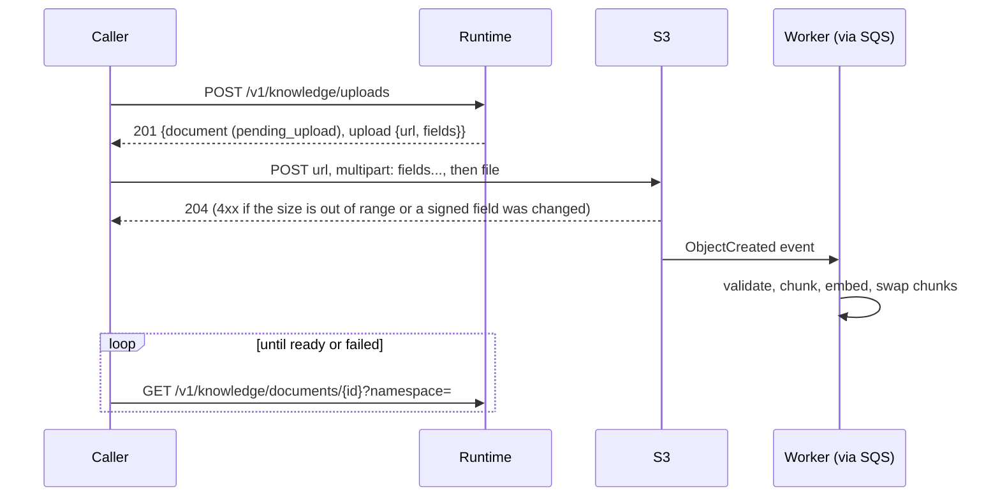

# API contracts and integration flows

One HTTP API exists between components: the agent runtime's, called by the Discord bot and
by operators. The bot exposes no API (it only connects out to Discord). The runtime calls
out to an OpenAI-compatible model, Tavily, an embedding server, and with uploads, S3 and
SQS.

The source of truth is the code: request and response models in
[`http_api.py`](../../agent_runtime/src/agent_runtime/adapters/inbound/http_api.py), the
bot's side in
[`agent_http/dto.rs`](../../discord_bot/src/adapters/outbound/agent_http/dto.rs). A running
runtime also serves its OpenAPI schema at `/docs` and `/openapi.json`.

## Conventions

* **Auth:** every `/v1/*` route requires `Authorization: Bearer <AGENT_API_KEY>`, compared
  in constant time. On GCP the runtime is a private Cloud Run service: Cloud Run first
  checks a Google ID token in `X-Serverless-Authorization` (the bot sends it when
  `AGENT_ID_TOKEN_FILE` is set) against `roles/run.invoker`, then passes the request on, so
  both checks apply. `/health` and `/ready` are open. There is one key and no roles; see
  [security.md](../security.md#access-control).
* **Errors:** always `{"error": "<fixed message>"}`. Validation errors list the failing
  fields; nothing from upstream bodies, URLs or credentials is returned.
* **Compatibility:** new fields are optional in both directions. The bot omits empty
  optional fields and ignores unknown response fields and unknown action types, so an
  older bot works with a newer runtime and the other way round.

| Status | Meaning |
|---|---|
| 401 | missing or wrong key |
| 404 | feature disabled (`knowledge base disabled`, `uploads disabled`) or document not in that namespace |
| 422 | invalid body or query, blank message, unsupported file |
| 502 | model rejected the request or answered with something unusable |
| 503 | model unreachable / 5xx / 429; embedding backend failed during a reload; S3 or SQS failed |
| 504 | model timed out |
| 500 | unexpected error (logged with a traceback, never returned) |

## Chat: `POST /v1/chat`

```jsonc
// request
{
  "message": "เปิดเพลงชิลๆ หน่อย",                  // 1..16000 chars
  "conversation_id": "discord:123:456:789",       // 1..256 chars; the bot's format, see below
  "client_tools": {                               // optional; the bot sends it in servers only
    "music": {
      "stations": [{"name": "lofi", "title": "Lofi Girl"}],   // 1..25, name ^[a-z0-9-]{1,32}$, unique
      "state": {                                  // optional: what is playing now
        "channel": "General",
        "queue": [{"title": "Lofi Girl", "live": true, "song": "Artist - Song"}]  // ≤ 11
      },
      "results": [                                // optional: outcomes of the previous turn's actions, ≤ 4
        {"action": "play", "station": "lofi", "ok": true, "detail": "Now playing Lofi Girl"}
      ],
      "library": true,                            // the server has uploaded tracks
      "library_hints": ["Proxie - Night Drive"]   // ≤ 20 titles, ≤ 100 chars each
    }
  }
}

// 200
{
  "message": "เปิดสถานี lofi ให้แล้ว",
  "conversation_id": "discord:123:456:789",
  "actions": [                                    // empty unless client_tools were sent and used
    {"type": "play_music", "action": "play", "station": "lofi", "track": null}
  ]
}
```

* `conversation_id` keys the history (in memory per process, or in Postgres with
  `CONVERSATION_STORE=postgres`). The bot builds it as
  `discord:<guild id | dm>:<channel id>:<user id>`, so each user has their own conversation
  per channel. The runtime also derives the knowledge namespaces from it (`global`, plus
  `discord:<guild id>` in a server).
* `action` is one of `play`, `play_track`, `skip`, `stop`, `queue`. `station` is always one
  of the stations sent in that request. `track` (for `play_track`) is free text that the
  bot only ever searches in that server's own library.
* The bot carries out at most 2 actions per reply and reports their outcomes in the next
  request's `results`. The runtime never calls the bot.
* Turn budget: the runtime caps a turn at `TURN_TIMEOUT_SECONDS` (110) and each model call at
  `MODEL_TIMEOUT_SECONDS` (100), below the bot's `AGENT_TIMEOUT_SECS` (120), so the bot gets a
  504 rather than timing out itself.

What the Discord user sees for each failure is in
[discord_bot/README.md](../../discord_bot/README.md#chat-runtime-contract-and-failures).

## Knowledge base (operators)

| Method | Path | Response |
|---|---|---|
| `GET` | `/v1/knowledge` | `{documents, chunks, embedder, indexed_at, duration_ms}` |
| `POST` | `/v1/knowledge/reload` | same, after re-indexing `RAG_DOCS_DIR`; 503 if the embedding backend fails (the previous index stays) |

Both return 404 when the knowledge base is off (neither `RAG_DOCS_DIR` nor
`RAG_STORE=postgres`). With the Postgres store, `chunks` counts all chunks of the configured
embedding model, uploads included.

## Document uploads

Enabled with `RAG_STORE=postgres`, `RAG_S3_BUCKET` and `RAG_SQS_QUEUE_URL`; otherwise 404
`uploads disabled`. Every route is scoped to a `namespace`
(`^[a-z0-9][a-z0-9:_-]{0,199}$`, e.g. `global`, `discord:123`). A document in another
namespace answers 404.

| Method | Path | Body / query | Response |
|---|---|---|---|
| `POST` | `/v1/knowledge/uploads` | `{namespace, filename, size_bytes, source?}` | 201 `{document, upload: {method: "POST", url, fields}, expires_at, max_bytes}` |
| `GET` | `/v1/knowledge/documents` | `?namespace=` | 200 `{documents: [...]}`, newest change first, at most 100 |
| `GET` | `/v1/knowledge/documents/{id}` | `?namespace=` | 200 document |
| `POST` | `/v1/knowledge/documents/{id}/reprocess` | `?namespace=&force=false` | 202 |
| `DELETE` | `/v1/knowledge/documents/{id}` | `?namespace=` | 204 |

A document is
`{id, namespace, source, title, status, mime_type, size_bytes, content_hash, error, chunks, created_at, updated_at, processed_at}`.
`status` is `pending_upload`, `queued`, `processing`, `ready` or `failed`, and `chunks` is
the number of retrievable chunks. Storage keys and buckets aren't exposed.

Request rules: `filename` must end in `.md`, `.markdown` or `.txt` (only its base name is
used); `0 < size_bytes ≤ RAG_UPLOAD_MAX_BYTES`. `source` names the document within the
namespace and defaults to the file name. Requesting an upload for an existing source
replaces that document when the new file is ingested.

### Upload flow



Uploading the file, with `curl` and the response saved as `upload.json`:

```sh
args=(); while IFS= read -r kv; do args+=(--form-string "$kv"); done \
  < <(jq -r '.upload.fields | to_entries[] | "\(.key)=\(.value)"' upload.json)
curl -sS "$(jq -r .upload.url upload.json)" "${args[@]}" -F "file=@guide.md"
```

The form fields must come before the file, and the presigned URL expires after
`RAG_UPLOAD_URL_TTL_SECONDS`. Ingestion, retries and failure handling:
[rag.md §7](rag.md#7-persistent-store-uploads-and-asynchronous-ingestion).

## Health

| Path | Meaning | Use |
|---|---|---|
| `GET /health` | the process serves HTTP | container health checks |
| `GET /ready` | the model backend answers `GET /models` and serves `MODEL_NAME` (200 or 503) | manual checks only: against a scale-to-zero endpoint it would wake or fail ([ADR 0001](../adr/0001-inference-provider.md)) |

## Outbound contracts (runtime)

| Dependency | Protocol | Adapter |
|---|---|---|
| Chat model | OpenAI Chat Completions, non-streaming, optional tool calls | `adapters/outbound/vllm.py` |
| Embeddings | OpenAI `POST /embeddings` | `adapters/outbound/openai_embeddings.py` |
| Web search | Tavily search API | `adapters/outbound/tavily.py` |
| S3 / SQS | AWS APIs through boto3 | `adapters/outbound/s3_storage.py`, `sqs_queue.py`, `adapters/inbound/sqs_worker.py` |
