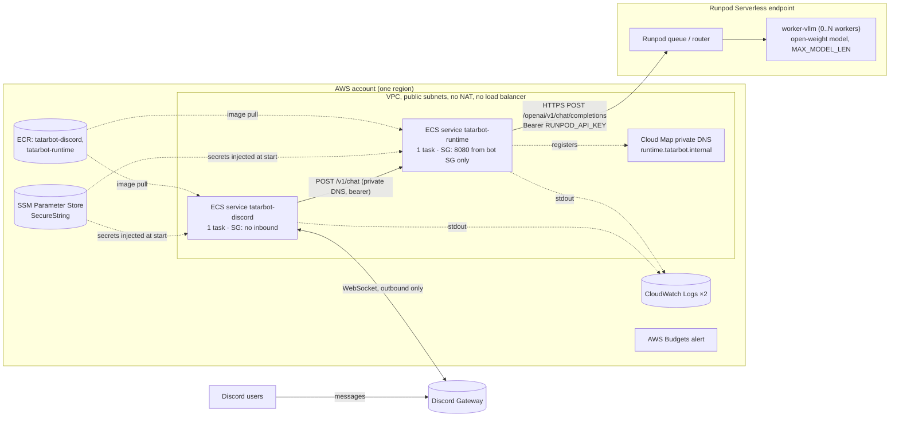

# Cloud inference: audit and design (Phase 0)

Status: proposal, 2026-10-10. Nothing described here has been deployed. Prices, GPU
availability and some Runpod behaviours are listed as **to verify**; none of them are
guarantees.

Decision record: [ADR 0001: Inference provider](../adr/0001-inference-provider.md).

> **Revision 2026-10-10 (later the same day):** the AWS side changed from one ECS task with
> both containers to **two independent ECS services** (`tatarbot-discord`,
> `tatarbot-runtime`) connected through Cloud Map private DNS, so each service can be built,
> deployed and scaled on its own. §3 and §5 reflect that. Containers, CI/CD and Terraform
> now exist (§5 status); nothing has been applied to AWS.

## 1. Current state

### 1.1 Components

| Path | Responsibility | Entry point |
|---|---|---|
| `discord_bot/` (Rust, serenity) | Discord adapter. Listens to `MESSAGE_CREATE` over the Discord Gateway WebSocket, responds to @mentions and replies to the bot, calls the Agent Runtime, splits answers at 2000 characters. Knows nothing about models. | `discord_bot/src/main.rs` (composition root), `src/adapters/inbound/discord/handler.rs` |
| `agent_runtime/` (Python, FastAPI) | Owns the system prompt and conversation history (in memory), builds a provider-neutral `InferenceRequest` and sends it through `ModelPort`. Only adapter today: `VLLMModel` (OpenAI-compatible Chat Completions). | `agent_runtime/src/agent_runtime/main.py` (`create_app` factory, run via `uvicorn --factory`) |
| `models/` | Empty, untracked directories `models/serving/` and `models/infrastructure/`. No content. | – |
| `model_experimental/` | Empty, untracked directory. | – |

There are no Dockerfiles, no compose file, no IaC, no CI workflows and no `docs/` directory.
The root `Makefile` runs both services locally (`make up`, `make check`). The model itself
currently runs outside this repository and is reached through a temporary tunnel URL.

### 1.2 Contracts

**Bot → Runtime** (`discord_bot/src/adapters/outbound/agent_http/`, `agent_runtime/src/agent_runtime/adapters/inbound/http_api.py`)

```http
POST {AGENT_BASE_URL}/v1/chat
Authorization: Bearer <AGENT_API_KEY>
{"message": "...", "conversation_id": "discord:<guild|dm>:<channel>:<user>"}

200 {"message": "...", "conversation_id": "..."}
4xx/5xx {"error": "<fixed message>"}
```

- Auth: static bearer key, constant-time comparison (`http_api.py:59-70`).
- Validation: message 1–16 000 chars, conversation id 1–256 chars (`http_api.py:32-37`).
- Bot timeout: `AGENT_TIMEOUT_SECS`, default 120 s (`discord_bot/src/config.rs:38-44`).
- Bot error mapping (`client.rs:83-98`): 408/504 → timeout, 401/403/429/5xx → unavailable,
  other 4xx → rejected (the `error` text is shown to the Discord user).

**Runtime → Model** (`agent_runtime/src/agent_runtime/adapters/outbound/vllm.py`)

```http
POST {MODEL_BASE_URL}/chat/completions
Authorization: Bearer <MODEL_API_KEY>      # only if set
Content-Type: application/json
{
  "model": "<MODEL_NAME>",
  "messages": [{"role": "system|user|assistant", "content": "..."}],
  "stream": false,
  "max_tokens": 1024,                       # MODEL_MAX_TOKENS, omitted if unset
  "temperature": 0.7,                       # MODEL_TEMPERATURE, omitted if unset
  "chat_template_kwargs": {"enable_thinking": false}   # MODEL_ENABLE_THINKING, omitted if empty
}
```

- Fields read from the response: `choices[0].message.content` (required, string),
  `choices[0].finish_reason`, `usage.prompt_tokens`, `usage.completion_tokens` (optional).
  `<think>…</think>` blocks are stripped (`vllm.py:127-133`).
- Readiness: `GET {MODEL_BASE_URL}/models` with a 3 s timeout; ready if `MODEL_NAME` is in
  `data[].id` (`vllm.py:63-70`). Exposed as the runtime's `GET /ready`.
- Timeout: `MODEL_TIMEOUT_SECONDS`, default 100 s, deliberately below the bot's 120 s
  (`agent_runtime/src/agent_runtime/config.py:17-18`).
- Streaming: none, end to end. The bot shows a typing indicator and posts the full reply.
- Error mapping (`vllm.py:89-100`, `http_api.py:105-110`):

  | Upstream | Runtime raises | Runtime returns | Bot shows |
  |---|---|---|---|
  | client timeout, 408, 504 | `ModelTimeoutError` | 504 | "took too long" |
  | transport error, 429, 5xx | `ModelUnavailableError` | 503 | "can't reach my brain" |
  | other 4xx (incl. 401, 404, context overflow) | `ModelRequestRejectedError` | 502 | "can't reach my brain" (502 is a 5xx for the bot) |
  | 200 with malformed/empty body | `ModelResponseError` | 502 | "can't reach my brain" |

  Upstream bodies are logged (first 500 chars) and never returned to callers.

### 1.3 Configuration

`agent_runtime/.env.example` and `agent_runtime/src/agent_runtime/config.py`: `AGENT_API_KEY`,
`MODEL_BASE_URL`, `MODEL_NAME` (required); `MODEL_API_KEY`, `MODEL_TIMEOUT_SECONDS`,
`MODEL_MAX_TOKENS`, `MODEL_TEMPERATURE`, `MODEL_ENABLE_THINKING`, `SYSTEM_PROMPT`,
`MAX_HISTORY_MESSAGES` (20), `MAX_CONVERSATIONS` (10 000).

`discord_bot/.env.example`: `DISCORD_TOKEN` (required), `AGENT_BASE_URL`, `AGENT_API_KEY`,
`AGENT_TIMEOUT_SECS`.

### 1.4 Tests

Run on 2026-10-10 with `make -C agent_runtime check` and `make -C discord_bot check`:

- `agent_runtime`: ruff lint + format check passed; **64 passed** (pytest). The vLLM adapter
  is tested against `httpx.MockTransport` (`tests/test_vllm.py`); no test hits a real backend.
- `discord_bot`: `cargo fmt --check`, `clippy -D warnings` passed; **24 passed**.

### 1.5 Findings that matter for the cloud move

1. **The runtime already speaks the target protocol.** `VLLMModel` is a plain OpenAI Chat
   Completions client. Any OpenAI-compatible endpoint that accepts a bearer key and returns
   the standard response shape works by changing `MODEL_BASE_URL`, `MODEL_API_KEY` and
   `MODEL_NAME`. No code change is needed for Runpod's vLLM worker (see §2).
2. **The bot needs no inbound network access.** It connects outbound to Discord; the runtime
   is only called by the bot, so it needs only a private endpoint reachable from the bot.
   No load balancer, public API or domain is required.
3. **The runtime is single-replica by design.** History is in memory and the per-conversation
   lock is per process (`chat_service.py:37-40`). The bot must also run exactly once: two
   instances on the same token would both receive `MESSAGE_CREATE` and reply twice.
4. **A tunnel URL is committed** in `agent_runtime/.env.example:6`. It is not a secret, but it
   is a live-environment detail in version control and should become a placeholder.
5. **No token budgeting.** History is trimmed by message count only. If the last 20 messages
   plus the new one exceed the model's context window, vLLM returns 400 → 502. Because failed
   turns are not stored and the stored window does not shrink, that conversation keeps failing
   until the process restarts. Discord caps user messages at 2000/4000 characters, so this
   is unlikely with a ≥16k context, but real with a small `MAX_MODEL_LEN`.
6. `discord_bot/README.md` mentions a "Tatar Gateway" that does not exist in the repo.

## 2. Compatibility: Agent Runtime ↔ Runpod Serverless vLLM

Runpod's vLLM worker ([runpod-workers/worker-vllm](https://github.com/runpod-workers/worker-vllm),
[OpenAI compatibility docs](https://docs.runpod.io/serverless/vllm/openai-compatibility))
exposes `https://api.runpod.ai/v2/<ENDPOINT_ID>/openai/v1` with `/chat/completions`,
`/completions` and `/models`, authenticated with `Authorization: Bearer <RUNPOD_API_KEY>`.
The served model name is the Hugging Face id unless `OPENAI_SERVED_MODEL_NAME_OVERRIDE` is set.

| Requirement of the runtime | Runpod vLLM worker | Status |
|---|---|---|
| `POST {base}/chat/completions`, JSON body | Supported | Compatible |
| Bearer auth via `MODEL_API_KEY` | Runpod API key as bearer | Compatible |
| `model` must match `MODEL_NAME` | HF id or `OPENAI_SERVED_MODEL_NAME_OVERRIDE` | Compatible; set the override to a stable alias |
| `stream: false` | Both modes supported | Compatible |
| `max_tokens`, `temperature` | Standard fields | Compatible |
| `chat_template_kwargs` | Not mentioned in Runpod docs; vLLM itself accepts it | **Verify**. If rejected (4xx → 502), use a non-thinking model and unset `MODEL_ENABLE_THINKING` |
| `choices[0].message.content`, `usage` | Standard vLLM response | Compatible |
| `GET {base}/models` answers in < 3 s | Unknown whether it needs a running worker | **Verify**. With scale-to-zero, `/ready` may report `not_ready` or start a billable worker |
| First reply in < 100 s | Cold start = container start + weight load + engine init | **Verify**. Can exceed 100 s without cached weights |
| Non-OpenAI error bodies (Runpod 401/404, queue errors) | Possible | Safe: runtime maps by status, never parses or forwards bodies |
| 200 with non-OpenAI body (e.g. a job-status object if a sync wait is exceeded) | Undocumented | Safe: becomes `ModelResponseError` → 502. **Verify** the actual behaviour |

**Conclusion: no application change is required to try Runpod.** The differences are
operational (readiness probe, cold-start latency, billing on abandoned requests), handled by
configuration and by how `/ready` is used, below.

## 3. Proposed architecture



### 3.1 Request flow

1. A user @mentions the bot. Discord delivers `MESSAGE_CREATE` over the bot's outbound
   WebSocket.
2. The bot builds `conversation_id` and calls
   `http://runtime.tatarbot.internal:8080/v1/chat` with `AGENT_API_KEY`. Cloud Map resolves
   the name to the runtime task's private IP; only the bot's security group may connect.
3. The runtime loads history, builds the Chat Completions body and POSTs to the Runpod
   OpenAI route with the Runpod key.
4. Runpod queues the job; a warm worker answers in seconds, a cold one first starts and loads
   the model.
5. The runtime strips reasoning, stores the exchange, returns `{message}`; the bot posts it.

### 3.2 AWS responsibilities (minimum)

AWS hosts the always-on, CPU-only part and the operational tooling. It does not run GPUs.

| Resource | Purpose | Notes |
|---|---|---|
| ECR, 2 repositories | `tatarbot-discord`, `tatarbot-runtime` | Immutable `sha-<commit>` tags, scan on push, keep 20 |
| ECS cluster, 2 Fargate services, 1 task each | `tatarbot-discord`, `tatarbot-runtime`, deployed independently | Bot: `min 0% / max 100%` so a deploy never runs two bots. Runtime: `min 100% / max 200%`. Circuit breaker with rollback |
| Cloud Map private DNS namespace | `runtime.tatarbot.internal` → runtime task IP | VPC-only; see `infra/aws/README.md` for Service Connect / ALB trade-offs |
| VPC with public subnets, `assignPublicIp=ENABLED` | Outbound internet for Discord, Runpod, ECR | No NAT gateway, no ALB. Bot SG: no inbound. Runtime SG: 8080 from bot SG only |
| SSM Parameter Store (SecureString) | `DISCORD_TOKEN`, `AGENT_API_KEY`, `MODEL_API_KEY` | Injected through task definition `secrets`; created outside Terraform |
| IAM: one execution role per service | Pull own image, read own secrets, write own logs | No task roles: the apps call no AWS APIs |
| IAM: GitHub OIDC deploy role | Push images, register task definitions, update the 2 services | Trusts only the `production` environment of this repository |
| CloudWatch log groups ×2 | Container stdout | 14-day retention |
| AWS Budgets | Monthly cost alert by email | Covers the AWS side only; Runpod spend is capped separately |
| Terraform (or OpenTofu) state | Reproducible infra | Local state is acceptable for Phase 1; S3 backend later |

Alternative considered: a single small EC2 instance with Docker Compose. Cheaper and simpler,
but host patching, SSH/SSM access and image deployment are then hand-rolled. Fargate shows
the platform-engineering pattern (immutable images, IAM-scoped secrets, declarative
deploys) at similar complexity. Choose EC2 if the AWS bill matters more than the portfolio
signal (see open questions).

### 3.3 Runpod Serverless responsibilities

- Run the official `worker-vllm` image; no custom handler code in Phase 1.
- Configuration by endpoint environment variables only, kept in the repo as a non-secret
  template (e.g. `MODEL_NAME`, `OPENAI_SERVED_MODEL_NAME_OVERRIDE`, `MAX_MODEL_LEN`,
  `QUANTIZATION`, `GPU_MEMORY_UTILIZATION`).
- Scaling: `min workers = 0` (scale to zero), `max workers = 1` or `2` (hard spend cap),
  idle timeout tuned against cold-start cost, execution timeout slightly above the runtime's
  `MODEL_TIMEOUT_SECONDS`.

### 3.4 Network boundaries, authentication, secrets

| Boundary | Direction | Auth | Exposure |
|---|---|---|---|
| Discord ↔ bot | Outbound WebSocket from AWS | `DISCORD_TOKEN` | No inbound port |
| Bot → runtime | Private VPC traffic via Cloud Map DNS | `AGENT_API_KEY` bearer | Runtime SG admits only the bot SG on 8080; no public listener, no load balancer |
| Runtime → Runpod | Outbound HTTPS to `api.runpod.ai` | `RUNPOD_API_KEY` bearer (as `MODEL_API_KEY`) | Runpod endpoint is internet-facing; protected only by the key |
| AWS control plane | Terraform (operator) / GitHub Actions deploy | Operator IAM/SSO; deploys via OIDC role, no stored keys | – |

- The Runpod endpoint is public by nature; there is no private link to AWS. The key is the
  only control. Use a Runpod API key restricted to this endpoint if Runpod's key permissions
  allow it (**verify**), and never the account-wide key.
- Secrets exist only in SSM and in local, git-ignored `.env` files. `.env.example` files
  contain placeholders only. No tunnel URLs, endpoint IDs or keys in docs or commits.
- The bot and runtime already redact secrets in `Debug`/`repr` and never return upstream
  bodies; keep it that way.

### 3.5 Model, quantization, context, cold start

Constraints from the code: chat only, no tools, no vision; `max_tokens` 1024; up to 20
history messages; Qwen3-style `enable_thinking` toggle; low volume.

| Choice | Recommendation | Why |
|---|---|---|
| Model family | Keep Qwen3 (current backend serves Qwen) | No prompt/behaviour change for the bot |
| Size | Start with a ~4B instruct model, keep ~8B as the step up | Smaller weights → shorter cold start, cheaper GPU tier. Validate answer quality with the smoke prompts |
| Thinking | Prefer a non-thinking instruct variant | Removes the dependency on `chat_template_kwargs` passthrough; `strip_reasoning` stays as a safety net |
| Quantization | BF16/FP16 for ~4B; AWQ or FP8 if moving to ~8B on a 24 GB-class GPU | Use only quantizations vLLM and the chosen GPU support; **verify** per model |
| `MAX_MODEL_LEN` | 16384 | Covers 20 history messages at Discord's message caps plus 1024 output tokens; avoids finding 1.5 #5. Lower only if KV-cache memory forces it, and then lower `MAX_HISTORY_MESSAGES` too |
| Served name | `OPENAI_SERVED_MODEL_NAME_OVERRIDE=tatarbot-chat` (example) | Lets the model change without changing `MODEL_NAME` in AWS |
| Weights | Baked into the image or Runpod's model caching, not downloaded per cold start | Download dominates cold start; a network volume pins the endpoint to one datacenter and narrows GPU availability (**verify** trade-off) |

**Cold start vs timeouts.** Today a reply must arrive within 100 s (runtime) / 120 s (bot).
Plan for the first message after idle to be slow:

- Measure cold-start time for the chosen model/GPU before picking timeouts.
- If it exceeds ~90 s, raise `MODEL_TIMEOUT_SECONDS` and `AGENT_TIMEOUT_SECS` together
  (keeping runtime < bot), e.g. 170/180 s. The typing indicator already covers the wait.
- A timed-out request still runs (and bills) on Runpod. Keep `max workers` low and the
  execution timeout bounded.

**Readiness.** `/ready` calls `GET /models`. Against a scale-to-zero endpoint it may be slow,
false, or wake a worker. Therefore:

- ECS container health check uses `/health` only.
- `/ready` stays a manual/deploy-time check (`make smoke`), not a periodic probe.
- If `/models` proves to wake workers, a later change could make the readiness check
  configurable; that is out of scope until measured.

### 3.6 Provider-independent interface

It already exists and is sufficient. `ModelPort` (`application/ports.py:9-23`) and the
`InferenceRequest`/`InferenceResult` domain types carry no provider details, and the only
adapter speaks the de facto standard OpenAI protocol that vLLM, Runpod, most hosted
providers and a local vLLM all implement. Switching between local vLLM, Runpod and a
dedicated VM is a configuration change. No new abstraction is justified now. Renaming
`VLLMModel` to something like `OpenAICompatibleModel` would be accurate but is cosmetic.
Defer it.

## 4. Deployment and cost

### 4.1 Runpod Serverless vs dedicated GPU VM

| | Runpod Serverless | Dedicated GPU VM (Runpod Pod, AWS g-class, etc.) |
|---|---|---|
| Billing | Per second of worker time (incl. cold start and idle timeout) | Per hour while running, idle or not |
| Idle cost | ~0 with min workers 0 (storage may still bill) | Full hourly rate unless stopped |
| Latency | Cold start on first request after idle | Always warm |
| Ops | Managed scaling, no host | Host, driver, vLLM process and TLS/auth in front are yours |
| Exposure | Runpod-managed HTTPS + API key | You must secure the port (auth proxy, SG, or private network) |
| AWS GPU quota | Not needed | New AWS accounts often have 0 GPU vCPU quota; increase request needed |
| Fit for low volume | Good | Poor unless scheduled on/off |

Rough model for comparison (fill in with verified rates):

```text
serverless_monthly ≈ requests_per_month × (avg_exec_s + cold_start_share_s + idle_timeout_share_s) × gpu_rate_per_s
                     + image/volume storage
dedicated_monthly  ≈ hours_running × gpu_rate_per_h + disk
```

Serverless wins while the GPU would be busy only a small fraction of the time, which is the
expected case for a portfolio Discord bot.

### 4.2 To verify before deploying (not facts)

- Runpod per-second price for the chosen GPU tier, flex vs active workers.
- Availability of that GPU tier in the regions the endpoint allows.
- Network volume and container-disk storage charges; whether model caching is billed.
- Measured cold-start time with and without FlashBoot / cached weights.
- Whether `GET /openai/v1/models` needs a running worker.
- Whether `chat_template_kwargs` is passed through to vLLM.
- Behaviour when a request exceeds Runpod's synchronous wait (status code and body).
- Default and maximum execution timeout; whether a client disconnect cancels the job.
- Whether Runpod API keys can be restricted to one endpoint.
- Runpod's documented scale-down of `max_workers` for endpoints idle 3+ days and how it
  recovers.
- AWS: Fargate vCPU/GB-hour rate for the chosen size and architecture, public IPv4 hourly
  charge, CloudWatch Logs ingestion, ECR storage. SSM standard parameters are expected to be
  free; Secrets Manager is billed per secret, which is why SSM is proposed.

## 5. Implementation plan

### Phase 1: containers, CI/CD, Terraform (done locally, no paid resources)

| Area | Files |
|---|---|
| Images | `agent_runtime/Dockerfile`, `discord_bot/Dockerfile`, `.dockerignore` in each: multi-stage, non-root, read-only-root compatible, no secrets |
| Local stack | `compose.yaml`: two containers on the default network, bot → `http://agent_runtime:8080`, no published ports |
| Integration | `integration/`: mock OpenAI-compatible model + black-box tests of the runtime image |
| Bot shutdown | `discord_bot/src/adapters/inbound/discord/mod.rs`: SIGTERM handled, bounded shard close |
| CI | `.github/workflows/ci-runtime.yml`, `ci-discord.yml`, `ci-repo.yml` (path-filtered) |
| CD | `_deploy-ecs.yml` (reusable) + `deploy-runtime.yml`, `deploy-discord.yml` (manual only) |
| AWS | `infra/aws/` Terraform (validated offline, never applied) |

Verified locally: both images build; runtime integration tests pass against the mock; bot
exits 0 on SIGTERM; `terraform validate`, `docker compose config` and actionlint pass. The
workflows have not yet run on GitHub.

### Phase 2: Runpod endpoint (paid, small, capped)

Files are in `model-inference/` (prepared; the endpoint has not been created):

| File | Change |
|---|---|
| `model-inference/runpod/endpoint.env.example` | Non-secret worker env template (model id, served name `tatarbot-chat`, `MAX_MODEL_LEN`, quantization) |
| `model-inference/README.md` | Manual endpoint creation steps, scaling limits, how to measure cold start |
| `model-inference/scripts/smoke.py` (`make -C model-inference smoke`) | Calls the endpoint directly with the exact body the runtime sends (cold and warm, timed), then `GET /models` and an unauthenticated request |
| `model-inference/local/compose.yaml` | Local vLLM on a developer GPU with the same served name and auth, replacing the tunnel for development |

Acceptance:
- Direct smoke: `/chat/completions` returns 200 with a non-empty `choices[0].message.content`
  for the runtime's exact body (including `chat_template_kwargs` if kept).
- Local runtime with `MODEL_BASE_URL` pointed at Runpod: `make -C agent_runtime smoke`
  returns a reply; a second turn in the same conversation sees the first.
- Cold-start and warm latency measured and recorded in this document; timeouts adjusted if
  needed.
- Endpoint max workers ≤ 2, min workers 0; a Runpod spend limit/alert set if available.
- Wrong `MODEL_API_KEY` → runtime returns 502 `model rejected the request`; nothing secret
  in the response or logs.

### Phase 3: AWS (paid, small)

Code is ready in `infra/aws/` and the deploy workflows; follow the apply order in
`infra/aws/README.md`.

Acceptance:
- `terraform plan` on a clean account shows only the resources listed in that README;
  `terraform destroy` removes everything.
- Each service deploys on its own through its workflow; deploying one leaves the other's
  task untouched.
- Bot online in Discord; mention → reply via Runpod; logs in both CloudWatch groups.
- Bot security group has zero inbound rules; runtime accepts only the bot's security group;
  no secret values in task-definition environment, Terraform state or logs.
- During a bot deploy, no message gets two replies.
- Budget alert exists.

### Smoke-test checklist (all phases)

1. `GET /health` → 200.
2. `GET /ready` → 200 when the backend is warm (manual only).
3. `POST /v1/chat` without key → 401.
4. `POST /v1/chat` with key, `"Say hello in one short sentence."` → 200, non-empty, no
   `<think>`.
5. Second turn referencing the first → answer uses history.
6. Backend unreachable (bad URL) → 503; wrong backend key → 502; neither leaks URL or key.
7. Discord: mention → one reply; reply-to-bot without mention → one reply; bot's own
   messages ignored.

## 6. Risks

| Risk | Impact | Mitigation |
|---|---|---|
| Runpod key leak | Anyone can run (and bill) the endpoint | Endpoint-scoped key if available, SSM only, max workers cap, spend alert, rotate on suspicion |
| Cold start > timeouts | First message after idle fails with "took too long" | Measure; cached weights; raise both timeouts consistently |
| Abandoned requests still bill | User retries stack GPU jobs | Low max workers, bounded execution timeout |
| `/ready` used as a health probe | Constant worker wake-ups or flapping | Health checks use `/health` only |
| Context overflow (finding 1.5 #5) | A conversation fails permanently until restart | `MAX_MODEL_LEN` 16k; later token-aware trimming or retry with shorter history |
| Two bot instances | Duplicate replies | `desiredCount=1`, `minimumHealthyPercent=0` |
| History lost on restart/deploy | Users lose context | Accepted for now; `ConversationStore` port allows Redis/Postgres later |
| Unverified Runpod behaviours (§4.2) | Surprises at deploy time | Phase 2 smoke tests exist to settle them before AWS work |
| Model licence | Redistribution/usage terms | Check the chosen model's licence before baking it into an image |

## 7. Out of scope now

Kubernetes, Envoy Gateway or any API gateway, a model registry, a full observability stack,
RLHF/fine-tuning, multi-region, autoscaling the bot/runtime, streaming responses.

## 8. Open questions

1. Fargate (portfolio signal) or a single EC2/Lightsail host (lower cost)? *Decided
   2026-10-19:* ECS on one Graviton EC2 instance by default, Fargate as a switch
   (`launch_type`); see [`infra/aws/`](../../infra/aws/README.md).
2. Which exact model and GPU tier, after cold-start and price checks?
3. Should `models/serving/` and `models/infrastructure/` (currently empty) hold the Runpod
   and AWS config, or should AWS IaC live in `infra/aws/` as proposed? What is
   `model_experimental/` intended for?
4. Is losing history on deploy acceptable for the portfolio demo?
5. Should CI (GitHub Actions with OIDC to AWS) be part of Phase 3 or later?
