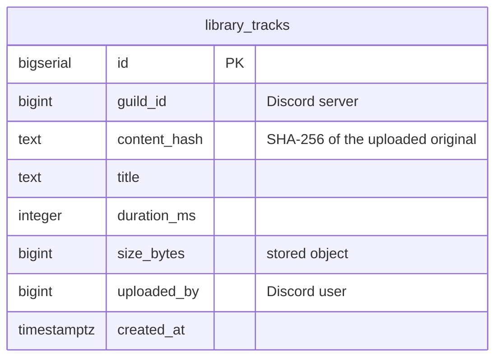
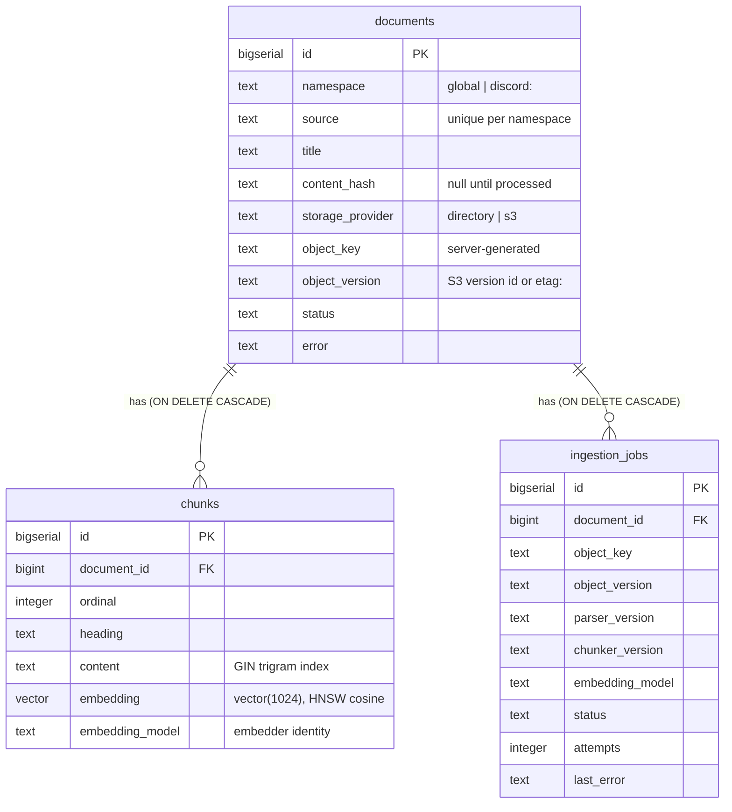
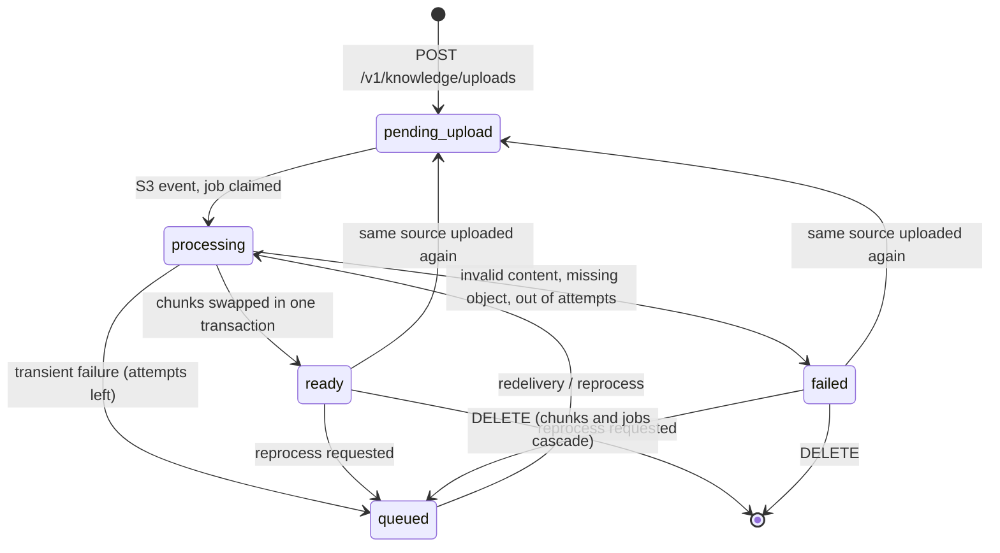

# Database: schema and data lifecycle

Both services can share one Postgres database: Supabase in production, the `postgres`
service of [`compose.yaml`](../../compose.yaml) locally. Each service owns its tables,
applies its own migrations, and keeps its own migration history, so neither can break the
other's.

| Owner | Schema | Tables | Migrations | Applied by | History table |
|---|---|---|---|---|---|
| `discord_bot` | `public` | `library_tracks` | [`discord_bot/migrations/`](../../discord_bot/migrations/) | the bot, on every (re)connect (sqlx) | `_sqlx_migrations` |
| `agent_runtime` | `rag` | `documents`, `chunks`, `ingestion_jobs` | [`agent_runtime/src/agent_runtime/db/migrations/`](../../agent_runtime/src/agent_runtime/db/migrations/) | an operator: `make -C agent_runtime migrate` (never on startup) | `_agent_runtime_migrations` |
| `agent_runtime` | `chat` | `conversations` | same runner (`20261103000000_conversations.sql`) | same | same |

Both are append-only: an applied migration file is never edited (each runner checks a
checksum and refuses), and a schema change is a new file. The SQL files are the source of
truth for column types and constraints; this page explains how the data moves.

Extensions: `pg_trgm` (both services), `vector` (runtime). Both are trusted extensions on
Supabase.

## Music library (`discord_bot`)

* One row per (server, file). The audio is the S3 object `<MUSIC_S3_PREFIX><content_hash>.ogg`,
  shared by every server that uploaded the same file.
* **Upload:** under advisory locks on the server (quota) and the hash, check the quota,
  `PUT` the object if it's new, insert the row, commit.
* **Delete:** under the hash lock, delete the row; delete the object only if no row
  references the hash any more.
* **Orphan sweep:** hourly, objects with no row and older than 1 hour are removed after a
  re-check under the hash lock.
* Details and the race tests: [`discord_bot/docs/outbound-adapters.md` §3](../../discord_bot/docs/outbound-adapters.md#3-pg_libraryrs-and-sqlx).

## Knowledge base (`agent_runtime`, schema `rag`)

Used only with `RAG_STORE=postgres`. The default in-memory store touches no database.

Migrations: `20261031000000_rag.sql` (documents, chunks, HNSW) and
`20261101000000_rag_ingestion.sql` (storage, status, jobs, trigram index).

### Where rows come from

| `storage_provider` | Written by | When |
|---|---|---|
| `directory` | the runtime (`PostgresVectorStore.replace`) | startup and `POST /v1/knowledge/reload`, from `RAG_DOCS_DIR`, into `global` |
| `s3` | the runtime (pending row) and the worker (chunks) | `POST /v1/knowledge/uploads`, then the S3 event |
| `NULL` | rows from before the second migration | treated as ready, never re-ingested |

### Document status

`status` describes the most recent upload or processing run. Whether a document is
retrievable depends only on whether it has chunks for the configured embedding model:

A re-upload or a failed run doesn't remove the live chunks, so the previous version stays
retrievable until a new one is `ready`.

### Ingestion jobs

* Identity: unique on (document, object key, object version, parser version, chunker
  version, embedding model). A duplicate event finds the existing job.
* `queued → processing → succeeded | failed | skipped`. `skipped` means superseded by a
  newer upload, or the same content already indexed under the same configuration.
* `attempts` counts claims. A `processing` job older than `RAG_INGEST_LEASE_SECONDS` is
  taken over (crashed worker).
* Rows stay after success as history. They go with their document and are not otherwise
  pruned (one row per upload or configuration change).

### Locking

Writers lock the document row, then the job row, in every code path
(`PostgresDocumentRepository`), so workers, reprocessing and deletes cannot deadlock.
`RAG_DOCS_DIR` re-indexing takes a transaction-level advisory lock, so runtime replicas
don't interleave.

### Invariants

* A `ready` document has a `content_hash`; an `s3` document has a bucket and key.
* Chunks are replaced only as a complete set, by the attempt that holds the job, and only
  while the document still points at that object.
* Retrieval filters by `namespace` and `embedding_model`; vectors of different models are
  never compared.
* `vector(1024)`: the runtime's config refuses other configured sizes at startup, the store
  compares with the live column type on first use, and every vector is checked on write and
  query.

## Conversation history (`agent_runtime`, schema `chat`)

Used with `CONVERSATION_STORE=postgres` (the GCP deployment, where the runtime scales to
zero on Cloud Run). `chat.conversations` has one row per `conversation_id` (the bot's
`discord:<guild|dm>:<channel>:<user>`), with `messages`, a JSONB array of the runtime's
`ChatMessage`s (role, content, tool calls, tool call id) oldest first, and `updated_at`.

* **Writes:** `append` and `replace_last` lock the row (`SELECT … FOR UPDATE`), change the
  list in the runtime, and upsert it, trimmed to `2 × MAX_HISTORY_MESSAGES`. Refused and
  failed turns are never stored.
* **Retention:** rows idle longer than `CONVERSATION_RETENTION_DAYS` (30) are deleted by
  the runtime, at most once an hour per process, after a write.
* **Failure:** every statement has a 5 s timeout. On a database error `load` returns no
  history and writes are dropped, each logged as a warning; the turn still gets an answer.
* **Contents:** this is user chat text. It is personal data in Supabase, under the same
  backups and access as the library.

## Connections

| Service | Driver | Pooler mode on Supabase | Why |
|---|---|---|---|
| bot | sqlx (`DATABASE_MAX_CONNECTIONS`, default 3) | session (port 5432) | sqlx uses prepared statements |
| runtime | psycopg 3 + psycopg-pool (`DATABASE_POOL_SIZE`, default 5; 2 on Cloud Run) | session | the migration runner holds an advisory lock for the whole session. The app disables prepared statements and uses only transaction-scoped settings and locks, so the transaction pooler (port 6543) should also work for it, but that is untested |

TLS to Supabase is verified (`sslmode=verify-full` with Supabase's root CA, shipped in both
images at `/etc/tatarbot/supabase-root-2021.crt`). Mind the free-tier connection limit when sizing both pools.

## Backups and retention

The database itself is managed by Supabase (see
[infra/gcp/README.md](../../infra/gcp/README.md#persistent-data)). Nothing here deletes data
on a schedule except the bot's orphan sweep, which only removes stored objects that no row
references, and the runtime's history retention (`CONVERSATION_RETENTION_DAYS`).
