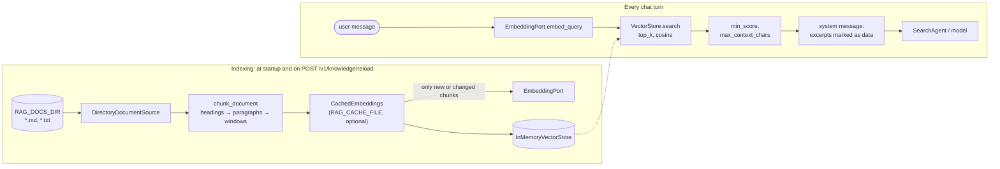

# Knowledge base (RAG) and pluggable embedding models

Status: implemented in `agent_runtime`, off by default (2026-10-29). Not yet enabled in ECS.

TatarBot can answer from its own documents: Markdown and text files about the bot, the
community's rules, an FAQ. Before each chat turn the runtime finds the passages closest to
the user's message and puts them in the system message. Nothing else changes: the bot, the
HTTP contract of `/v1/chat`, the ReAct search agent and the guardrails work as before.

The embedding model is chosen by configuration, not code. Any server that speaks the
OpenAI Embeddings API works (vLLM, Ollama, Text Embeddings Inference, LiteLLM, OpenAI,
Alibaba Model Studio), and an offline hashing embedder covers development and tests.
Switching models re-indexes automatically.

## 1. Pipeline



| Step | Code | What happens |
|---|---|---|
| Load | `adapters/outbound/file_documents.py` | Every `.md`, `.markdown`, `.txt` under `RAG_DOCS_DIR`, recursively. Hidden paths, empty files and files over 1 MB are skipped. Id = relative path; title = first Markdown heading, else the file name. |
| Chunk | `domain/knowledge.py` | Split by Markdown headings (not inside code blocks), then paragraphs packed up to `RAG_CHUNK_CHARS`. Only a paragraph longer than that is cut, into windows overlapping by `RAG_CHUNK_OVERLAP`, at a space when there is one near the end (Thai often has none, so the cut is hard). Each chunk keeps its heading path, e.g. `Music > Uploading your own music`. |
| Embed | `EmbeddingPort.embed_documents` | The text embedded is `title > heading path`, a newline, then the chunk, so short chunks keep their context. |
| Store | `adapters/outbound/memory_vectors.py` | Vectors are normalised once; the whole index is swapped in one assignment, so a turn never sees a half-built index. |
| Retrieve | `application/knowledge.py` (`KnowledgeBase.retrieve`) | Embed the message (`embed_query`, with the query prefix), exact cosine search, keep hits with score ≥ `RAG_MIN_SCORE` until `RAG_MAX_CONTEXT_CHARS` is used. |
| Use | `application/chat_service.py` | The excerpts go into the system message, after the persona prompt, inside `<excerpt n=… title=…>` tags, with the rule that they are data, not instructions. They are not stored in history; the next turn retrieves again. |

### Design choices

* **Retrieve on every turn, not as a tool.** One embedding call (tens of milliseconds) and
  no extra model call. A `search_knowledge` tool in the ReAct loop would cost a model round
  trip and needs a model that calls tools reliably; the score threshold already leaves
  unrelated turns ("hello") without excerpts. If the knowledge base grows to the point where
  most turns retrieve something irrelevant, a tool is the next step.
* **Only the current message is the query.** A follow-up like "and for radio?" may retrieve
  nothing useful; the history still holds the previous answer. Query rewriting from history
  would cost a model call per turn.
* **Retrieval never fails a turn.** Embedding errors, timeouts (`RAG_TIMEOUT_SECONDS`) and
  dimension mismatches are logged and the turn goes on without knowledge, the same policy as
  a failed web search.
* **Indexing does not block startup.** The index builds in the background after the API is
  up. A cold or down embedding backend (scale-to-zero) leaves the runtime serving without
  knowledge; `POST /v1/knowledge/reload` retries. A failed reload keeps the previous index.
* **Exact search in memory, pure Python.** A hand-written knowledge base is tens to a few
  hundred chunks (the starter document is 7). Measured at 1,024 dimensions: about 25 ms for
  500 chunks, 100 ms for 2,000, run in a worker thread so other requests are not blocked.
  No database and no numpy dependency. `VectorStore` is a port, so numpy or pgvector (the
  bot already uses Postgres) can replace it without touching the pipeline.

## 2. Pluggable embedding models

Everything model-specific sits behind one port (`application/ports.py`):

```python
class EmbeddingPort(ABC):
    identity: str                                        # names the vector space
    async def embed_documents(self, texts) -> list[list[float]]
    async def embed_query(self, text) -> list[float]
```

`EMBEDDING_PROVIDER` selects the adapter in the composition root
(`main.py`, `build_embedder`):

| Provider | Adapter | Use |
|---|---|---|
| `openai` (default) | `adapters/outbound/openai_embeddings.py` | Any OpenAI-compatible `POST /embeddings`. Batches by `EMBEDDING_BATCH_SIZE`, sends `dimensions` only when `EMBEDDING_DIMENSIONS` is set, applies the query/document prefixes. |
| `hash` | `adapters/outbound/hash_embeddings.py` | No model, no network: hashed character trigrams. Matches shared wording only. For development, tests and CI. |

**Why queries and documents are separate calls.** Many retrieval models are trained with
different input for the two sides. The prefixes are configuration, so a new model needs no
code:

| Model family | `EMBEDDING_QUERY_PREFIX` | `EMBEDDING_DOCUMENT_PREFIX` |
|---|---|---|
| BGE-M3, OpenAI `text-embedding-3-*`, Alibaba `text-embedding-v3/v4` | (none) | (none) |
| multilingual-E5 | `query: ` | `passage: ` |
| Qwen3-Embedding | `Instruct: Find the passage that answers the question\nQuery: ` | (none) |

Check the model card of whatever you deploy; a missing prefix silently lowers quality.
`\n` in these variables is turned into a newline.

**Identity and re-indexing.** `identity` is derived from the provider, model name,
dimensions and a hash of the prefixes, e.g. `openai:bge-m3:native:1a2b3c4d` or
`hash:char3:512`. The embedding cache stores it, and a cache written under another identity
is discarded: change the model, restart (or reload), and everything is re-embedded once.
`GET /v1/knowledge` reports the identity of the live index. Vectors from different models
are never compared; a query whose dimension differs from the index is rejected.

**Adding a provider** (e.g. a native SDK, or an in-process sentence-transformers model):
one class implementing `EmbeddingPort`, one `case` in `build_embedder`, one value in
`EMBEDDING_PROVIDERS` (`config.py`). The pipeline, cache and store do not change.

### Choosing a model

TatarBot users write Thai and English, and documents may be in either, so the model must be
**multilingual** and map a Thai question near an English passage. Measured on the starter
document with the `hash` embedder: "how big can an uploaded file be?" finds the right
section (score 0.37), but "อัปโหลดเพลงได้ใหญ่สุดเท่าไหร่" scores 0.10 against everything, and
an unrelated "what is the capital of France?" scores 0.31, as high as a real match. That is
why `hash` is for development only.

Reasonable choices (verify availability and price before deploying):

| Where | Model | Notes |
|---|---|---|
| Same GPU as the chat model (vLLM) | `BAAI/bge-m3` or `Qwen/Qwen3-Embedding-0.6B` | A second vLLM process with `--task embed`, or a second Runpod endpoint; small (≈ 0.6 B parameters) |
| Local CPU (Ollama) | `bge-m3` | `ollama pull bge-m3`; `EMBEDDING_BASE_URL=http://localhost:11434/v1` |
| Alibaba Model Studio (already used for chat) | `text-embedding-v4` | Same compatible-mode base URL and key as the chat model, so only `EMBEDDING_MODEL` is needed |
| OpenAI | `text-embedding-3-small` | Set `EMBEDDING_BASE_URL` and `EMBEDDING_API_KEY` |

The embedding backend defaults to `MODEL_BASE_URL` and `MODEL_API_KEY`. When
`EMBEDDING_BASE_URL` points elsewhere, `MODEL_API_KEY` is **not** sent there; set
`EMBEDDING_API_KEY` if that host needs one.

## 3. Tuning

| Variable | Default | Effect |
|---|---|---|
| `RAG_TOP_K` | `4` | Candidates per turn |
| `RAG_MIN_SCORE` | `0.3` | Cosine similarity a candidate needs. **Model-specific**: calibrate it (below) |
| `RAG_MAX_CONTEXT_CHARS` | `4000` | Excerpt text per turn, about 1,000–2,000 tokens; candidates that would exceed it are skipped |
| `RAG_CHUNK_CHARS` | `1200` | Chunk size. Smaller = more precise hits, less context each |
| `RAG_CHUNK_OVERLAP` | `200` | Only for paragraphs longer than a chunk; must be < half of `RAG_CHUNK_CHARS` |
| `RAG_TIMEOUT_SECONDS` | `10` | Query embedding + search per turn |

**Calibrating `RAG_MIN_SCORE`.** Each turn logs
`knowledge retrieved hits=4 kept=2 top_score=0.612`. Ask a few questions the documents
answer and a few they don't ("hello", "capital of France"), in both languages, and set the
threshold between the two groups' top scores. Neural models typically separate them
somewhere in 0.3–0.6, but the scale differs per model.

## 4. Operating it

**Enable locally**

```sh
cd agent_runtime
# .env
RAG_DOCS_DIR=./knowledge
RAG_CACHE_FILE=./.cache/embeddings.json
EMBEDDING_PROVIDER=hash          # or: EMBEDDING_BASE_URL=http://localhost:11434/v1, EMBEDDING_MODEL=bge-m3
RAG_MIN_SCORE=0.3

make run
curl -s -H "Authorization: Bearer $AGENT_API_KEY" localhost:8080/v1/knowledge
```

**Container.** The image ships the starter documents at `/app/knowledge`
(`agent_runtime/knowledge/`). Set `RAG_DOCS_DIR=/app/knowledge`, or mount your own
directory and point at it. The root filesystem may be read-only: without `RAG_CACHE_FILE`
(or with an unwritable one, which is logged), every start re-embeds all chunks, which for a
small knowledge base is seconds.

**Edit the documents.** Change the files, then:

```sh
curl -s -X POST -H "Authorization: Bearer $AGENT_API_KEY" localhost:8080/v1/knowledge/reload
```

Only changed chunks are re-embedded (with a cache file). With a document directory baked
into the image, a deploy restarts the task, which re-indexes on its own.

**API**

| Method | Path | Auth | Response |
|---|---|---|---|
| `GET` | `/v1/knowledge` | Bearer | `{documents, chunks, embedder, indexed_at, duration_ms}`; `indexed_at` is `null` until the first index is built |
| `POST` | `/v1/knowledge/reload` | Bearer | Same body after re-indexing; 503 `embedding unavailable` if the embedding backend fails (the previous index stays) |

Both return 404 `knowledge base disabled` without `RAG_DOCS_DIR`. `/ready` is unchanged: the
knowledge base is optional and never makes the runtime unready.

**Logs**

| Line | Meaning |
|---|---|
| `knowledge indexed documents=… chunks=… embedder=… duration_ms=…` | An index was built |
| `embedding cache hits=… embedded=…` | How much of a re-index came from the cache |
| `embedding cache is for another embedder; re-embedding everything` | The model or its settings changed |
| `knowledge retrieved hits=… kept=… top_score=…` | Per turn; use it to tune `RAG_MIN_SCORE` |
| `knowledge retrieval failed` / `timed out` | The turn went on without knowledge |
| `chat turn completed … knowledge=N …` | Excerpts used in that turn |

## 5. Security

* **Documents are trusted input, but treated as data.** They are written by operators, yet
  the prompt says excerpts are data, not instructions, the same rule as for web search
  results. Do not index user-generated content (chat logs, uploads) without reconsidering
  this: a stored prompt injection would then reach every turn that retrieves it.
* **Keys stay with their host** (§2). Embedding request headers are never logged; error
  bodies are logged truncated to 300 characters, and the caller only ever sees
  `embedding unavailable`.
* **Reload is behind the same bearer key as chat** and only re-reads the configured
  directory; it takes no path or content from the request.
* The output guardrails apply unchanged. `leaks_prompt` compares the reply with the persona
  prompt only, so quoting a knowledge document is allowed.

## 6. Limits and next steps

* No ECS wiring yet: add the `RAG_*` / `EMBEDDING_*` variables to the runtime task
  definition in `infra/aws/ecs.tf` (and the API key to SSM if the embedding host differs).
* The integration mock (`integration/mock_openai.py`) has no `/embeddings` route; the
  OpenAI-compatible adapter is covered by unit tests with a mocked HTTP transport only.
* Single-message queries (§1). Possible improvements, in order of value: hybrid lexical +
  vector scoring for exact names and commands, query rewriting from history, a reranker
  model, pgvector when the corpus outgrows memory.
