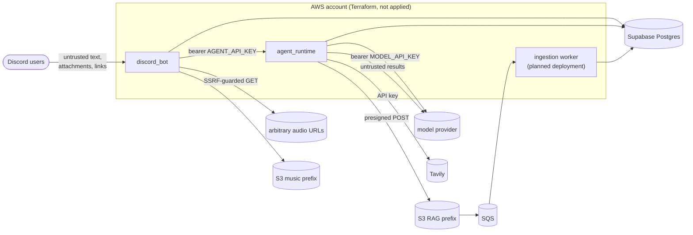

# Security and access control

A map of trust boundaries and controls, with links to where each is implemented and
described in detail. It covers what exists. Items marked *planned* are designed, not built.

## Trust boundaries

| Input | Treated as | Controls |
|---|---|---|
| Chat messages | untrusted | input guardrails (prompt-injection patterns), output guardrails (prompt leaks, secret-looking strings): `agent_runtime/src/agent_runtime/domain/guardrails.py` |
| Web search results, knowledge excerpts | untrusted data, never instructions | marked as data in the system message; sources footer built from the actual results |
| Model tool calls (`play_music`) | untrusted | station must be one the bot sent; actions limited to play/play_track/skip/stop/queue; at most 2 per reply; links in track names dropped by the runtime and refused by the bot ([root README §6](../README.md#6-security)) |
| `/play` URLs | untrusted | SSRF-safe resolver (no private, loopback, link-local, CGNAT addresses), every redirect re-checked: `discord_bot/src/adapters/outbound/audio_http.rs` |
| `/upload` audio | untrusted | Discord CDN hosts only, size capped while streaming, ffprobe validation, hardened minimal ffmpeg build: `ffmpeg.rs`, `attachment_fetch.rs` |
| Knowledge uploads | untrusted content from a trusted caller | server-generated keys, S3-enforced size, type detected from bytes, text/Markdown only ([rag.md §7.2](architecture/rag.md#72-what-is-trusted)) |

## Access control

| Who | Can | Enforced by |
|---|---|---|
| Any member who can mention the bot | chat; control music through chat within the music rules | Discord; `MusicUseCase` |
| Member in the bot's voice channel | play, skip, stop, queue | `MusicUseCase` (`discord_bot/src/application/use_cases/music.rs`) |
| Role `MUSIC_UPLOAD_ROLE` (default `DJ`) or Manage Server | upload, delete others' tracks | `discord_bot` library commands |
| Holder of `AGENT_API_KEY` (the bot, operators) | every runtime `/v1/*` route, including knowledge uploads and deletes in **any** namespace | `http_api.py` bearer check |
| A chat turn | read knowledge from `global` and its own server's namespace only | namespaces derived from `conversation_id` on the server (`domain/ingestion.py`, `retrieval_namespaces`) |

The runtime has no per-user identity. Any future bot command that manages knowledge
documents must check Discord permissions itself before calling the runtime. Letting
ordinary members upload would also let them plant prompt injections that every chat in
their server retrieves.

## Secrets

* Never in the repository, images, Terraform variables or state. Locally they live in
  git-ignored `.env` files (the runtime's `make env` creates its file with mode 600; the
  bot's copies `.env.example` as is, so restrict it yourself). In ECS they come from SSM Parameter
  Store SecureStrings, injected at task start and readable only by that service's execution
  role ([infra/aws/README.md](../infra/aws/README.md#security-notes)).
* AWS access from code uses the default credential chain (task roles); no access keys in
  configuration. Deploys use GitHub OIDC, no stored keys.
* The runtime sends `MODEL_API_KEY` to the embedding server only when the embedding URL is
  defaulted to the model's: a key never goes to a host it wasn't configured for
  (`config.py`, `_embedding_from_env`).
* Secret settings are excluded from `repr` (`config.py`, `field(repr=False)`); upstream
  error bodies are logged truncated and never returned to callers.

## Network

* No inbound internet access to either service: no security group admits it, no SSH
  (Session Manager instead). The runtime is reachable only from the bot (Docker bridge on
  EC2, security-group-to-security-group on Fargate).
* Containers can't reach the instance role (IMDSv2, hop limit 1).
* TLS to Supabase is verified against its root CA (`sslmode=verify-full`).

## IAM (least privilege)

| Role | Permissions | Status |
|---|---|---|
| Execution roles (per service) | own ECR repo, own log group, own SSM parameters | Terraform, not applied |
| Bot task role | get/put/delete/list under the music prefix | Terraform, not applied |
| GitHub deploy role | ECR push, task definitions, service update; assumable only from the `production` environment | Terraform, not applied |
| Runtime task role (uploads) | `s3:PutObject`, `s3:DeleteObject` on the RAG prefix, `sqs:SendMessage` | *planned* ([rag.md §7.6](architecture/rag.md#76-deployment-requirements-not-built-yet)) |
| Worker task role | `s3:GetObject` on the RAG prefix, receive/delete/change-visibility on the queue | *planned* |

## Containers

Both images run as non-root users with no secrets baked in. The bot's image is distroless
(no shell) with a read-only root filesystem in ECS (`/tmp` is a scratch volume). The
runtime's is `python:3.12-slim` with a virtualenv.

