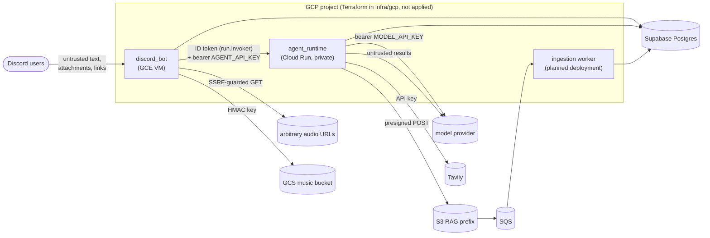

# Security and access control

A map of trust boundaries and controls, with links to where each is implemented and
described in detail. It covers what exists. Items marked *planned* are designed, not built.

## Trust boundaries

| Input | Treated as | Controls |
|---|---|---|
| Chat messages | untrusted | input guardrails (prompt-injection patterns), output guardrails (prompt leaks, secret-looking strings): `agent_runtime/src/agent_runtime/domain/guardrails.py` |
| Web search results, knowledge excerpts | untrusted data, never instructions | marked as data in the system message; sources footer built from the actual results |
| Model tool calls (`play_music`) | untrusted | station must be one the bot sent; actions limited to play/play_track/skip/stop/queue; at most 2 per reply; links in track names dropped by the runtime and refused by the bot ([root README §6](../README.md#6-security)) |
| `/play` URLs | untrusted | SSRF-safe resolver (no private, loopback, link-local, CGNAT addresses), every redirect re-checked: `discord_bot/src/adapters/outbound/audio_http.rs` |
| `/upload` audio | untrusted | Discord CDN hosts only, size capped while streaming, ffprobe validation, hardened minimal ffmpeg build: `ffmpeg.rs`, `attachment_fetch.rs` |
| Knowledge uploads | untrusted content from a trusted caller | server-generated keys, S3-enforced size, type detected from bytes, text/Markdown only ([rag.md §7.2](architecture/rag.md#72-what-is-trusted)) |

## Access control

| Who | Can | Enforced by |
|---|---|---|
| Any member who can mention the bot | chat; control music through chat within the music rules | Discord; `MusicUseCase` |
| Member in the bot's voice channel | play, skip, stop, queue | `MusicUseCase` (`discord_bot/src/application/use_cases/music.rs`) |
| Role `MUSIC_UPLOAD_ROLE` (default `DJ`) or Manage Server | upload, delete others' tracks | `discord_bot` library commands |
| Holder of `AGENT_API_KEY` (the bot, operators) | every runtime `/v1/*` route, including knowledge uploads and deletes in **any** namespace | `http_api.py` bearer check; on GCP also Cloud Run IAM (below) |
| The VM's service account (GCP) | invoke the Cloud Run runtime (`roles/run.invoker` on that service); nobody else can reach it | Cloud Run IAM + internal ingress (`infra/gcp/cloudrun.tf`) |
| A chat turn | read knowledge from `global` and its own server's namespace only | namespaces derived from `conversation_id` on the server (`domain/ingestion.py`, `retrieval_namespaces`) |

The runtime has no per-user identity. Any future bot command that manages knowledge
documents must check Discord permissions itself before calling the runtime. Letting
ordinary members upload would also let them plant prompt injections that every chat in
their server retrieves.

## Secrets

* Never in the repository, images, Terraform variables or state. Locally they live in
  git-ignored `.env` files (the runtime's `make env` creates its file with mode 600; the
  bot's copies `.env.example` as is, so restrict it yourself). On GCP they live in Secret
  Manager, readable per secret by the consuming service's identity only: the VM's host
  writes the bot's to tmpfs at each start, Cloud Run injects the runtime's at instance start
  ([infra/gcp/README.md](../infra/gcp/README.md#identity-secrets-and-the-metadata-server)).
* The bot calls the runtime with a Google ID token that the host mints and refreshes; the
  bot container never holds a service-account credential (it can't reach the metadata
  server). The one long-lived credential is the music bucket's HMAC key (one bucket only).
  Deploys use Workload Identity Federation, no stored keys.
* The runtime sends `MODEL_API_KEY` to the embedding server only when the embedding URL is
  defaulted to the model's: a key never goes to a host it wasn't configured for
  (`config.py`, `_embedding_from_env`).
* Secret settings are excluded from `repr` (`config.py`, `field(repr=False)`); upstream
  error bodies are logged truncated and never returned to callers.

## Network

* No inbound internet access to either service. The VM's firewall admits only IAP's range
  on port 22 (OS Login). The runtime's Cloud Run ingress is internal (this project's VPC)
  and invocation requires IAM, granted to the VM's identity only.
* The bot container can't reach the metadata server (iptables `DOCKER-USER` rules; the unit
  refuses to start without them), so it never gets the VM's service account.
* TLS to Supabase is verified against its root CA (`sslmode=verify-full`).

## IAM (least privilege)

GCP (`infra/gcp`, not applied); the full table is in
[infra/gcp/README.md](../infra/gcp/README.md#identity-secrets-and-the-metadata-server).

| Identity | Permissions |
|---|---|
| `tatarbot-vm` (host only) | pull the bot image, read the bot's secrets, `run.invoker` on the runtime service, write logs and metrics |
| `tatarbot-runtime` (Cloud Run) | read the runtime's secrets |
| `tatarbot-music` (HMAC key) | object user on the music bucket |
| `tatarbot-deploy` (GitHub, `production` environment only) | push both images; OS Login with sudo and IAP on the VM; `run.developer` on the runtime service and actAs its identity |
| Upload and worker identities | *planned* ([rag.md §7.6](architecture/rag.md#76-deployment-requirements-not-built-yet)) |

## Containers

Both images run as non-root users with no secrets baked in. The bot's image is distroless
(no shell) with a read-only root filesystem on the VM (`/tmp` is a scratch volume, the ID
token a read-only mount). The
runtime's is `python:3.12-slim` with a virtualenv.

## Chat cost controls (OWASP API4)

Every chat turn costs model tokens and up to `SEARCH_MAX_SEARCHES` web searches, so the bot
admits a turn *before* doing any work for it (`application/use_cases/chat_limits.rs`):

| Limit | Default | Setting |
|---|---|---|
| Per member | 3 at once, then 6 per minute | `CHAT_USER_BURST`, `CHAT_USER_PER_MINUTE` |
| Per server (all members) | 10 at once, then 30 per minute | `CHAT_GUILD_BURST`, `CHAT_GUILD_PER_MINUTE` |
| In flight / waiting / max wait | 4 / 8 / 15 s | `CHAT_MAX_CONCURRENT`, `CHAT_MAX_QUEUED`, `CHAT_QUEUE_TIMEOUT_SECS` |

* **The agent can't be called without admission.** `ChatService::chat` takes the
  `ChatPermit` that `admit` returns. A refused message costs no model call, no search, no
  library query and no typing indicator.
* **Busy refusals are refunded,** so they don't use up the member's or server's budget.
* **At most one "slow down" reply per member per 30 s,** so the limiter can't be used to
  make the bot spam a channel.
* **Behind the bot:**
  * the runtime's Cloud Run limits (1 instance, concurrency 10, `TURN_TIMEOUT_SECONDS`);
  * `SEARCH_MAX_SEARCHES` per turn;
  * the project budget alerts.

Worst case with the defaults: one busy server can make at most about 30 turns a minute,
and all servers together at most 4 at a time. Lower `CHAT_GUILD_PER_MINUTE` or
`CHAT_MAX_CONCURRENT` to cap model spend further.

## OWASP API Security Top 10 (2023)

Reviewed 2026-11-03 for the agent runtime, the ingest worker and the bot's outbound calls.
Code-level controls are tested. The GCP-level ones (ingress, IAM) are verified after
deployment (`infra/gcp/README.md`).

| Risk | Controls | Tests |
|---|---|---|
| API1 Object-level authorization | Library rows scoped by guild in every query. Ingest jobs scoped to their producer. RAG namespaces derived on the server from the conversation id, which the bot builds from Discord ids, never from message text. The bot never calls the runtime's knowledge or admin routes. | `pg_tracks_are_isolated_per_guild`, `only_the_uploader_or_a_manager_deletes`, ingest `pg_cancelling…` (other producer: not found) |
| API2 Authentication | Runtime: Cloud Run IAM plus an API key compared in constant time. Ingest: Google ID tokens verified in the app (signature, `aud`, `iss`, `exp`, `email_verified`); stripped signatures rejected. No long-lived cloud keys except the HMAC key until ADR 0004 phase 4. | `ingest-core` `auth` and `tests/http.rs` |
| API3 Property-level authorization | Typed request bodies with length limits. The job API never receives Discord data or interaction tokens. | `pg_upload_submits_with_the_id_token_and_a_generic_contract` |
| API4 Resource consumption | Chat admission control (above). Upload limits (25 MiB, per-member and per-server ingest limits, guild quota, ffmpeg rlimits). Max instances and concurrency on every Cloud Run service. Budget brake. | `chat_limits` tests, `spam_reaches_the_agent_only_for_admitted_turns`, ingest admission tests |
| API5 Function-level authorization | Ingest `/internal/*` only for the tasks invoker; `/v1/*` only for registered producers. | `tests/http.rs` |
| API6 Sensitive business flows | Upload and chat limits, quotas, the kill switch. | as API4 |
| API7 SSRF | Bot links: public-only DNS at connect time (rebinding-safe), IP literals checked on the URL and every redirect, at most 5 redirects, http(s) only. Chat can never play a link. Ingest: exact HTTPS host allowlist re-checked on every redirect, public-only DNS, allowlisted IP literals must be public. ffmpeg opens local files only. | `audio_http` (obfuscated literals, rebinding, redirects), `fetch` (parser tricks, metadata redirect, private DNS), `links_are_never_played_from_chat` |
| API8 Security misconfiguration | Runtime `/docs`, `/redoc` and `/openapi.json` off unless `API_DOCS_ENABLED=true` (only `make dev`). Internal ingress, deny-all firewall, distroless non-root read-only containers. | `test_api_docs_are_off_by_default` |
| API9 Inventory | All routes in code, versioned (`/v1`), documented. | – |
| API10 Unsafe consumption of APIs | Model output: guardrails, and actions limited to a fixed set (at most 2, run as the requesting member under the music rules). Untrusted text (search results, knowledge, member-uploaded titles, stream titles) is flattened, bounded and labelled as data, not instructions. Tool arguments validated against the offered stations and lengths. | `test_library_titles_are_quoted_and_marked_as_data`, `test_arguments_are_validated`, `at_most_two_actions_run` |

**Residual risks:**
* Prompt injection can't be fully prevented. Its effect is limited to the actions above,
  which the requesting member could take anyway.
* No dependency scanning in CI yet.
* No alerting on authentication-failure spikes yet.
* The HMAC key remains until ADR 0004 phase 4.
