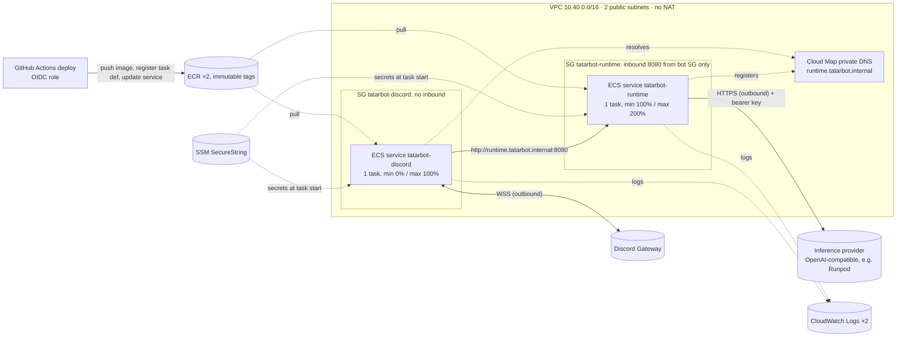

# TatarBot on AWS ECS Fargate (Terraform)

**Status: prepared, never applied.** `terraform fmt` and `terraform validate` pass offline;
no `plan` or `apply` has been run and no AWS resource exists. Applying creates billable
resources.

Why this shape (Fargate over EC2, Supabase + S3 over SQLite/EFS, one bot task) is in the
[top-level README](../../README.md#8-deployment). The music library's resources (`music.tf`)
are off unless `music_library_enabled = true`.

## What it creates



| File | Resources |
|---|---|
| `network.tf` | VPC, IGW, 2 public subnets, route table, locked-down default SG, SGs for bot and runtime, Cloud Map namespace `tatarbot.internal` + service `runtime` |
| `ecr.tf` | ECR `tatarbot-discord`, `tatarbot-runtime` (immutable tags, scan on push, lifecycle: 20 images, untagged 7 days) |
| `ecs.tf` | Cluster (Fargate only), log groups, initial task definitions, services `tatarbot-discord` and `tatarbot-runtime` |
| `iam.tf` | Per-service execution roles (own image, own log group, own secrets only), GitHub OIDC provider + deploy role |
| `music.tf` | Only with `music_library_enabled`: private S3 bucket for library audio (public access blocked, TLS only, SSE-S3), the bot's task role (get/put/delete under `music_library_prefix`, list that prefix) |
| `budget.tf` | Monthly budget with email alerts (only if `budget_email` is set) |

## Networking and service discovery

* **Bot → runtime** uses Cloud Map private DNS: the runtime service registers its task IP
  as an A record `runtime.tatarbot.internal` (TTL 10 s), resolvable only inside the VPC.
  The bot's `AGENT_BASE_URL` is `http://runtime.tatarbot.internal:8080`. Plain HTTP stays
  inside the VPC; the bearer `AGENT_API_KEY` is still required.
* **The runtime is not reachable from the internet.** Its security group admits TCP 8080
  only from the bot's security group. Tasks have public IPv4 addresses purely for outbound
  traffic, because there is no NAT gateway.
* **Why not Service Connect?** It adds an Envoy sidecar to every task (CPU/memory on a
  0.25 vCPU task, more moving parts) for retries/metrics we don't need at one request at a
  time. Cloud Map DNS is enough for one caller and one callee.
* **Why not an internal ALB?** An ALB bills hourly plus LCUs. It would add health-checked
  routing and connection draining, which matter at more replicas, not at one.
* **Why not private subnets?** Tasks would need a NAT gateway (hourly plus per-GB) or VPC
  interface endpoints for ECR API, ECR DKR, Logs and SSM (hourly per endpoint per AZ), plus
  NAT anyway for Discord and the inference provider. Either typically costs more than the two
  Fargate tasks combined. Switch to private subnets + NAT if a policy forbids public IPs.

DNS caveat: after a runtime redeploy, a pooled keep-alive connection in the bot can point
at the old task until it fails. Such a message gets the bot's "can't reach my brain" reply
and the next one resolves the new IP. Acceptable at this scale; Service Connect or an ALB
removes it.

## Cost items (verify current prices for your region before applying)

Rates change and are not quoted here. Items that bill:

* Fargate vCPU-hours and GB-hours for two always-on tasks (0.25 vCPU / 0.5 GB each by
  default).
* Public IPv4 addresses: one per running task, billed hourly.
* CloudWatch Logs ingestion and storage (14-day retention).
* ECR storage (lifecycle keeps ≤ 20 images per repo) and image scanning on push.
* Cloud Map: hosted zone for the private namespace, DNS queries.
* SSM Parameter Store standard parameters: expected free; Secrets Manager was avoided
  because it bills per secret.
* Inference provider usage is billed by that provider, not AWS. Cap it there.

Not created, deliberately: NAT gateway, load balancers, VPC endpoints, Container Insights,
KMS customer-managed keys.

## Apply order (when you decide to)

```sh
cd infra/aws
cp terraform.tfvars.example terraform.tfvars   # set model_base_url, model_name, budget_email
terraform init
terraform plan                                 # review: only the resources listed above
terraform apply                                # services start with desired count 0
```

1. **Create the secrets** (SecureString, default `aws/ssm` key; values never touch Terraform
   state or the repository):

   ```sh
   aws ssm put-parameter --type SecureString --name /tatarbot/discord/DISCORD_TOKEN --value "$DISCORD_TOKEN"
   aws ssm put-parameter --type SecureString --name /tatarbot/shared/AGENT_API_KEY  --value "$(python3 -c 'import secrets; print(secrets.token_urlsafe(32))')"
   aws ssm put-parameter --type SecureString --name /tatarbot/runtime/MODEL_API_KEY --value "$MODEL_API_KEY"
   # Web search (skip, and set web_search_enabled = false, to run without it)
   aws ssm put-parameter --type SecureString --name /tatarbot/runtime/TAVILY_API_KEY --value "$TAVILY_API_KEY"
   # Music library, only with music_library_enabled = true (Supabase, session mode, verified TLS;
   # see discord_bot/README.md):
   aws ssm put-parameter --type SecureString --name /tatarbot/discord/DATABASE_URL --value "$DATABASE_URL"
   ```

2. **Configure GitHub**: create the `production` environment (add required reviewers) and set
   the variables from `terraform output github_actions_variables`: `AWS_REGION`,
   `AWS_DEPLOY_ROLE_ARN`, `ECS_CLUSTER`.
3. **Deploy each service once** (Actions → *Deploy runtime* / *Deploy discord*). This pushes
   `sha-<commit>` images and registers real task definitions.
4. **Scale up**: set `runtime_desired_count = 1` and `discord_desired_count = 1`, then
   `terraform apply`. Deploy the runtime before the bot.
5. **Check**: CloudWatch log group `/ecs/tatarbot-runtime` shows `agent runtime started`;
   `/ecs/tatarbot-discord` shows `connected to Discord`; a mention in Discord gets a reply.

Tear down with `terraform destroy` (ECR repositories must be empty first:
`aws ecr batch-delete-image` or delete images in the console).

## Operational notes

* **Health checks**: the runtime container checks `/health` (liveness). `/ready` is not used,
  because it calls the inference backend and could wake or bill a scale-to-zero endpoint
  on every probe. The bot has no HTTP port; ECS restarts it if the process exits.
* **Timeouts**: bot → runtime 120 s (`AGENT_TIMEOUT_SECS`) > runtime → model 100 s
  (`MODEL_TIMEOUT_SECONDS`). No load balancer sits in between, so no idle timeout applies.
* **Graceful shutdown**: the runtime drains in-flight requests on SIGTERM
  (`stopTimeout` 120 s, the Fargate maximum). The bot closes its gateway connection on
  SIGTERM within 5 s (`stopTimeout` 30 s); a reply still being generated at that moment is
  lost.
* **Deployments**: the bot stops the old task before starting the new one (no duplicate
  replies; a few seconds offline). The runtime starts the new task first; history lives in
  memory, so a runtime deploy resets conversations.
* **Failure**: the circuit breaker rolls a service back if new tasks keep failing.
* **State**: Terraform state is local. Move it to an S3 backend before more than one
  person or a pipeline applies.

## CI/CD (GitHub Actions)

| Workflow | Runs when | Does |
|---|---|---|
| `ci-runtime.yml` | `agent_runtime/**`, `integration/**`, `compose.yaml` change | ruff, pytest, image build, integration tests |
| `ci-discord.yml` | `discord_bot/**`, `compose.yaml` change | fmt, clippy, unit tests; library integration tests (Postgres races and search, RustFS, ffmpeg) and the `.sqlx` check; image build, startup and SIGTERM smoke tests |
| `ci-inference.yml` | `model-inference/**` change | inference Compose config, endpoint smoke test against the mock model |
| `ci-repo.yml` | `.github/**`, compose files, `infra/**` change | actionlint, `docker compose config`, `terraform fmt` + `validate` (offline) |
| `deploy-runtime.yml` / `deploy-discord.yml` | manual only | via `_deploy-ecs.yml`: push a `sha-<commit>` image to ECR (skipped if it exists), register a task-definition revision, rolling ECS update |

CI uses `pull_request` (not `pull_request_target`), read-only tokens and no secrets, so fork
PRs run safely. Deploys run in the `production` GitHub environment and assume an AWS role
through OIDC that trusts only that environment of this repository; they refuse commits that
are not on `main`, and fail with a clear message until the AWS variables are set.
