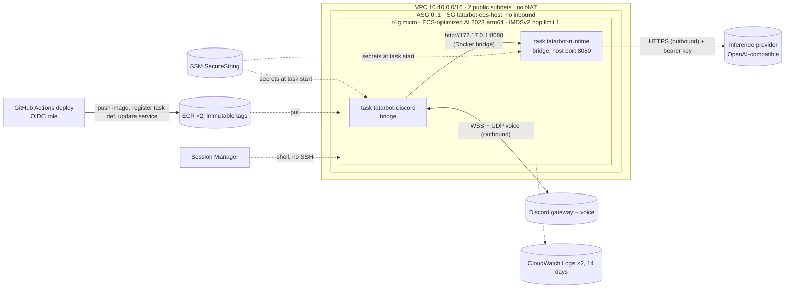

# TatarBot on AWS ECS (Terraform)

**Status: prepared, never applied.** `terraform fmt` and `validate` pass, and `terraform plan`
succeeds against the real account for both launch types (35 resources for EC2, 34 for
Fargate, nothing changed or destroyed). No `apply` has been run and no TatarBot resource
exists in AWS. Applying creates billable resources.

Two ways to run the same two ECS services (`tatarbot-discord`, `tatarbot-runtime`),
chosen with `launch_type`:

* **`EC2` (default): one Graviton instance (t4g.micro) runs both tasks.** About $15/month
  around the clock, or about $3 with 4 hours a day of scheduled on-hours.
* **`FARGATE`: one ARM64 task per service.** About $26.50/month around the clock. No host
  to patch.

Costs, assumptions and the other options are in [Cost](#cost-ap-southeast-1). Why the
services are shaped this way (Supabase + S3 instead of SQLite/EFS, one bot task) is in the
[top-level README](../../README.md#8-deployment). The music library's resources (`music.tf`)
are off unless `music_library_enabled = true`.

## What it creates (EC2)



With `launch_type = "FARGATE"`, each task gets its own ENI, security group and public IP,
and the bot reaches the runtime at `http://runtime.tatarbot.internal:8080` through Cloud
Map private DNS. The runtime's security group admits only the bot's.

| File | Resources |
|---|---|
| `network.tf` | VPC, IGW, 2 public subnets, route table, locked-down default SG. EC2: the instance's SG (no inbound). Fargate: per-service SGs and Cloud Map `tatarbot.internal` |
| `ec2.tf` | EC2 only: instance role and profile (ECS agent + Session Manager), launch template, ASG (0..1, instance refresh), optional start/stop schedule |
| `ecs.tf` | Cluster, log groups, initial task definitions, both services |
| `ecr.tf` | ECR `tatarbot-discord`, `tatarbot-runtime` (immutable tags, scan on push, keep `ecr_keep_images` = 10, untagged 7 days) |
| `iam.tf` | Per-service execution roles (own image, own log group, own secrets only), GitHub OIDC provider and deploy role |
| `music.tf` | Only with `music_library_enabled`: private S3 bucket (public access blocked, TLS only, SSE-S3) and the bot's task role (get/put/delete under the prefix, list it) |
| `budget.tf` | Monthly budget with email alerts (only if `budget_email` is set) |

## How the EC2 layout works

* **Capacity.** An Auto Scaling Group with `min 0 / max 1` keeps one instance registered in
  the cluster (`ECS_CLUSTER` in user data). There is no capacity provider; both services
  use `launch_type = "EC2"` and ECS places them on whichever instance is registered. A
  placement constraint (`ecs.cpu-architecture == arm64`) keeps them off a wrong-architecture
  instance: the task stays pending instead of failing with `exec format error`.
* **Resources.** On EC2 the task definitions have no task-level size. Each container has a
  hard memory limit (`*_memory`, 512 MiB) and a reservation that placement counts
  (`*_memory_reservation`, 192 MiB). A t4g.micro registers about 900 MiB, so both
  reservations fit, and either container can burst past its reservation. Measured locally:
  the runtime idles at about 70 MiB and the bot at about 7 MiB offline. The bot's real use
  while connected and playing **has not been measured**. ffmpeg runs inside the bot
  container during uploads, capped at 512 MiB address space. If the instance runs short,
  use `ec2_instance_type = "t4g.small"`.
* **CPU.** Both containers share the instance's 2 vCPUs. A t4g.micro's baseline is 10% per
  vCPU; radio decode + Opus encode should stay under it. `ec2_cpu_credits = "unlimited"`
  (default) never throttles, but bills sustained use above baseline. `standard` caps the
  cost and throttles instead.
* **Bot → runtime.** Both tasks use bridge networking. The runtime publishes port 8080 on
  the instance, and the bot calls `http://172.17.0.1:8080`, the Docker bridge gateway. The
  security group has no inbound rules, so the port is unreachable from the network, and
  the bearer `AGENT_API_KEY` is still required. A fixed host port fits one runtime task per
  instance, so the runtime deploys stop-then-start (`min 0% / max 100%`), like the bot.
* **Credentials.** IMDSv2 is required with a hop limit of 1, so bridge-networked
  containers can't reach the instance metadata service or the instance role. The bot gets
  its own task role (S3 library) from the ECS agent's credential endpoint; the runtime has
  none. Host networking was rejected because it would expose the instance role to both
  containers.
* **Restarts.** A crashed container restarts in place (`restartPolicy`, at most once per
  60 s). If the task keeps failing, the service replaces it, and the circuit breaker rolls
  back a bad deploy. If the instance fails an EC2 status check, the ASG replaces it. Both
  services are down meanwhile, because **there is one instance: this is not highly
  available.**
* **Health checks.** The runtime container checks `/health` (liveness). `/ready` is not
  used, because it calls the inference backend and could wake or bill a scale-to-zero
  endpoint on every probe. The bot has no HTTP port; a process exit triggers the restart.
* **Patching.** The AMI is read from AWS's public parameter
  `/aws/service/ecs/optimized-ami/amazon-linux-2023/arm64/recommended/image_id` at plan
  time. When AWS publishes a new one, `terraform plan` shows a launch-template change.
  Applying it replaces the instance (terminate, launch, a few minutes offline).
* **Access.** No SSH key and no inbound rule. Shell access is Session Manager (free):
  `terraform output -raw ecs_instance_shell` prints the command.

## Persistent data and backups

Nothing on the instance or in a task needs to survive. The root volume is deleted with the
instance.

| Data | Where | Survives restart, redeploy, instance replacement? | Backup |
|---|---|---|---|
| Images | ECR (last `ecr_keep_images`) | yes | rebuild from git |
| Secrets | SSM Parameter Store | yes | keep your own copy; Terraform never sees them |
| Library metadata | Supabase Postgres (free tier) | yes | Supabase's own backups; `pg_dump` if you need more |
| Library audio | S3 bucket (no versioning) | yes | none: a delete is final, by design (refcounted) |
| Conversation history | runtime process memory | **no**: lost on every runtime restart or deploy | none |
| Logs | CloudWatch, `log_retention_days` = 14 | yes, 14 days | none |

SQLite was not added: nothing in the stack needs it, and on this layout it would need a
persistent volume, which is exactly what the instance doesn't have.

## Cost (ap-southeast-1)

Rates come from the AWS Price List API (October 2026, on-demand, no free tier or credits
assumed): t4g.nano $0.0053/h, t4g.micro $0.0106/h, t4g.small $0.0212/h; gp3 $0.096/GB-month;
public IPv4 $0.005/h; Fargate ARM $0.04045/vCPU-h + $0.00442/GB-h; CloudWatch Logs
$0.70/GB ingested + $0.03/GB-month; ECR $0.10/GB-month; S3 Standard $0.025/GB-month; data
out to the internet $0.12/GB; Route 53 private zone $0.50/month. Check them again before
applying.

**Usage assumptions:**
- One Discord community and one active voice channel.
- 60 hours of music a month, at 128 kbit/s Opus out (3.5 GB).
- 0.2 GB of logs a month and a 2 GB library.
- 10 image versions of about 43 MB (bot) and 76 MB (runtime) compressed each, as measured.
- A month is 730 hours.

Costs that apply to every option (logs $0.14, ECR $0.12, S3 $0.05, data out $0.41) add up
to $0.73 and are included in every row below.

| Option | Compute | Disk | Public IPv4 | Other | **Month** |
|---|---|---|---|---|---|
| A. EC2 t4g.micro, 24/7 (default) | $7.74 | $2.88 | $3.65 | $0.73 | **$15.00** |
| A. EC2 t4g.small, 24/7 | $15.48 | $2.88 | $3.65 | $0.73 | **$22.74** |
| A. EC2 t4g.micro, 5 h/day schedule | $1.61 | $0.60 | $0.76 | $0.73 | **$3.70** |
| A. EC2 t4g.micro, 4 h/day schedule | $1.29 | $0.48 | $0.61 | $0.73 | **$3.11** |
| A. EC2 t4g.micro, 3 h/day schedule | $0.97 | $0.36 | $0.46 | $0.73 | **$2.51** |
| B. Fargate ARM64 2 × (0.25 vCPU, 0.5 GB), 24/7 | $17.99 | incl. | $7.30 | $1.23 | **$26.52** |
| B. Fargate ARM64, 5 h/day | $3.75 | incl. | $1.52 | $1.23 | **$6.50** |
| B. Fargate ARM64, 4 h/day | $3.00 | incl. | $1.22 | $1.23 | **$5.45** |
| C. Local Ubuntu host, AWS for S3 only | n/a | n/a | n/a | ~$0.10–0.50 | **< $0.50** |

**What the table assumes:**
- **The largest costs**, in order, are compute, the public IPv4 address, and the 30 GB root
  volume.
- **The floor for an always-on instance is about $10.40.** That's a t4g.nano, too small for
  both services, plus its volume and IPv4 address, before any usage. The ECS-optimized
  AMI's snapshot is 30 GB, which sets the volume's minimum size.
- **Scheduled EC2 terminates the instance** when the ASG scales to 0, so the volume and
  IPv4 address stop billing too. A *stopped* instance would keep billing for its volume
  ($2.88).
- **Scheduled Fargate** isn't implemented here. It would set both services' desired count
  on a timer, and the Cloud Map zone keeps billing either way.
- **Data out:** the first 100 GB a month to the internet are covered by AWS's permanent
  free allowance. The table leaves it out anyway, so that's a $0.41 margin.
- **Not created, deliberately:** a NAT gateway (about $43/month plus per-GB in Singapore), a
  load balancer, VPC endpoints, Container Insights, KMS keys, detailed monitoring.
- **Billed outside AWS, not in the table:**
  - Model API usage, billed by the provider. Cap it there.
  - Tavily search.
  - Supabase (free tier).
- **Free:** SSM standard parameters, Session Manager, the ASG and its schedules, and the
  first two AWS Budgets.

### Comparing the options

| | A. ECS on one EC2 Graviton instance | B. ECS Fargate ARM64 | C. Local Ubuntu host |
|---|---|---|---|
| Cost 24/7 | ~$15 | ~$26.50 | electricity and your connection |
| Reliability | one instance; ASG replaces it in minutes; both services share its fate | each task replaced independently and quickly; no host to fail | your machine, power and ISP; no automatic recovery |
| Operations | AMI refresh by `terraform apply`; memory sharing to watch | nothing below the container | everything: OS, Docker, restarts, uplink |
| Limitations | not HA; one runtime task (fixed port); credit-based CPU | costs most; two IPv4 addresses | home NAT, dynamic IP, uptime; fine for development |

## Apply order (when you decide to)

```sh
cd infra/aws
cp terraform.tfvars.example terraform.tfvars   # model_base_url, model_name, budget_email
terraform init
terraform plan                                 # review: only the resources listed above
terraform apply                                # services start at desired count 0
```

The images must be `linux/arm64` (CI builds them that way) to match `cpu_architecture`.

1. **Create the secrets** (SecureString, default `aws/ssm` key; values never touch
   Terraform state or the repository):

   ```sh
   aws ssm put-parameter --type SecureString --name /tatarbot/discord/DISCORD_TOKEN --value "$DISCORD_TOKEN"
   aws ssm put-parameter --type SecureString --name /tatarbot/shared/AGENT_API_KEY  --value "$(python3 -c 'import secrets; print(secrets.token_urlsafe(32))')"
   aws ssm put-parameter --type SecureString --name /tatarbot/runtime/MODEL_API_KEY --value "$MODEL_API_KEY"
   # Web search (skip, and set web_search_enabled = false, to run without it)
   aws ssm put-parameter --type SecureString --name /tatarbot/runtime/TAVILY_API_KEY --value "$TAVILY_API_KEY"
   # Music library, only with music_library_enabled = true (Supabase, session mode, verified TLS;
   # see discord_bot/README.md):
   aws ssm put-parameter --type SecureString --name /tatarbot/discord/DATABASE_URL --value "$DATABASE_URL"
   ```

2. **Configure GitHub**: create the `production` environment (add required reviewers) and set
   the variables from `terraform output github_actions_variables`: `AWS_REGION`,
   `AWS_DEPLOY_ROLE_ARN`, `ECS_CLUSTER`.
3. **Deploy each service once** (Actions → *Deploy runtime* / *Deploy discord*). This pushes
   `sha-<commit>` images and registers real task definitions. With desired count 0 the job
   finishes without starting a task.
4. **Scale up**: set `runtime_desired_count = 1` and `discord_desired_count = 1`, then
   `terraform apply`. ECS starts both on the instance; the bot copes if the runtime is still
   starting.
5. **Check**:
   - CloudWatch `/ecs/tatarbot-runtime` shows `agent runtime started`.
   - `/ecs/tatarbot-discord` shows `connected to Discord`.
   - A mention in Discord gets a reply. That proves the bot reaches the runtime over the
     Docker bridge, which only a live apply can confirm.
   - Join a voice channel and play a station and a library track.
   - Run `docker stats` through Session Manager to see real memory use.

## Day-to-day operations

* **Deploy:** run *Deploy runtime* or *Deploy discord* (manual workflows, `main` only).
  Each stops the old task, then starts the new one, so expect a few seconds offline. A
  runtime deploy resets conversations, because history is in memory.
* **Roll back:** run the deploy workflow on an older commit of `main`. Its `sha-` image is
  reused if it's still in ECR (last 10). Alternatively, `aws ecs update-service --cluster tatarbot
  --service <name> --task-definition <family>:<older revision>`. A deploy whose tasks keep
  failing is rolled back by the circuit breaker on its own.
* **Terraform changes to a task definition** (environment, memory) register a new revision,
  but the running service keeps the old one (`ignore_changes = [task_definition]`). The
  change goes live with the next deploy, which copies the newest revision.
* **Stop everything:** `ec2_desired_capacity = 0`, then `terraform apply`. The instance and
  its volume are deleted, and no compute, volume or IPv4 charges remain. The services stay
  at desired count 1 and their tasks start when the instance is back
  (`ec2_desired_capacity = 1`, about 2–3 minutes). For a quicker, untracked toggle:
  `aws autoscaling set-desired-capacity --auto-scaling-group-name tatarbot-ecs --desired-capacity 0`.
  The next `apply` resets it.
* **Only the bot or only chat:** set that service's desired count to 0 and apply.
* **On-hours:** `ec2_schedule = { start = "0 18 * * *", stop = "0 23 * * *" }` (cron in
  `time_zone`, default `Asia/Bangkok`). An `apply` during off-hours starts the instance
  until the next scheduled stop.
  - The deploy workflow waits for the service to become stable, so deploy during on-hours.
  - The ASG terminates the instance without draining it. Tasks get Docker's shutdown
    signal, and a reply still being generated at that moment is lost.
* **Shell:** `terraform output -raw ecs_instance_shell`, then `docker ps` or
  `docker stats`.
* **Switch to Fargate:** `launch_type = "FARGATE"`, then `apply` (this replaces the task
  definitions and services and deletes the instance), then deploy both services once.

## Teardown

`terraform destroy` removes everything this configuration created. First:

* **ECR repositories must be empty:** `aws ecr batch-delete-image`, or delete the images in
  the console.
* **The music bucket must be empty** if `music_library_enabled`. That deletes the library
  audio permanently, so copy it first if you want it.
* **Created outside Terraform, so not removed:** the SSM parameters
  (`terraform output ssm_parameters_to_create` lists them; remove them with
  `aws ssm delete-parameter`), Supabase, and any inference endpoint (for example Runpod).

## Networking notes

* **Why not private subnets?** Tasks would need a NAT gateway (hourly plus per-GB) or VPC
  interface endpoints for ECR API, ECR DKR, Logs and SSM (hourly per endpoint per AZ), plus
  NAT anyway for Discord and the inference provider. Either costs more than the instance.
  Switch to private subnets + NAT if a policy forbids public IPs.
* **Why not IPv6-only to drop the IPv4 charge?** Discord voice servers are reached over
  IPv4, so the bot needs an IPv4 path: either a public address or NAT.
* **Why not Service Connect, or an internal ALB (Fargate)?** Service Connect adds an Envoy
  sidecar to every task. An ALB bills hourly plus LCUs. Both are built for retries and
  draining across replicas; with one caller and one callee, Cloud Map DNS is enough.
* **Fargate DNS caveat:** after a runtime redeploy, a pooled keep-alive connection in the
  bot can point at the old task until it fails. That message gets "can't reach my brain";
  the next one resolves the new IP. On EC2 the address never changes.

## Security notes

* **IAM.**
  - Each service's execution role reads only its own image, log group and secrets.
  - The bot's task role reaches only its S3 prefix.
  - The deploy role is assumable only from the `production` environment of this
    repository, through OIDC with no stored keys.
  - The EC2 instance role uses AWS-managed `AmazonEC2ContainerServiceforEC2Role` (ECS
    agent, image pulls, logs) and `AmazonSSMManagedInstanceCore` (Session Manager). Both
    are broader than a hand-written policy, so that AWS can keep them in step with the
    agents. Containers can't reach the role (IMDSv2, hop limit 1).
* **Network.** No security group admits traffic from the internet, there's no SSH, and the
  root volume is encrypted.
* **Secrets** are injected at task start from SSM and never appear in Terraform variables,
  state or the repository.

## CI/CD (GitHub Actions)

| Workflow | Runs when | Does |
|---|---|---|
| `ci-runtime.yml` | `agent_runtime/**`, `integration/**`, `compose.yaml` change | ruff, pytest; on an arm64 runner: image build and integration tests |
| `ci-discord.yml` | `discord_bot/**`, `compose.yaml` change | fmt, clippy, unit tests; library integration tests (Postgres races and search, RustFS, ffmpeg) and the `.sqlx` check; on an arm64 runner: image build, startup and SIGTERM smoke tests |
| `ci-inference.yml` | `model-inference/**` change | inference Compose config, endpoint smoke test against the mock model |
| `ci-repo.yml` | `.github/**`, compose files, `infra/**` change | actionlint, `docker compose config`, `terraform fmt` + `validate` (offline) |
| `deploy-runtime.yml` / `deploy-discord.yml` | manual only | via `_deploy-ecs.yml` on an arm64 runner: push a `sha-<commit>` `linux/arm64` image to ECR (skipped if it exists), register a task-definition revision, rolling ECS update |

CI uses `pull_request` (not `pull_request_target`), read-only tokens and no secrets, so fork
PRs run safely. Deploys run in the `production` GitHub environment and assume an AWS role
through OIDC that trusts only that environment of this repository; they refuse commits that
are not on `main`, and fail with a clear message until the AWS variables are set. The deploy
job works the same for both launch types: it copies the live task definition and swaps the
image.
