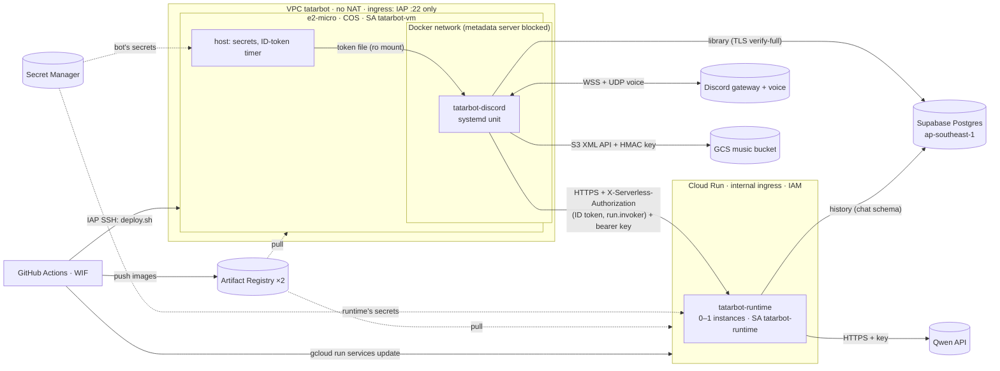

# TatarBot on GCP (Terraform)

**Status: prepared, not applied.** `terraform fmt` and `validate` pass, and on 2026-11-03
`terraform plan` against project `tatarbot` succeeded: 61 to add, nothing changed or
destroyed. Billing isn't linked to that project yet, and `apply` needs it.

This replaces the AWS deployment in [`infra/aws/`](../aws/README.md). The AWS stack stays up
until GCP is deployed and verified; then the music data moves and AWS is destroyed with its
existing Terraform state ([Migration from AWS](#migration-from-aws)).

Hybrid, everything in **asia-southeast1 (Singapore)**, close to Supabase (ap-southeast-1),
the Qwen endpoint (Alibaba ap-southeast-1) and the Discord voice servers the Thai users get:

* **Compute Engine e2-micro, 24/7: the Rust Discord bot only.** Gateway WebSocket, UDP
  voice and music playback need a long-lived process.
* **Cloud Run: the Python Agent Runtime.** Private, request-based billing, 0–1 instances.
  Chat is bursty and mostly idle, so it scales to zero; history lives in Postgres, so
  scaling to zero loses nothing.

## What it creates



| File | Resources |
|---|---|
| `apis.tf` | The project APIs used here (never disabled on destroy) |
| `network.tf` | VPC, one subnet (Private Google Access on), firewall: SSH from the IAP range only, explicit deny-all ingress |
| `compute.tf` | The bot VM: COS, Shielded VM, ephemeral external IPv4 on the **Standard** network tier, OS Login, the rendered startup script |
| `templates/startup.sh.tftpl` | Host setup on every boot: Docker network, metadata block, ID-token timer, the bot's systemd unit, `prestart.sh`, `deploy.sh` |
| `cloudrun.tf` | The runtime service (internal ingress, IAM, request-based billing, secrets from Secret Manager), its service account, `run.invoker` for the VM |
| `registry.tf` | Artifact Registry `tatarbot-runtime`, `tatarbot-discord` (immutable tags, keep newest `registry_keep_images` = 3) |
| `secrets.tf` | Secret Manager secrets (no values) and per-secret access for the consuming service only |
| `storage.tf` | Only with `music_library_enabled`: private bucket, `tatarbot-music` service account (object user on that bucket) |
| `iam.tf` | VM and deploy service accounts, Workload Identity Federation pool and provider for GitHub |
| `budget.tf` | Monthly budget with alerts (only if `billing_account` is set) |

## The bot VM

* **One unit, not an orchestrator.** COS keeps `/etc` stateless, so the startup script
  writes the systemd units, helper scripts and non-secret environment on every boot. The
  bot unit runs `docker run --rm` with `--read-only`, a 512 MiB hard limit,
  `Restart=always` and a 30 s stop timeout.
* **What runs is chosen by the deploy, not by Terraform.** The unit runs the image named in
  `/var/lib/tatarbot/images/discord` (kept across reboots) and does nothing until the first
  deploy writes it. Configuration changes update the metadata in place and apply at the
  next boot or after `sudo google_metadata_script_runner startup`.
* **Health and rollback.** `deploy.sh` waits up to 3 minutes for the `connected to
  Discord` log line and otherwise restores the previous image. A crash restarts the unit
  after 10 s. Host failures are GCE's (`automatic_restart`, live migration). **One VM: not
  highly available.**
* **Patching.** COS (`cos-stable`) updates itself and reboots. The startup script runs
  again and the bot comes back on the same image. That's a minute or two offline.
* **Logs.** COS's logging agent ships container stdout to Cloud Logging (json-file driver,
  3 × 10 MB on disk).

## The runtime on Cloud Run

| Setting | Value | Why |
|---|---|---|
| Ingress | internal | Only VPC networks of this project. That includes the VM, even with an external IP; no connector or NAT needed. Your laptop gets 404/403 |
| Authentication | IAM, `roles/run.invoker` for `tatarbot-vm` only | Plus the runtime's own `AGENT_API_KEY` bearer, as defence in depth |
| Billing | request-based (`cpu_idle = true`) | CPU is billed only while a request runs |
| Instances | min 0, max 1 | Scale to zero. One instance keeps the per-conversation turn lock in one process |
| CPU / memory | 1 vCPU / 512 MiB, startup CPU boost | Measured idle use: 82 MiB. 1 vCPU allows concurrency above 1 |
| Concurrency | 10 | Turns mostly wait on the model |
| Request timeout | 150 s | Must exceed the bot's 120 s (enforced by a precondition) |
| Startup probe | TCP 8080, every 2 s, up to 60 s | uvicorn listens only after startup. A revision that never listens never gets traffic |
| Image | set by the deploy workflow (`ignore_changes`) | Terraform owns everything else |

**How the bot authenticates** (no long-lived credential in the container):

1. The host's `tatarbot-agent-token.timer` (at boot, then every 10 min) asks the metadata
   server for an ID token with `audience=<runtime URL>`, signed by Google for
   `tatarbot-vm`. It writes the token atomically to `/run/tatarbot/agent-token/id-token`
   (tmpfs, mode 0640, group = the bot's UID 65532).
2. The bot mounts that directory read-only and re-reads the file on every request
   (`AGENT_ID_TOKEN_FILE`). It sends the token as `X-Serverless-Authorization: Bearer …`,
   which Cloud Run checks instead of `Authorization`, and `Authorization: Bearer
   <AGENT_API_KEY>` for the runtime itself.
3. Cloud Run checks the signature, the audience and `run.invoker`, then forwards the
   request. A token lasts 60 minutes, so a failed refresh leaves about 50 minutes to recover.
4. The bot container can't reach the metadata server, so all it ever holds is a token
   that can do nothing but call this one service, for an hour.

If the token can't be fetched, the bot still starts (music doesn't need the runtime) and
chat answers "can't reach my brain" until the next refresh succeeds.

**Timeouts, inner to outer:**

| Layer | Timeout |
|---|---|
| Runtime → model (`MODEL_TIMEOUT_SECONDS`) | 100 s |
| Whole turn incl. searches (`TURN_TIMEOUT_SECONDS` = bot − 15) | 105 s |
| Bot → runtime (`AGENT_TIMEOUT_SECS`), including any cold start | 120 s |
| Cloud Run request timeout | 150 s |

The 15 s between the turn and the bot is the cold-start budget. A cold start (estimated
2–5 s, below) followed by a maximal 105 s turn still ends before the bot gives up. If both
run long, the user gets the bot's timeout message.

### Scale to zero and state

Cloud Run stops an idle instance after about 15 minutes (not guaranteed) and may replace one
at any time. What the runtime keeps in process, and what happens to it:

| State | Before | Now | After scale-to-zero |
|---|---|---|---|
| Conversation history | in-memory LRU, unbounded in time | Postgres `chat.conversations` (`CONVERSATION_STORE=postgres`, new migration `20261103000000`) | **kept**. Tested by starting two app instances in a row (`test_history_survives_a_cold_start`) |
| Pending music-action results (tool messages) | in history | in history | kept |
| Per-conversation turn lock | in process | in process + a row lock on every write | not needed across instances while max = 1 |
| Knowledge base (RAG) | off in production | off | would re-embed `RAG_DOCS_DIR` on every cold start, and indexing runs in the background, which request-based billing throttles. Keep it off on Cloud Run, or use `RAG_STORE=postgres` |
| HTTP connection pools (model, Tavily, Postgres) | in process | in process | rebuilt on the first request (TLS handshakes) |

With `runtime_history_store = "memory"`, Terraform refuses `runtime_min_instances = 0`
(precondition), so history can't be lost to scaling by accident. A database outage doesn't
fail chat: the runtime answers without history and logs a warning.

### Cold starts

Measured locally: the runtime image goes from `docker run` to a healthy `/health` in
**1.26–1.37 s** (5 runs, 1 CPU, image cached; idle memory 82 MiB). On Cloud Run, add
instance scheduling and image fetch (258 MB uncompressed). Startup CPU boost speeds the
Python imports. Then the first request opens TLS connections to Supabase and the model.
**Estimate: 2–5 s extra on the first message after about 15 idle minutes. Not measured on
Cloud Run yet** ([verify](#apply-order), step 7).

If that's too slow: `runtime_min_instances = 1` keeps one instance warm. It's billed at the
idle min-instance rate ($0.0000035 per vCPU-second and per GiB-second): 1 vCPU + 0.5 GiB
around the clock is about $13.80/month, so it costs more than the VM.

## Identity, secrets and the metadata server

| Identity | Can | Used by |
|---|---|---|
| `tatarbot-vm` | pull the bot image; read the bot's secrets; `run.invoker` on the runtime service; write logs and metrics | the VM's host (never the container) |
| `tatarbot-runtime` | read the runtime's secrets | Cloud Run |
| `tatarbot-music` | object user on the music bucket | the bot, through an HMAC key |
| `tatarbot-deploy` | push to both repositories; OS Login with sudo and IAP tunnel on this one VM; `run.developer` on the runtime service and actAs `tatarbot-runtime`; `compute.instances.get`/`projects.get` | GitHub Actions, only from this repo's `production` environment |

What isn't granted: no project-wide `secretAccessor`, no `run.invoker` on anything else,
and the runtime has no access to the bucket, the registry or the VM. Cloud Run pulls the
runtime image with its own service agent, which reads same-project repositories by default.

* **The metadata block.** GCE has no IMDSv2 hop limit. Without a block, the bot container
  could get a `tatarbot-vm` token and read every bot secret and mint invoker tokens itself.
  iptables `DOCKER-USER` rules reject container traffic to `169.254.169.254` except DNS,
  and the unit's `ExecStartPre` refuses to start without them.
* **Secrets.** Terraform creates the secrets and their IAM, never their values. The VM's
  host fetches the bot's at each start into tmpfs. Cloud Run injects the runtime's at each
  instance start (`version = "latest"`). To rotate one: add a version, then restart the bot
  unit or deploy a new runtime revision.

  | Secret | Env | Consumer | When |
  |---|---|---|---|
  | `tatarbot-discord-token` | `DISCORD_TOKEN` | bot | always |
  | `tatarbot-agent-api-key` | `AGENT_API_KEY` | bot + runtime | always |
  | `tatarbot-database-url` | `DATABASE_URL` | bot | `music_library_enabled` |
  | `tatarbot-music-hmac-access-id` / `-secret` | `AWS_ACCESS_KEY_ID` / `AWS_SECRET_ACCESS_KEY` | bot | `music_library_enabled` |
  | `tatarbot-model-api-key` | `MODEL_API_KEY` | runtime | always |
  | `tatarbot-tavily-api-key` | `TAVILY_API_KEY` | runtime | `web_search_enabled` |
  | `tatarbot-runtime-database-url` | `DATABASE_URL` | runtime | `runtime_history_store = "postgres"` |

  The runtime's database URL is separate from the bot's, so it can move to its own Postgres
  role (only the `chat` and `rag` schemas) without touching the bot. Both images ship
  Supabase's CA at `/etc/tatarbot/supabase-root-2021.crt` for `sslmode=verify-full`.
* **Music bucket through the S3 API.** The bot's `aws-sdk-s3` code is unchanged:
  `MUSIC_S3_ENDPOINT=https://storage.googleapis.com`, `AWS_REGION=auto`, flexible checksums
  off (`AWS_REQUEST_CHECKSUM_CALCULATION=when_required`). **Not verified against GCS yet.**
  The HMAC key is the one long-lived credential. A native GCS adapter behind the bot's
  `ObjectStore` port would remove it, but it isn't built.

## Memory

| Where | Budget | Measured | Not measured |
|---|---|---|---|
| e2-micro (1 GiB) | bot limit 512 MiB, COS + Docker + logging agent the rest | bot about 7 MiB offline | bot while connected and playing; COS overhead on this VM |
| Cloud Run instance | 512 MiB | runtime 82 MiB idle (local, amd64) | under concurrent turns with search |

With the runtime off the VM, the bot has the e2-micro to itself, so `discord_memory_mb` can
go up to about 650 if playing needs it. Use `machine_type = "e2-small"` only if the
measurement says so.

## Cost (asia-southeast1)

Unit prices come from the **Cloud Billing Catalog API** (pulled on 2026-11-03, USD,
on-demand, no credits). Secret Manager is from Google's pricing page. Usage assumptions:
- one Discord community;
- 60 h of music a month (3.5 GiB out);
- 1,500 chat turns a month at about 10 s billed each, plus about 30 cold starts;
- 2 GiB of library audio;
- 730 hours in a month.

| Item | Unit price (catalog) | Month |
|---|---|---|
| e2-micro (0.25 vCPU + 1 GiB) | E2 core $0.02690931/h × 0.25 + E2 RAM $0.00360594/GiB-h = $0.01033/h | **$7.54** |
| Boot disk, 10 GiB pd-balanced | $0.11/GiB-month (pd-standard: $0.044) | $1.10 |
| External IPv4 (in use) | $0.005/h after the first 720 h per billing account per month, which are $0 | $0.05 (see note) |
| Internet egress, Standard tier | first 200 GiB per account per month $0, then $0.11/GiB | $0 |
| Cloud Run CPU (request-based, Tier 2) | $0.0000336/vCPU-s × ~15,100 s | $0.51 |
| Cloud Run memory | $0.0000035/GiB-s × ~7,550 GiB-s | $0.03 |
| GCS Standard, Singapore | $0.020/GiB-month × 2 | $0.04 |
| Secret Manager | 8 active versions, 6 free, $0.06 each after | $0.12 |
| Artifact Registry | first 0.5 GB free, then $0.10/GB; 2 × 3 images ≈ 0.4 GB | $0 |
| Cloud Logging | first 50 GiB free | $0 |
| **Total** | | **≈ $9.40** |

**Notes on the total:**
- **External IP.** The catalog's account-level tier makes one always-on address nearly
  free. Older Google pages say the free tier covers only Always Free VMs. If that applies
  to your bill, add $3.60: about **$13** in total.
- **Cloud Run.** The SKU above lists no free tier. Google's pricing page lists a monthly
  free tier for request-based billing (180,000 vCPU-s, 360,000 GiB-s, 2 million requests),
  which would cover this usage entirely.
- **Standard network tier** keeps the 3.5 GiB of voice traffic at $0. The Premium tier
  costs $0.12/GiB. Traffic leaves Google's network in Singapore, where Discord, Supabase and
  Qwen are.
- **Compared with:** AWS 24/7 about $15, AWS on 3 h/day about $2.50. Keeping one Cloud Run
  instance warm would add about $13.80.
- **Billed outside GCP:** the Qwen API, Tavily, Supabase (free tier).

Not created, deliberately: Cloud NAT, Serverless VPC Access connector, Direct VPC egress, a
load balancer, a static IP, GKE.

## Apply order

Needs `gcloud` (here: `~/google-cloud-sdk/bin/gcloud`), Terraform ≥ 1.10, and **billing
linked to the project** (`gcloud billing projects link tatarbot --billing-account …`).

1. **Plan.**

   ```sh
   gcloud auth login && gcloud auth application-default login
   cd infra/gcp
   cp terraform.tfvars.example terraform.tfvars   # project_id, model, billing_account
   terraform init && terraform plan
   ```

2. **Apply phase 1: APIs, secrets and service accounts only.** Cloud Run refuses to create
   a revision whose secrets have no version, so the values go in before the service exists:

   ```sh
   terraform apply -target=google_secret_manager_secret.this -target=google_service_account.music
   ```

3. **Fill the secrets.** `terraform output secrets_to_fill` lists them by consumer.

   ```sh
   printf %s "$DISCORD_TOKEN" | gcloud secrets versions add tatarbot-discord-token --data-file=-
   python3 -c 'import secrets; print(secrets.token_urlsafe(32), end="")' \
     | gcloud secrets versions add tatarbot-agent-api-key --data-file=-
   printf %s "$MODEL_API_KEY"  | gcloud secrets versions add tatarbot-model-api-key --data-file=-
   printf %s "$TAVILY_API_KEY" | gcloud secrets versions add tatarbot-tavily-api-key --data-file=-
   # Supabase, session mode, verify-full (the CA path exists in both images):
   printf %s "$DATABASE_URL" | gcloud secrets versions add tatarbot-database-url --data-file=-
   printf %s "$DATABASE_URL" | gcloud secrets versions add tatarbot-runtime-database-url --data-file=-
   # HMAC key for the music service account (the secret is shown once):
   gcloud storage hmac create "tatarbot-music@tatarbot.iam.gserviceaccount.com" --format=json > /dev/shm/hmac.json
   python3 -c 'import json; print(json.load(open("/dev/shm/hmac.json"))["metadata"]["accessId"], end="")' \
     | gcloud secrets versions add tatarbot-music-hmac-access-id --data-file=-
   python3 -c 'import json; print(json.load(open("/dev/shm/hmac.json"))["secret"], end="")' \
     | gcloud secrets versions add tatarbot-music-hmac-secret --data-file=-
   shred -u /dev/shm/hmac.json
   ```

4. **Migrate the database once** (adds the `chat` schema; also the `rag` schema and the
   `vector`/`pg_trgm` extensions, which Supabase allows):
   `DATABASE_URL="$DATABASE_URL" make -C agent_runtime migrate`. The bot's own migrations
   run when it starts.

5. **Apply phase 2:** `terraform apply`. The runtime starts on Google's sample image, and
   the VM boots and starts nothing (no bot image yet).

6. **Copy the music library** ([Migration](#migration-from-aws), step 1). Then set the
   GitHub `production` variables from `terraform output github_actions_variables`
   (`GCP_PROJECT_ID`, `GCP_REGION`, `GCP_ZONE`, `GCP_VM_NAME`, `GCP_WIF_PROVIDER`,
   `GCP_DEPLOY_SA`, `GCP_RUNTIME_SERVICE`). Run *Deploy runtime (GCP)*, then *Deploy discord
   (GCP)*. **Never run the GCP bot while an AWS bot task runs** (both would answer). The AWS
   services are at desired count 0 today.

7. **Verify** (`terraform output -raw shell` for a shell):
   - `systemctl status tatarbot-discord tatarbot-agent-token.timer`.
     `ls -l /run/tatarbot/agent-token/` shows `id-token`, mode 0640, group 65532.
   - The bot logs `connected to Discord`. The runtime's logs in Cloud Logging show `agent
     runtime started (… history=postgres)`.
   - A mention gets a reply. That proves the ID token, `run.invoker`, internal ingress and
     the API key together. A second message after about 20 idle minutes still knows the
     first one (history survived scale-to-zero). Note how long it took: that's the real cold
     start.
   - From your laptop, `curl -sI "$(terraform output -raw runtime_url)/health"` must fail
     (403/404: internal ingress and IAM).
   - Play a radio station and a library track, then `/upload` and `/delete` one track
     (the GCS S3 API).
   - `docker stats --no-stream` while playing: record the bot's real memory here.
   - The metadata block: `docker run --rm --network tatarbot curlimages/curl:8.11.1 -m 3 -sS -H 'Metadata-Flavor: Google' http://169.254.169.254/computeMetadata/v1/`
     must fail, and `… -m 5 -sSI https://discord.com` must succeed.
   - `sudo reboot` once: the bot and the token timer come back on their own.

## Day-to-day operations

* **Deploy the bot:** *Deploy discord (GCP)*. The old container stops and the new one
  starts (a few seconds offline). It rolls back if the new one doesn't connect within
  3 minutes.
* **Deploy the runtime:** *Deploy runtime (GCP)*. It creates a revision, and traffic moves
  only once the revision listens. A broken image fails the job and the previous revision
  keeps serving. History is in Postgres, so a deploy no longer resets conversations.
* **Roll back:** run either workflow on an older commit of `main` (images kept: newest 3).
  For the runtime, `gcloud run services update-traffic tatarbot-runtime --to-revisions <rev>=100`
  also works.
* **Configuration change:** `terraform apply`. The runtime gets a new revision with the same
  image. On the VM, run `sudo google_metadata_script_runner startup`.
* **Secret rotation:** add a version. Then `sudo systemctl restart tatarbot-discord` for the
  bot, or deploy (or `gcloud run services update tatarbot-runtime --region asia-southeast1`)
  for the runtime.
* **Keep the runtime warm** (cost above): `runtime_min_instances = 1`, then apply.
* **Stop the bot:** `gcloud compute instances stop tatarbot --zone asia-southeast1-b`. The disk
  still bills (~$1.10). The runtime costs nothing while unused.

## Persistent data

| Data | Where | Survives restart, deploy, scale-to-zero, VM replacement? | Backup |
|---|---|---|---|
| Images | Artifact Registry (newest 3) | yes | rebuild from git |
| Secrets | Secret Manager | yes | keep your own copy |
| Library metadata | Supabase (`public.library_tracks`) | yes | Supabase backups; `pg_dump` |
| Conversation history | Supabase (`chat.conversations`, 30-day retention) | yes | same |
| Library audio | GCS (no versioning, soft delete off) | yes | none: a delete is final, by design |
| Bot image reference | VM disk (`/var/lib/tatarbot`) | not VM replacement: redeploy | the deploy workflow |
| Logs | Cloud Logging, 30 days | yes | none |

## Migration from AWS

Supabase doesn't move, and the audio's object keys (`library/...`) stay the same, so only
the audio files are copied.

1. **Copy the audio** (AWS: `aws login`, then
   `eval "$(aws configure export-credentials --format env)"`):

   ```sh
   SRC=s3://tatarbot-music-204936843729
   DST=gs://$(terraform -chdir=infra/gcp output -raw music_bucket)
   mkdir -p /tmp/tatarbot-music && aws s3 sync "$SRC" /tmp/tatarbot-music
   gcloud storage rsync --recursive /tmp/tatarbot-music "$DST"
   aws s3 ls "$SRC" --recursive --summarize | tail -2      # same count and bytes as:
   gcloud storage du --summarize "$DST"; gcloud storage ls --recursive "$DST/**" | wc -l
   ```

   The AWS bot is at desired count 0, so nothing writes to S3 meanwhile. Repeat both syncs
   if it ran.

2. **Deploy and verify on GCP** ([Apply order](#apply-order), steps 6–7).

3. **Destroy AWS with the existing state** (`infra/aws/terraform.tfstate`, local only and the
   only copy):

   ```sh
   cd infra/aws
   cp terraform.tfstate ~/tatarbot-aws-tfstate-$(date +%F).backup
   terraform output ssm_parameters_to_create   # note these; Terraform doesn't own them
   for r in tatarbot-discord tatarbot-runtime; do
     ids=$(aws ecr list-images --repository-name $r --query 'imageIds[*]' --output json)
     [ "$ids" = "[]" ] || aws ecr batch-delete-image --repository-name $r --image-ids "$ids"
   done
   aws s3 rm s3://tatarbot-music-204936843729 --recursive   # only after step 2
   terraform plan -destroy && terraform destroy
   aws ssm delete-parameter --name <each parameter noted above>
   ```

   Don't touch the unrelated `stock-app` ECR repository in the same account.

4. **Clean up the repository** in a follow-up PR:
   - remove `infra/aws/`, `deploy-runtime.yml`, `deploy-discord.yml` and `_deploy-ecs.yml`;
   - remove the `arm64` entries of the CI image matrices;
   - delete the `AWS_*` / `ECS_CLUSTER` GitHub variables.

## Teardown (GCP)

`terraform destroy` removes everything here except the enabled APIs. First empty the music
bucket (`force_destroy = false`), and delete the HMAC key by hand (`gcloud storage hmac
update <id> --deactivate`, then `delete`). Supabase isn't managed here.

## Known gaps

* Nothing is applied yet. Every live check in step 7 is open, including the cold start on
  Cloud Run.
* The bot's memory and CPU while playing on e2-micro.
* GCS through the S3 API with `aws-sdk-s3`.
* Whether the external IP's free 720 h applies to this account (≈ $3.60/month either way).
* The knowledge base's upload path (S3 presigned POST, SQS) has no GCP equivalent;
  [rag.md §7.6](../../docs/architecture/rag.md#76-deployment-requirements-not-built-yet).
* Terraform state is local. Move it to a GCS backend before more than one person applies.

## CI/CD (GitHub Actions)

| Workflow | Runs when | Does |
|---|---|---|
| `ci-runtime.yml` | `agent_runtime/**`, `integration/**` change | ruff, pytest (incl. Postgres history); image build and integration tests on **amd64 and arm64** |
| `ci-discord.yml` | `discord_bot/**` change | fmt, clippy, tests; image build and smoke tests on **amd64 and arm64** |
| `ci-repo.yml` | `.github/**`, compose files, `infra/**` change | actionlint, `docker compose config`, `terraform fmt` + `validate` for `infra/aws` and `infra/gcp` |
| `deploy-gcp-discord.yml` | manual | `_deploy-gce.yml`: build and push a `linux/amd64` `sha-<commit>` image, IAP SSH, `deploy.sh` with rollback |
| `deploy-gcp-runtime.yml` | manual | `_deploy-cloudrun.yml`: build and push, `gcloud run services update --image`; traffic moves only to a revision that starts |
| `deploy-runtime.yml` / `deploy-discord.yml` | manual | AWS ECS (arm64), until the AWS teardown |

Deploy jobs run in the `production` environment, refuse commits not on `main`, and fail with
a clear message until the `GCP_*` variables are set. WIF trusts only
`assertion.repository == PatiphanAK/tatarbot` and `assertion.environment == production`.
