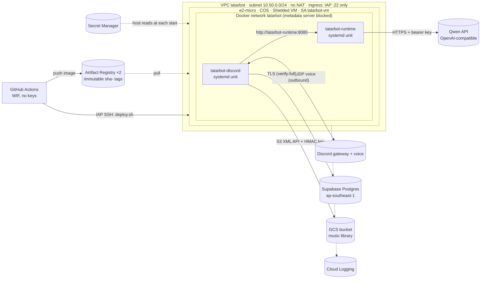

# TatarBot on GCP (Terraform)

**Status: prepared, not applied.** `terraform fmt` and `validate` pass, and on 2026-11-03
`terraform plan` against project `tatarbot` succeeded: 53 to add, nothing changed or
destroyed. Billing isn't linked to that project yet, and `apply` needs it. Applying
creates billable resources.

This replaces the AWS deployment in [`infra/aws/`](../aws/README.md). The AWS stack stays up
until GCP is deployed and verified; then the music data moves and AWS is destroyed with its
existing Terraform state ([Migration from AWS](#migration-from-aws)).

One **e2-micro VM in asia-southeast1 (Singapore)** runs both services as containers:

* Singapore is close to the Supabase database (ap-southeast-1), the Qwen endpoint
  (Alibaba ap-southeast-1) and the Discord voice servers the Thai users get.
* Container-Optimized OS (COS) and systemd: no ECS/GKE control plane to pay for or run.
* The same separation as on AWS: two images, two units, deployed independently.

## What it creates



| File | Resources |
|---|---|
| `apis.tf` | The project APIs used here (never disabled on destroy) |
| `network.tf` | VPC, one subnet (Private Google Access on), firewall: SSH from the IAP range only, explicit deny-all ingress |
| `compute.tf` | The VM: COS, Shielded VM, ephemeral external IPv4, OS Login, the rendered startup script |
| `templates/startup.sh.tftpl` | Host setup on every boot: Docker network, metadata block, systemd units, `prestart.sh`, `deploy.sh` |
| `registry.tf` | Artifact Registry `tatarbot-runtime`, `tatarbot-discord` (immutable tags, keep newest `registry_keep_images` = 3) |
| `secrets.tf` | Secret Manager secrets (no values) and per-secret access for the VM |
| `storage.tf` | Only with `music_library_enabled`: private bucket, `tatarbot-music` service account (object user on that bucket) |
| `iam.tf` | VM and deploy service accounts, Workload Identity Federation pool and provider for GitHub |
| `budget.tf` | Monthly budget with alerts (only if `billing_account` is set) |

## How the VM layout works

* **Units, not an orchestrator.** COS keeps `/etc` stateless, so the startup script
  (`startup-script` metadata) writes the systemd units, helper scripts and non-secret
  environment on every boot. Each unit runs `docker run --rm` with `--read-only`, a hard
  memory limit, `Restart=always` and the stop timeout from the AWS task definitions (runtime
  120 s, bot 30 s).
* **What runs is chosen by the deploy, not by Terraform.** A unit runs the image named in
  `/var/lib/tatarbot/images/<svc>` (kept across reboots) and does nothing until the first
  deploy writes it. Terraform changes to configuration update the metadata in place; they
  apply at the next boot or after
  `sudo google_metadata_script_runner startup` on the VM. That command restarts both
  services.
* **Bot → runtime.** Both containers join the user-defined Docker network `tatarbot`, and
  the bot calls `http://tatarbot-runtime:8080` through Docker's DNS. No port is published on
  the host, and the bearer `AGENT_API_KEY` is still required. This replaces the
  `172.17.0.1` host-port trick from AWS.
* **Memory.** e2-micro has 1 GB. Limits: runtime 384 MiB, bot 512 MiB (including ffmpeg
  during uploads). Measured locally: runtime idle about 70 MiB, bot about 7 MiB offline. The
  bot's use while connected and playing **has not been measured**; if the VM runs short,
  use `machine_type = "e2-small"` (2 GB).
* **CPU.** e2-micro is 2 shared vCPUs with a sustained share of 25% (bursting is free and
  not credit-billed like T4g `unlimited`). Radio decode and Opus encode should fit; not
  measured.
* **Health and restarts.** The runtime image's `HEALTHCHECK` (`/health`) sets the container
  health; `deploy.sh` waits for `healthy`. The bot has no HTTP port; `deploy.sh` waits for
  its `connected to Discord` log line. A crash restarts the unit after 10 s. A host failure is
  handled by GCE (`automatic_restart`, live migration during maintenance). **There is one VM:
  this is not highly available**, the same as on AWS.
* **Patching.** COS updates itself (`cos-stable`) and reboots into the new image. The
  startup script runs again and the services come back with the same images (a minute or
  two offline). The boot image family is only read when the VM is created.
* **Logs.** `google-logging-enabled` turns on COS's logging agent, which ships container
  stdout (json-file driver, 3 × 10 MB rotation on disk) to Cloud Logging. Query:
  `resource.type="gce_instance" AND jsonPayload.container_name=~"tatarbot-"` (the exact
  field names depend on the agent version; check the first entries).

## Identity, secrets and the metadata server

| Identity | Can | Used by |
|---|---|---|
| `tatarbot-vm` | read its own two repositories, access exactly the enabled secrets, write logs and metrics | the host (image pulls, secret reads, logging agent) |
| `tatarbot-deploy` | push to the two repositories; `osAdminLogin` + IAP tunnel on this one VM; `compute.instances.get` / `compute.projects.get` | GitHub Actions, only from this repo's `production` environment |
| `tatarbot-music` | object user on the music bucket only | the bot, through an HMAC key |

* **Containers can't reach the metadata server.** GCE has no IMDSv2 hop limit, so without a
  block every container could get a `tatarbot-vm` token and read every secret. The startup
  script adds `DOCKER-USER` iptables rules that reject container traffic to
  `169.254.169.254` except DNS (Docker's resolver forwards there), and every unit's
  `ExecStartPre` refuses to start if the rules are missing.
* **Secrets.** Terraform creates the secrets and their IAM, never their values. Before each
  container start, `prestart.sh` fetches the latest versions with the VM's token and
  writes them to `/run/tatarbot/<svc>.secrets.env` (tmpfs, mode 600). To rotate a secret:
  add a version, then restart the unit. Each container gets only its own secrets:

  | Secret | Env | Service | When |
  |---|---|---|---|
  | `tatarbot-discord-token` | `DISCORD_TOKEN` | discord | always |
  | `tatarbot-agent-api-key` | `AGENT_API_KEY` | both | always |
  | `tatarbot-model-api-key` | `MODEL_API_KEY` | runtime | always |
  | `tatarbot-tavily-api-key` | `TAVILY_API_KEY` | runtime | `web_search_enabled` |
  | `tatarbot-database-url` | `DATABASE_URL` | discord | `music_library_enabled` |
  | `tatarbot-music-hmac-access-id` | `AWS_ACCESS_KEY_ID` | discord | `music_library_enabled` |
  | `tatarbot-music-hmac-secret` | `AWS_SECRET_ACCESS_KEY` | discord | `music_library_enabled` |

* **Music bucket through the S3 API.** The bot's `aws-sdk-s3` code is unchanged:
  `MUSIC_S3_ENDPOINT=https://storage.googleapis.com` (path style), `AWS_REGION=auto`, and
  the SDK's default flexible checksums turned off
  (`AWS_REQUEST_CHECKSUM_CALCULATION=when_required`), since S3-compatible stores may reject
  them. **Not verified against GCS yet**: put, get, delete, `ListObjectsV2` and presigned
  GET all need the live check in [step 6](#apply-order). The HMAC key is long-lived. A native
  GCS adapter behind the bot's `ObjectStore` port would remove it, but it isn't built.
* **SSH.** OS Login, project-wide SSH keys blocked, port 22 open only to IAP's range.
  People need `roles/compute.osAdminLogin` (or `osLogin`) and
  `roles/iap.tunnelResourceAccessor`.

## Cost (asia-southeast1, estimate)

**These numbers aren't confirmed.** I couldn't verify the Singapore e2-micro rate: sources
give $0.0084–0.0134/h across regions. Check the
[pricing calculator](https://cloud.google.com/products/calculator) before applying. The
Always Free e2-micro only applies in three US regions, so it doesn't apply here.

| Item | Assumption | Month |
|---|---|---|
| e2-micro, 24/7 | about $0.0105/h × 730 h (unverified) | ~$7.70 |
| Boot disk | 10 GB pd-balanced at ~$0.11/GB | ~$1.10 |
| External IPv4 (in use) | $0.005/h ([VPC pricing](https://cloud.google.com/vpc/pricing)) | $3.65 |
| Internet egress | 3.5 GB of music (60 h at 128 kbit/s) at ~$0.12/GB, Premium tier | ~$0.42 |
| GCS | 2 GB Standard | ~$0.05 |
| Secret Manager | 7 active versions, 6 free | ~$0.06 |
| Artifact Registry | 2 × 3 images, under the 0.5 GB free | $0 |
| Cloud Logging | far under 50 GiB free | $0 |
| **Total** | | **~$13** |

Compared with AWS: about $15 for a t4g.micro 24/7, and about $2.50 for 3 h a day on a
schedule (the current setting). GCP 24/7 is roughly the same price as AWS 24/7. A daily
schedule (GCE instance schedules, free) could be added the same way as on AWS, but isn't
built. Billed outside GCP, as before: the Qwen API, Tavily, Supabase (free tier).

**Not created, deliberately:**
- Cloud NAT and a load balancer (nothing inbound, one VM).
- GKE and Cloud Run. The bot needs a long-lived gateway and UDP voice session, so it would
  need always-on Cloud Run at several times the price. Scaling the runtime to zero would
  wipe its in-memory conversation history whenever it goes idle.
- A static IP (nothing connects in).

## Apply order

Needs the [gcloud CLI](https://cloud.google.com/sdk/docs/install), Terraform ≥ 1.10, and a
project with billing enabled.

1. **Authenticate and plan.**

   ```sh
   gcloud auth login
   gcloud auth application-default login
   gcloud config set project <project id>
   cd infra/gcp
   cp terraform.tfvars.example terraform.tfvars   # project_id, model, billing_account
   terraform init
   terraform plan                                 # review: only the resources listed above
   ```

2. **Apply** (when you decide to): `terraform apply`. The VM boots, writes its units and
   starts nothing, because nothing is deployed yet.

3. **Fill the secrets.** `terraform output secrets_to_fill` lists them. Values go from stdin,
   so they stay out of shell history and Terraform:

   ```sh
   printf %s "$DISCORD_TOKEN" | gcloud secrets versions add tatarbot-discord-token --data-file=-
   python3 -c 'import secrets; print(secrets.token_urlsafe(32), end="")' \
     | gcloud secrets versions add tatarbot-agent-api-key --data-file=-
   printf %s "$MODEL_API_KEY"  | gcloud secrets versions add tatarbot-model-api-key --data-file=-
   printf %s "$TAVILY_API_KEY" | gcloud secrets versions add tatarbot-tavily-api-key --data-file=-
   # Music library: the same Supabase URL as on AWS (session mode, verify-full, see discord_bot/README.md)
   printf %s "$DATABASE_URL"   | gcloud secrets versions add tatarbot-database-url --data-file=-
   # HMAC key for the music service account (the secret is shown once):
   gcloud storage hmac create "$(terraform output -raw music_service_account)" --format=json > /dev/shm/hmac.json
   python3 -c 'import json; print(json.load(open("/dev/shm/hmac.json"))["metadata"]["accessId"], end="")' \
     | gcloud secrets versions add tatarbot-music-hmac-access-id --data-file=-
   python3 -c 'import json; print(json.load(open("/dev/shm/hmac.json"))["secret"], end="")' \
     | gcloud secrets versions add tatarbot-music-hmac-secret --data-file=-
   shred -u /dev/shm/hmac.json
   ```

   Reuse the AWS values (`aws ssm get-parameter --with-decryption --name ...`) if you prefer,
   but **`AGENT_API_KEY` must be the same for both services on GCP.**

4. **Copy the music library** ([Migration](#migration-from-aws), step 1). Do this before the
   bot starts, so existing tracks resolve.

5. **Configure GitHub.** On the `production` environment, set the variables from
   `terraform output github_actions_variables`: `GCP_PROJECT_ID`, `GCP_REGION`, `GCP_ZONE`,
   `GCP_VM_NAME`, `GCP_WIF_PROVIDER`, `GCP_DEPLOY_SA`. Then run *Deploy runtime (GCP)*, and
   after it, *Deploy discord (GCP)*. Each builds a `linux/amd64` `sha-<commit>` image, pushes
   it, and runs `deploy.sh` over IAP SSH.

   **Never run the GCP bot while an AWS bot task is running.** Two bots on one token both
   answer every command. Today both AWS services are at desired count 0; confirm with
   `aws ecs describe-services --cluster tatarbot --services tatarbot-discord --query 'services[0].runningCount'`.

6. **Verify** (`terraform output -raw shell` for a shell):
   - `journalctl -u tatarbot-runtime` / `-u tatarbot-discord`, and Cloud Logging, show
     `agent runtime started` and `connected to Discord`.
   - A mention in Discord gets a reply. That proves the bot reaches the runtime over the
     Docker network.
   - In voice: play a radio station, then a library track (presigned GCS URL). Then
     `/upload` and `/delete` one track (put, delete, list over the S3 API).
   - `docker stats --no-stream` while playing: record the real memory use here.
   - The metadata block: `docker run --rm --network tatarbot curlimages/curl:8.11.1 -m 3 -sS -H 'Metadata-Flavor: Google' http://169.254.169.254/computeMetadata/v1/`
     must fail (connection refused/reset), and
     `docker run --rm --network tatarbot curlimages/curl:8.11.1 -m 5 -sSI https://discord.com`
     must succeed (DNS and egress work).
   - Reboot once (`sudo reboot`). Both services must come back on their own with the same
     images.

## Day-to-day operations

* **Deploy:** run *Deploy runtime (GCP)* or *Deploy discord (GCP)* (manual, `main` only). The
  old container stops and the new one starts, so expect a few seconds offline. A runtime
  deploy resets conversations (history is in memory). If the new container doesn't come up
  within 3 minutes, `deploy.sh` restores the previous image and the job fails.
* **Roll back:** run the deploy workflow on an older commit of `main`. Its image is reused
  if it is still in the registry (newest 3). Or, on the VM:
  `sudo bash /etc/tatarbot/deploy.sh <svc> <older image>`.
* **Configuration change** (env, memory, secrets list): `terraform apply`, then on the VM
  `sudo google_metadata_script_runner startup` (or reboot).
* **Secret rotation:** add a version, then `sudo systemctl restart tatarbot-<svc>`.
* **Stop a service:** `sudo systemctl stop tatarbot-<svc>` (until the next boot), or
  `<svc>_enabled = false` + apply + rerun the startup script (permanent).
* **Stop everything:** `gcloud compute instances stop tatarbot --zone asia-southeast1-b`.
  Compute and IPv4 stop billing; the disk (~$1.10) keeps billing. `start` brings both
  services back.
* **Status:** `systemctl status 'tatarbot-*'`, `docker ps`, `docker stats`.

## Migration from AWS

The music metadata is in Supabase and doesn't move. Its object keys (`library/...`) stay
the same, so only the audio files are copied, with their keys unchanged.

1. **Copy the audio** (AWS credentials: `aws login`, then
   `eval "$(aws configure export-credentials --format env)"`):

   ```sh
   SRC=s3://tatarbot-music-204936843729
   DST=gs://$(terraform -chdir=infra/gcp output -raw music_bucket)
   mkdir -p /tmp/tatarbot-music && aws s3 sync "$SRC" /tmp/tatarbot-music
   gcloud storage rsync --recursive /tmp/tatarbot-music "$DST"
   # Same object count and bytes on both sides:
   aws s3 ls "$SRC" --recursive --summarize | tail -2
   gcloud storage du --summarize "$DST"; gcloud storage ls --recursive "$DST/**" | wc -l
   ```

   The AWS bot is at desired count 0, so nothing writes to S3 during the copy. If it ran in
   between, repeat the two sync commands; they copy only what changed.

2. **Deploy and verify on GCP** ([Apply order](#apply-order), steps 5–6).

3. **Destroy AWS with the existing state** (`infra/aws/terraform.tfstate`, local only and the
   only copy; back it up first):

   ```sh
   cd infra/aws
   cp terraform.tfstate ~/tatarbot-aws-tfstate-$(date +%F).backup
   terraform output ssm_parameters_to_create   # note these; Terraform doesn't own them
   # ECR repositories must be empty:
   for r in tatarbot-discord tatarbot-runtime; do
     ids=$(aws ecr list-images --repository-name $r --query 'imageIds[*]' --output json)
     [ "$ids" = "[]" ] || aws ecr batch-delete-image --repository-name $r --image-ids "$ids"
   done
   # The bucket must be empty. This deletes the S3 copy of the library: only after step 2.
   aws s3 rm s3://tatarbot-music-204936843729 --recursive
   terraform plan -destroy        # review: only tatarbot resources
   terraform destroy
   aws ssm delete-parameter --name <each parameter noted above>
   ```

   Don't touch the unrelated `stock-app` ECR repository in the same account.

4. **Clean up the repository** in a follow-up PR: remove `infra/aws/`,
   `deploy-runtime.yml`, `deploy-discord.yml` and `_deploy-ecs.yml`, and the `arm64` entries
   of the CI image matrices. Delete the `AWS_*` / `ECS_CLUSTER` variables from the GitHub
   environment.

## Teardown (GCP)

`terraform destroy` removes everything here except the enabled APIs. First:

* The music bucket must be empty (`force_destroy = false`). That deletes the library audio
  permanently.
* Not managed by Terraform: secret versions go with their secrets, but delete the HMAC key
  (`gcloud storage hmac update <id> --deactivate`, then `gcloud storage hmac delete <id>`),
  and Supabase.

## Known gaps

* Every live check in step 6 (only `plan` has run).
* The bot's real memory and CPU while playing, on e2-micro.
* GCS through the S3 API with `aws-sdk-s3` (checksums, `ListObjectsV2`, presigned GET).
* The exact Cloud Logging field names from COS's agent.
* The knowledge base (RAG): S3 presigned POST and SQS have no GCP equivalent here
  (GCS signed POST + Pub/Sub needs new adapters). It wasn't deployed on AWS either;
  [rag.md §7.6](../../docs/architecture/rag.md#76-deployment-requirements-not-built-yet).
* Terraform state is local. Move it to a GCS backend before more than one person applies.

## CI/CD (GitHub Actions)

| Workflow | Runs when | Does |
|---|---|---|
| `ci-runtime.yml` | `agent_runtime/**`, `integration/**` change | ruff, pytest; image build and integration tests on **amd64 and arm64** runners |
| `ci-discord.yml` | `discord_bot/**` change | fmt, clippy, tests, library integration tests; image build and smoke tests on **amd64 and arm64** |
| `ci-repo.yml` | `.github/**`, compose files, `infra/**` change | actionlint, `docker compose config`, `terraform fmt` + `validate` for `infra/aws` and `infra/gcp` (offline) |
| `deploy-gcp-runtime.yml` / `deploy-gcp-discord.yml` | manual only | via `_deploy-gce.yml` on an amd64 runner: push a `sha-<commit>` `linux/amd64` image to Artifact Registry (skipped if it exists), IAP SSH, `deploy.sh` with rollback |
| `deploy-runtime.yml` / `deploy-discord.yml` | manual only | AWS ECS (arm64), until the AWS teardown |

Deploy jobs run in the `production` GitHub environment (add required reviewers there),
refuse commits that are not on `main`, and fail with a clear message until the `GCP_*`
variables are set. WIF trusts only `assertion.repository == PatiphanAK/tatarbot` and
`assertion.environment == production`, so fork PRs and other workflows can't get a token.
